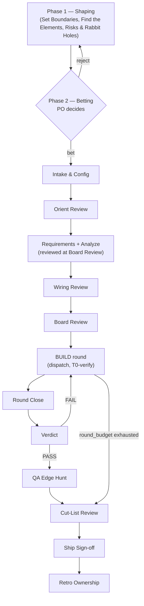

<!-- HARNESS_START -->
# Shape Up SDLC Local Harness

## Enforcement model

A three-phase Shape Up loop driven by `/ship` — the `building` skill, in your own session. The loop is guidance you follow; the runtime holds five things and nothing more, so expect hook denials and gate answers, not arguments:

- **The receipt.** Opening a run writes a receipt (with the run's id, the intake's digest and the plugin copy that answered), the launch record, and the pointer every hook reads. A run that left no receipt did not happen.
- **The gate resolver.** Every gate resolves from an answer set or stops for the PO, and the decision's source is written to a ledger. An answer chooses among the answers a gate allows; it never supplies the evidence that makes one allowed.
- **The T0 witness.** A scope's fixtures are run, scored against the last kept attempt, and the artifact is hashed. The tree moves forward only when the score strictly improves.
- **The write fence.** While an order has no result, a write outside that order's substrate is refused. Writing a committed file whose text names a run-trace path or a board id is refused at the write.
- **The dispatch receipts.** Each dispatch leaves a row naming the agent the host says ran, with the tokens, duration and model the host measured beside the model the call asked for, so "the artifact exists" is never mistaken for "the shipped worker produced it", and "the record asked for this model" is never mistaken for "this model ran".

Everything else in the workflow below — sequencing the phases, applying a worker's result to the board, counting attempts against the budget, linting the spec, the census, the ship report — is the loop's own discipline, written down in the skill and checked by nothing but the PO and the evaluator. Where this file says "the loop does X", no script verifies it.

- Hook-denied: dispatching a worker without a schema-valid WorkOrder; writing outside the live order's substrate; writing a path a different dispatch's order owns; writing a committed file whose text names a run-trace path or a board id.
- **The tier-direction rule is refused at the write.** A committed file cannot carry a `.shapeup/` path or a `TASK-NNN` id — boards renumber per machine and the run trace is gitignored, so either one resolves only where it was written. The knowledge base is outside the rule: those files are instructions, not references anyone resolves.
- **Attested, not assumed.** A dispatch leaves a receipt naming the plugin's own agent as the host resolved it. A dispatch that fails is answered by the sub-agent improvising the craft, which every other check accepts — so the receipt, not the artifact, is the evidence the shipped skill produced it.
- Sign-off is a file: each gate resolves from the answer set (`ci`/`guarded`/`interactive`) — cross, stop for the PO, or abort; the decision's source is ledgered. The Round Close gate is advisory over unfinished tasks and warns instead of blocking, but a board with no tasks at all can never cross it; the Ship Sign-off gate reads the census file, the run's QA record (was a hunt owed, and did it run a charter or get an explicit `skip`) and the models on the dispatch receipts (no `exec` or `eval` worker ran below the floor; a model other than the one the launch record asked for is written into the gate's row, not refused) and nothing else before any answer set may say `ship`.
- **Every run ends on a record.** Closing a run writes its status, its cause and its timestamp, and retires the fence's pointer, so an ended run stops fencing the checkout. A `shipped` ending is refused unless a Ship Sign-off row of the same run says `ship`, and the record names that sign-off; `escalated` and `aborted` need none. A gate waiting for the PO records no close by design — it is answered in the session that reached it.
- **Your scope cut decides your concurrency.** Two scopes that both declare a write to one path never build at the same time: an edit is read-modify-write and concurrent writers silently drop each other's work. The fence enforces each scope's substrate; reading the contracts for overlap before releasing scopes together is the loop's job.
- The build+eval loop breaks only two ways: the evaluation passes → QA → Ship; or the outer `round_budget` is exhausted. A scope exhausting its per-scope `attempt_budget` queues a Cut-List Review proposal and never blocks the round; budget trips route to the Cut-List Review, so what is green ships and the run is never killed from outside.

### Workflow at a Glance

### Gate names

Every gate below pauses the run for a PO decision unless a pre-recorded gate-answer preset
resolves it (`ci`/`guarded`/`interactive`). This document and the commands call a gate by its
plain name; the last column is the machine id the same gate carries in `decisions.jsonl`,
`gates.jsonl` and any gate-answers file, and is the only place an id appears here.

| Gate | What it checks | Who answers | Id in ledgers and answer files |
|------|-----------------|-------------|------|
| Intake & Config | Model/budget matrix set, worker roster confirmed on disk | PO | `L0` |
| Orient Review | The Scout's code-surface map and spike findings, before any board exists | PO | `L1a` |
| Wiring Review | `wiring-map.md` — every use case traced to its seam and entry point | PO | `L1a.5` |
| Board Review | The scope board and substrate disjointness — where scope is actually decided | PO | `L1b` |
| Round Close | Board 100% done and T0-green, before the round's work goes to evaluation (see note) | PO | `L2` |
| Verdict | The evaluator's PASS/FAIL judgment for the round | PO | `L3` |
| QA Edge Hunt | Exploratory findings outside what the evaluation already probed — never a verdict | PO | `QA` |
| Cut-List Review | The stop census and its baseline comparison — what ships, what's cut | TL/PO | `H` |
| Ship Sign-off | Final go/no-go, gated on the Cut-List Review's census | PO | `L4` |
| Retro Ownership | Which skill owns each retro rule, before it's written to the knowledge base | PO | `COACH-1` |

**Note on Round Close:** a board with literally zero tasks can never auto-proceed here — the resolver forces
a stop for the PO no matter what a preset says ("board 100%" of nothing proves nothing). A board
with real tasks still unfinished *can* proceed past Round Close if the operator explicitly allows it; that
choice is recorded as a flagged `warn`, not a silent pass — a signal that evaluation ran over
incomplete work, not a bug in the harness.

Four phrases recur below instead of symbols:

- **Needs scope contracts** — the step requires `shapeup/<slug>/scopes/*.md`; the write fence is skipped, not failed, when no order carries a substrate.
- **Test Surface** — the per-use-case rows the evaluation grades and QA and Ship status report against.
- **Preflight** — the refusals made before planning is paid for: the worker roster and the model floor.
- **QA finding** — logged with no verdict and no score; QA discovers, it never blocks.

### Phase 1 — Shaping (`/shapeup`)
1. Set Boundaries → `/shapeup shaping`
2. Find the Elements → `/shapeup breadboarding`
3. Risks & Rabbit Holes → `/shapeup spike`
(The completed pitch is formed by `shaping.md` + `breadboard.md`. The loop finds the breadboard beside the pitch or in `shaping/`, takes one named with `--breadboard`, or reads it inline in a single pitch file, and hands it to every planning step. Each breadboard Place with UI affordances becomes its own screen in the spec, and a Place the shape will not build is deferred at Board Review with the PO's yes.)

### Phase 2 — Betting (PO governance, no skill)
Betting Table: PO decides; rejected pitches loop back to raw idea.

### Phase 3 — Building
Rows marked *pauses* stop for the PO at the named gate.

| Step | Gate | Action |
|------|------|--------|
| Kick-off | *pauses* at **Intake & Config** — the worker roster is checked first (preflight) | `/ship intake` — a non-English pitch is made English by the loop itself: `<name>.en.md` + a glossary, and the run opens on the copy |
| Orient (Scout) | *pauses* at **Orient Review** | `/orient` |
| Requirements | — (reviewed at Board Review) | **plan** (`requirements`), done by `/ship`'s loop in its own session, no sub-agent: the pitch's clauses → committed `requirements.md`, one atomic clause per `REQ-<n>` row naming the pitch clause it came from, ids assigned once and frozen |
| Analyze | — (reviewed at Board Review) | **plan** (`spec`): spec tree + board (use cases + invariants + Test Surface); before Wire (needs its use cases). An acceptance criterion that grades a requirement carries `(covers: REQ-…)` — that clause is the edge the verdict travels back along |
| Wire | *pauses* at **Wiring Review** | **plan** (`wire`): committed `wiring-map.md` — per-use-case engine → seam → entry-point call site → affordance |
| Map Scopes | *pauses* at **Board Review** | **plan** (`scopes`): scope contracts (needs scope contracts). The loop reads the plan back before the gate: substrates disjoint, every scope anchored to a use case, every requirement graded by a criterion or claimed by a scope or marked `CUT (PO-approved)` — and prints the requirement → criterion table |
| Build Vertically | *pauses* at **Round Close** | per dispatch: write the order → open it for the fence → `/task-executor` (--order) → check the result's envelope → apply it. T0-verified per attempt, substrate-fenced (needs scope contracts). Scopes build concurrently where their contracts do not overlap (`--parallel-scopes N` caps it, default 4); a scope green in this round is skipped rather than rebuilt. Before evaluation the loop builds and launches the feature with the project profile's commands: a red step ends the round with no verdict and becomes the next round's bug |
| Evaluation (once per round) | *pauses* at **Verdict** | `/spec-evaluator` (--order): spec- and Test Surface conformance, T0 citation — the order names the dimensions it grades (the set the PO named at Intake & Config, else the set the spec calls for) and Ship Sign-off lists the ones left out. A PASS names every Test Surface row as its own criterion. A scope that did not go green in the round has its rows graded FAIL |
| FAIL → round r+1 | — | regression rule (Test Surface): bugs + full Test Surface of the touched use case. Every criterion the verdict graded FAIL reaches the round, whether or not the judge filed a bug for it, addressed to the scope that owns its use case |

Traceability stays advisory until `covers:` is populated. Absent artifact ⇒ arm skipped (non-regression).

**Planning runs under its own write fence.** Each of the four **plan** substeps is opened by an order that stamps that substep's write contract — nothing is dispatched. While one is open, the staged pitch and breadboard, the project profile, the run's receipts and ledgers and the order and result files are frozen, and each substep may write only its own artifact.

**Two preflight refusals, before anything is spent.** Opening a run refuses outright when the worker skills are not on disk — the roster comes from the schema that defines it, so it cannot drift from a hand-kept list — and when the launch record's `exec` or `eval` model is below the floor (sonnet or above; `qa` is not checked, and `eval` is not under `--no-eval`). A worker agent is defined with `model: inherit`, so the loop passes the launch record's model for the role on every dispatch, and the receipt records both the model the call asked for and the one the host says ran. Ship Sign-off reads the second: a worker that ran below the floor refuses `ship`, and a model other than the record's is written into the gate's row and the ship report — the record states what was asked for; only the receipts say what ran.

### QA Edge Hunt (`/qa-edge-hunter`, post-PASS, pre-ship)
**Q0** Preflight → **Q1** Charter (6 lenses − the ones the evaluation covered) → **Hunt** (repro required, QA findings → ledger) → report (no verdict, no score). Skip with `--no-qa`. A hunt that reached the app and ran no charter is a failed hunt: the loop sends it back once, and the report says `not-hunted`, never that QA ran. A run whose round passed cannot cross Ship Sign-off with `ship` unless the hunt ran a charter or the QA Edge Hunt gate was answered `skip` — a ledgered decision, not a silent omission.

### Ship & Triage
- **Cut-List Review** — `/hammer` (`/ship stop`), done by the loop in its own session, no sub-agent: census (QA findings + discovered ledger + attempt-budget proposals; every claim names the file it came from — ownership comes from the scope contracts, exhaustion from the dispatch receipts) → baseline comparison (never the ideal) → cut list; TL/PO promotes selected items only. The census is written as data and Ship Sign-off reads that file — and the run's QA record and the models on its dispatch receipts, nothing else — before any answer set may say `ship`. The loop then writes the ship report (`REPORT.md`, frozen at Ship Sign-off: a shipped FAIL says so in its first line) and closes the run with its verdict.
- **Ship Sign-off** (shows QA status).
- **Retro** — Ship Sign-off feedback → `/retro`, done by the loop itself; the Retro Ownership gate asks the PO which skill owns each rule (never assumes) → committed `shapeup/knowledge-base/<name>.md` (team inherits on pull). Categories: `/task-executor`, `/qa-edge-hunter`, `/orient`, **plan** (read at every planning step), and **building** (the loop's workflow guidance read at Intake & Config, plus suggested values it confirms before pinning); `/spec-evaluator` is not (single judge) and neither is the stop census. **Guidance never decides a gate**: a rule may add a question or a check to a gate block, never an answer, a skip or a wider substrate. `/retro --scan` seeds the same files from the project on disk before the first run, and `/retro --research <stack>` from the platform's official documentation when there is nothing on disk yet (a source, never a verification: nothing it reads runs until the PO pins it at Intake & Config), optional, every rule confirmed at Retro Ownership.
- Post-fix: `eval --single-pass` → remaining QA findings + new feedback → new raw idea.

### Discovered Tasks
Everything discovered funnels into `.shapeup/<slug>/discovery/ledger.md` (Orient, task-executor, QA); the loop appends each worker's discoveries from its result. A new invariant triggers a **plan** `spec` step in `reconcile` mode → `TS-INV-NN` Test Surface row.

### Architectural Invariants
- **Single judge** — verdict belongs to `spec-evaluator`; QA has no verdict, no score.
- **Evaluation exactly once per round** — QA sits after PASS, outside the loop.
- **Ledger = single source of truth** — every discovery flow writes only its own section, and the loop is the only writer of it.
- **QA is a level-up, not a gate** — it never blocks on what it finds; `--no-qa` or a `skip` answer skips it on the record; the round budget outranks the Hunter. What it cannot do is go missing unrecorded: Ship Sign-off refuses `ship` over an owed hunt that never ran.
- **Role separation** — Evaluator grades, task-executor fixes, QA discovers.
- **Envelope port** — every dispatch is WorkOrder in / WorkResult out; a malformed order is hook-denied; the loop checks a result against the schema before it applies it. Workers: stateless, craft-only, pipeline-blind.
- **The witness is mechanical** — a verdict that cites T0 cites an artifact whose hash the evaluator re-computes; a green T0 is evidence about the fixtures, not about whether the feature was built.

## Setup & Execution

- Orders/results live in `.shapeup/<slug>/orders|results/`; the envelope schemas ship with the plugin runtime, not with any individual skill, so every worker validates against the same copy.
- The plugin's run entry points need a one-time permission grant — `npx shapeup-sdlc init` writes it into `.claude/settings.json` (`permissions.allow`); without it a headless run stalls at step one. That grant is necessary, not sufficient: it covers the run's own deterministic entry points, not the generic file edits every worker skill makes constantly, or any command a worker reaches for beyond the grant's own exact shape. A truly unattended run also needs a Claude Code permission mode that covers those (`acceptEdits` at minimum) — the plugin cannot grant that on your behalf. Two facts about how grants reach the run's workers, both measured: a worker dispatched inside a run takes its permissions from the project's settings file, not from flags given to the launching session, so a tool the workers need belongs in `permissions.allow`; and every work order names the plugin's kernel by absolute path, because a command that spells it through a variable is refused in a headless session before any permission rule is read.
- The grant is necessary but sits under two more layers this plugin cannot reach either. A fresh
  checkout is an **untrusted workspace**, and Claude Code discards the whole permission grant — every
  rule in it, not only this one — until the workspace is trusted; the installer detects that state and
  tells you, because trusting a directory to run code from is your decision to make, never a package's
  to make for you. Above workspace trust sits Claude Code's own **auto-mode classifier**, which can
  still block a call the grant already covers, invisibly to anything this plugin ships — no rule or
  hook here can see it, let alone override it. When either layer stops an automated run, drive the
  Build step by hand — write the order, dispatch, check the result, run T0 — one call at a time, until
  the run can resume unattended again.
- Two storage tiers: COMMITTED `shapeup/<slug>/` (shaping, spec, scopes, wiring-map, project-profile, requirements, `REPORT.md` frozen at Ship Sign-off) vs GITIGNORED `.shapeup/` (board, orders/results, T0/eval/QA artifacts, ledgers, metrics, gate answers, and the launch record).
- **Opening a run stages nothing.** The run is driven by the loop in your session, so there is no script to copy into your project and no launch to authorise beyond the two kernel Bash rules; opening writes the run's own trace and the **launch record** (`.shapeup/<slug>/run-args.json` — the models, budgets, dial and skip switches the run was launched with), and a run already open keeps the record it has.
- **A write the substrate does not cover is denied for as long as the dispatch is in flight, and no longer.** A dispatch is live from the moment its order is written until a result for *that* dispatch lands. The fence is armed by a pointer the loop sets when it opens an order, and it is enforced only while the pointer exists on disk: a missing pointer allows every write, which is why the loop sets and retires it through a command that reads it back instead of writing it by hand. **Every close retires the pointer**, so an escalated or aborted run stops fencing the checkout the moment it ends. An order the run left unanswered stays genuinely unresolved — un-fenced, but not done — until re-opening the run with `--force` writes a synthetic result for it, which is also what lets a count of attempts tell work nobody did apart from work that failed. What the fence gates is narrower than "the project": it is this assistant's own edit path (a direct file write or edit call) outside the live order's substrate; a shell command, `git`, or any other editor still writes straight through it. The committed tier is never a worker's to write: those files belong to the orchestrator, whose window is a phase boundary rather than the middle of somebody else's order.
- Every run has a `run_id` — the receipt mints it, and orders, T0 artifacts, trial rows and hook decisions all carry it. It is the only key that separates two runs of the same feature: everything else (`order_id`, round/attempt) repeats. It is **not** a time boundary — `/ship` over an open run resumes the same run and reuses the key, so one `run_id` legitimately spans every session after a kill.
- Contracts: markdown on disk, JSON on the wire.
- Never hard-code a storage root — generated paths resolve through the shared path resolver.
- Hooks file under the project root they find above the shell's working directory (a run pointer, the committed tier, or a git boundary), never under the folder a worker happened to `cd` into — so a sub-folder shell neither splits the decision ledger nor slips the substrate fence.
<!-- HARNESS_END -->
