# ShapeUp SDLC

**Shape Up for coding agents — with gates the agent can't talk its way past.**

[](https://github.com/nguyenvanphituoc/shapeup-sdlc-plugin/actions/workflows/ci.yml)
[](LICENSE)


Your agent says it's done. It isn't. This is a [Claude Code](https://code.claude.com) plugin
that runs a full Shape Up lifecycle — idea → pitch → build → evaluate → ship — where the
important rules are enforced by the runtime instead of asked for in a prompt.

The ceremony is sized by the pitch's appetite: `/ship` runs the full gated loop, and a small
pitch is a one-scope run with a short round budget — the gates and the verification floor are the same.

<p align="center">
  
</p>

<p align="center"><sub>
The denial above is <b>verbatim stdout</b> from <code>hooks/sandbox-guard.mjs</code> —
<a href="tools/demo/record-demo.mjs">the recorder runs the real hook</a> and fails rather than
draw a picture. <a href="docs/assets/demo-gate.txt">Plain-text transcript.</a>
</sub></p>

## What it does to your agent

Every framework in this category answers *"the agent ignored the spec"* with better prose.
This one answers it with a runtime. Three things are true of a run here that are not true of a
prompt-based harness:

**1. A worker cannot act on an order nobody compiled.** Every dispatch carries a schema-validated
WorkOrder, and a `PreToolUse` hook hard-denies the call when that order is missing or malformed —
the tool call never reaches the worker. The same layer denies any write the order's own substrate
does not permit. A run that left no receipt did not happen.
→ *Prevents: an agent inventing its own brief, then reporting against it.*

(The Round Close gate, the board-green check before evaluation, is advisory: it warns when a round's evaluation
runs over unfinished tasks rather than denying it. The board is local to the machine running the
harness.)

**2. Progress is measured, not claimed.** A scope counts as built only when `verify t0` runs
its fixtures and its DB probe and writes an artifact to disk — with each command's exit code,
its captured output, and whether it ran at all. The evaluator must cite that artifact, and a worker's own account of its progress counts for nothing.
Two limits, stated here because the point of this section is that a claim without a mechanism
behind it is the thing this harness exists to prevent: a citation is re-hashed from disk, checked
against the scope, round and run the artifact records, and refused unless it names a file this
run's own verifier wrote — what that does NOT prove is that a judge with a dishonest hand could
not have arranged the artifact first, which is why the judge's own substrate freezes the verdicts
directory. A T0 artifact is
also evidence about the machine that produced it, and now says so: each verdict carries where it
ran — the absolute path, the git tree, the resolved toolchain, lockfile digests, declared cache
directories and a digest over an allowlist of environment values — so a disagreeing re-run can be
told from a regression. That block measures and judges nothing.
→ *Prevents: "done" asserted with nothing behind it.*

**3. Parallel work can't corrupt shared state.** Each scope gets a write-whitelist of files
enforced by a hook, and the loop alone applies every board and ledger change.
→ *Prevents: two parallel executors both rewriting the board, and one's completions vanishing.*

Under the hood this rests on a typed worker envelope and a single-writer state layer. Those
are load-bearing plumbing, and you should not have to think about them to use the harness —
they are documented for [contributors](CONTRIBUTING.md), not for users.

## Quickstart

```
/plugin marketplace add nguyenvanphituoc/shapeup-sdlc-plugin
/plugin install shapeup-sdlc-plugin@nvptuoc-marketplace
/shapeup-sdlc-plugin:ship "add dark mode to the settings screen"
```

That last one walks the whole lifecycle and pauses at each gate for you. That's the whole
quickstart.

> **The `shapeup-sdlc-plugin:` prefix is not optional.** A plugin's commands are namespaced by the
> plugin that ships them, so the bare `/ship` is not a command and answers `Unknown command: /ship`
> — measured on both a marketplace install and a `--plugin-dir` checkout. Interactively you will
> normally pick the command off `/`-completion and never type the prefix yourself; it matters when
> you are writing the command down, which is exactly what a headless `claude -p` invocation or a CI
> step does. **Everything below writes commands in the short form for readability — prepend
> `shapeup-sdlc-plugin:` to any of them you actually type.**

> **Running unattended?** The plugin install grants no permissions — every pipeline step is a Node
> script that ships *with* the plugin and therefore lives outside your project, so it needs
> approval. You click once interactively; headless there is nobody to click. Scaffold instead, which
> writes the grant:
>
> ```bash
> npx shapeup-sdlc init -d . -y
> ```
>
>
> The loop runs in your own session, in the foreground, so print mode's background-task ceiling does
> not apply to it. A killed session loses nothing: `/ship` again over the open run reads the artifacts on
> disk and carries on from the first step that is not done.

Want to see a full run before installing anything? **[docs/quickstart.md](docs/quickstart.md)**
walks one small feature end to end — including what the hooks do to a premature eval, a FAIL round
with real evaluator output, and the fix that turns it green.

<sub>No prerequisites for non-UI work — a browser (`npx playwright install chromium`) is needed
only when a run actually reaches a `[ui]` acceptance criterion. Team installs, the scaffolding
installer, and troubleshooting are in
**[docs/install.md](docs/install.md)**; upgrading is **[docs/upgrading.md](docs/upgrading.md)**.</sub>

## Agent support

The harness targets **Claude Code only**. The reason is the row that never travelled when we
compiled to other CLIs: hooks. The 7 skills, 2 slash commands and the kernel are
portable prose and plain Node — but hook-enforced gates (envelope validation, the substrate
fence, the safety spine, dispatch receipts) are a per-CLI mechanism, and without them every gate degrades from
**enforced** to **instructed** — the same honor system every other framework runs on
everywhere. If the deny hooks are why you're here, that means Claude Code.

## Glossary

This harness has its own vocabulary. Here is all of it, in plain English — you can read the
rest of this README after this table and nothing will be a surprise.

| Term | In plain English |
|---|---|
| **board** | The round's task list. "Green" means every task is done. The Round Close gate reads this before an evaluation and warns if it is not green. |
| **round** | One build → evaluate cycle. A FAIL verdict starts round *r+1*. |
| **T0** | The smoke test a scope must pass before it counts as built: its fixtures and a DB probe. Writes an artifact to disk that the evaluator must cite. |
| **substrate** | The exact list of files one dispatch is allowed to write, stamped into its work order. A hook blocks anything outside it — and anything the order marks frozen. |
| **scope contract** | The file defining one vertical slice: its substrate, its fixtures, its affordances. |
| **affordance** | The thing a user can actually click, type or call. UI is graded on affordances, not on looks. |
| **hill / hill phase** | How much of a scope is still *unknown* versus merely *unfinished*. The Scout reports a signal at orient; nothing later derives it. |
| **gate** | A checkpoint in a run, called by its plain name: Intake & Config, Orient Review, Wiring Review, Board Review, Round Close, Verdict, QA Edge Hunt, Cut-List Review, Ship Sign-off and Retro Ownership. [`AGENTS.md`'s Gate names](AGENTS.md#gate-names) says what each one checks. Most pause for you; the Round Close gate is advisory: it can be crossed over unfinished work, recorded as a flagged `warn`. |
| **covers-closure** | Every requirement clause is graded by at least one acceptance criterion or claimed by a scope, or the PO marks it `CUT`. The loop reads the plan back for this before the board review; nothing silently drops. |
| **discovery ledger** | The one file everything found mid-run gets written to, so nothing is lost between rounds. |

A longer version, including the internals, is in [docs/glossary.md](docs/glossary.md).

## The workflow

The harness walks a pitch from idea to ship. The full annotated pipeline — the build round,
the gate walkthrough, the circuit breaker — is
[`docs/design/04-functional-design.md`](docs/design/04-functional-design.md), and the design
document as a whole starts at [`docs/design/`](docs/design/README.md). This diagram shows the
full phase and gate mechanism — simpler than that per-attempt detail, but the whole pipeline:

<p align="center">
  
</p>

<p align="center"><sub>
Plan-phase skills in blue, build-phase in green, QA-phase in pink; amber pills are gates —
the outlined <b>Round Close</b> gate is advisory, the rest block. The dashed region marks what
<code>/ship</code> drives end to end.
</sub></p>

Since v1.3 the pipeline carries a **traceability spine**: the plan activity's requirements
substep writes a requirement registry (`requirements.md`), its wire substep commits a
per-use-case wiring map (`wiring-map.md`, the Wiring Review gate) resolved against the Intake & Config `project-profile.md`, and the loop reads the plan back at the board review for a
registered requirement that no acceptance criterion grades. It is advisory until `covers:` is
populated; every arm is skipped when its artifact is absent, so older specs are unaffected.

## What's included

### Skills

| Phase | Skill | What it does |
|-------|-------|--------------|
| Shaping | `shapeup` | Frame the problem, breadboard affordances, spike risks, write the pitch. Sub-commands: `full`, `shaping`, `spike`, `breadboarding`, `framing-doc`, `kickoff-doc`, `breadboard-reflection`. |
| Intake & Config | `building` | The `intake` sub-command, done by the loop itself: a non-English intake (pitch/PRD/transcript) becomes a faithful English `<name>.en.md` plus a persisted glossary, verified (residual-language scan, structural diff) before the run opens on it. The harness is English-only downstream. |
| Orient | `orient` | Builder-led recon: reads the code, spikes the single riskiest area, emits a code-surface map, spike findings, discovered-task seed, and a hill signal. Writes no production code. |
| Plan (Wiring Review, Board Review) | `building` | The loop that drives a run in your session, reading the run's files to decide what comes next. Planning is its `plan` activity, done in the loop's own context — no sub-agent — under a write fence (a fence-only `plan` order): requirements registry (`requirements.md`) → linked DDD spec tree + board (use cases with BDD scenarios, a system flow and a derived `## Test Surface`) → the committed wiring map (`wiring-map.md`: per-UC engine → seam → entry-point call site → affordance, resolved against `project-profile.md`) → write-whitelisted scope contracts (`scopes/*.md`). The loop reads the plan back against each substep's checklist; no script lints it. |
| Build | `task-executor` | Pure worker: work order in → code out. Assumption scan, minimum-code/surgical-change discipline, Layer 1/2/3 UI rules, substrate-sandboxed, zero-memory. Never writes boards/ledgers/run-state. |
| Evaluate (Verdict) | `spec-evaluator` | The single judge (pure worker). Verifies spec-conformance, TDD surface, and integration against the running app — skeptical, files `file:line` bugs, runs exactly once per build round. Requires a T0 artifact citation, grades UI affordance-only; verdict + refuted boxes return as data. |
| QA (post-PASS) | `qa-edge-hunter` | Exploratory edge hunt on the running app through six fixed lenses, charting edges *outside* what the evaluator probed. Findings go to the ledger as QA findings; never blocks ship. |
| Stop (Cut-List Review) | `building` | The `stop` sub-command — the Cut-List Review gate, done by the loop itself: must-have census (every ownership, exhaustion and requirement claim names the file it came from) → baseline comparison (never vs. the ideal) → cut list + ship verdict, written as data that the Ship Sign-off gate reads. Handles the normal stop and both circuit-breaker triggers. |
| Retro (after Ship Sign-off) | `building` | The `retro` sub-command — RLHF for the harness: turns raw PO/TL feedback at Ship Sign-off into per-reader guidelines under committed `shapeup/knowledge-base/<reader>.md` (readers: `task-executor`, `orient`, `qa-edge-hunter`, the `plan` activity, and the loop itself at the Intake & Config gate — workflow guidance, never a gate answer). `--scan` seeds the same files from the project on disk before the first run; `--research <stack>` seeds them from the platform's official documentation when the project has nothing to scan, and cross-checks a scan's rules when it has. The Retro Ownership gate asks the PO which reader owns each rule — never assumes; mechanism defects are filed to the harness-defect register instead. |

### Commands

`/ship` runs the whole lifecycle, and with a sub-command one activity of it. `/retro` files feedback and seeds the
knowledge base. Every other step is a skill, typed by its own name, so the pipeline is still learnable from
`/`-completion alone. Names are written short here; the real name of each carries the
`shapeup-sdlc-plugin:` prefix, which `/`-completion fills in for you and a script must spell out.

| Type this | Phase | What it does |
|-----------|-------|--------------|
| `/ship` | all | Run the full harness on a pitch (interactive gates by default; `--auto`, `--unattended`). |
| `/ship plan` | Wiring Review, Board Review | The planning steps alone: requirements, spec tree + board, the wiring map, then scope contracts. Stops once Board Review is crossed. |
| `/ship stop` | Cut-List Review | Must-have census, baseline comparison, cut list + ship verdict. |
| `/ship intake` | Intake & Config | The language gate alone: a non-English pitch becomes a faithful English copy plus a glossary. |
| `/retro` | after Ship Sign-off | File ship-gate feedback into the per-reader knowledge base; `--scan` and `--research <stack>` seed it. |
| `/shapeup` | Shaping | The skill. Shape a raw idea into a pitch: boundaries → breadboard → spike → `pitch.md`. |
| `/orient` | Orient | The skill. Builder-led recon; spikes the riskiest area, writes no production code. |
| `/task-executor` | Build | The skill. Implement one task's acceptance criteria exactly. |
| `/spec-evaluator` | Verdict | The skill. The single judge. Its feature-level form crosses the Round Close gate first. |
| `/qa-edge-hunter` | post-PASS | The skill. Exploratory edge hunt; findings never block ship. |

### What is enforced, and by what

The honest version of this table matters more than a long one. A guarantee is only as strong as
the layer that carries it, and the three layers here fail differently:

| Layer | Works when | Fails how |
|---|---|---|
| **Wall** — a hook | Under every permission mode, including `bypassPermissions`. The CLI runs it; the model cannot decline it. | Fail-OPEN on anything ambiguous, and every evaluation writes a decision row, so "permitted" never looks like "never ran". |
| **Runtime** — the kernel | When the run goes through the harness. A schema rejection or a non-zero exit stops the step. | A lane that never calls the kernel is never checked — which is why the hooks below cover the doors, not the steps. |
| **Advisory** — a report section | When somebody reads the artifact. | Silently, if nobody does. It is a cleanup list, never a verdict. |

**Four walls.** These are hooks because nothing in the runtime can substitute for them:

- `PreToolUse` (`Skill|Agent`) — **`harness verify envelope` denies any worker dispatch whose order
  file is missing or fails the WorkOrder schema.** A malformed envelope never reaches a worker.
- `PreToolUse` (`Edit|Write|MultiEdit`) — **`hooks/sandbox-guard.mjs` blocks a write that no LIVE
  order's substrate permits.** It reads every order that is written and not yet answered rather than
  a pointer to one, so scopes building concurrently are each held to their own contract and a finished
  run fences nothing. `frozen` is checked first and outranks everything, across every live contract,
  and an order's own result answers to the sub-agent that took its dispatch, so with two legs live
  neither can write the other's. The fence is armed by a pointer the loop sets with `harness order open`
  and retires with `harness order close`; with no pointer it allows every write, which is why those are
  commands that read the pointer back rather than a file the loop edits. The close that records a
  `shipped` ending refuses unless a Ship Sign-off row of the same run says `ship`, so the gate's
  refusals cannot be walked around by ending the run.
- `PreToolUse` (`Edit|Write|MultiEdit`) — **the same hook also refuses a committed-tier write whose
  content names a path into the local run trace or a board id.** Four different producers wrote a
  committed file that a later check rejected, and one did it twice in a session, because a worker carries
  no lesson across a dispatch; the remedy is a refusal the writer can act on while it still knows what
  it meant to say. The knowledge base is outside it — those files are instructions, not references a
  reader has to resolve.
- `PreToolUse` (`Bash|Read|Write|Edit|MultiEdit`) — **`hooks/safety-spine.mjs` denies destructive
  commands** (`rm -rf` on unrecoverable targets, force-push/push-to-main, `git reset --hard`,
  `DROP TABLE`) and secret-file reads. A machine guard, not a pipeline guard; the escape hatch is
  the human-authored `.shapeup/safety-overrides.json`.

**One recorder**, which denies nothing and is what makes a wall possible one layer down:

- `PostToolUse` (`Skill|Agent`) — **`hooks/dispatch-receipt.mjs` writes down which agent actually
  ran.** Until it existed, a dispatch that failed — plugin absent, disabled, or a different version
  loaded — was indistinguishable from one that succeeded: the sub-agent would do the craft itself from
  the prose in its own prompt, the artifacts landed where the order permitted, so the order gate and the
  fence both passed and the run advanced having applied none of the shipped craft. The hook appends
  `{order_id, worker_declared, skill_invoked, dispatch_ok, usage, model_requested, at}` to `.shapeup/<slug>/receipts/`,
  with the tokens, duration and model the host measured beside the model the call asked for (the
  agents inherit the session's model unless the dispatch names one, and Ship Sign-off reads what ran
  against the launch record). A failed dispatch never reaches `PostToolUse`
  at all, so the receipt's *existence* is the evidence. The loop counts an attempt against a receipt, not
  against the artifact. It has no deny path and every write is guarded.

**What the runtime no longer carries.** Earlier versions also checked, with scripts, that a spec was
well-linked at the board review, that a worker's result was applied exactly once, that a run's attempts
and rounds were counted from attested records, that the build and launch probes were green before
evaluation, and that a ship report matched the board. Those are now the loop's own discipline, written
in the `building` skill and checked by the PO and the evaluator. A measured comparison found the scripted
sequencing completed more runs than the same loop reading its own table, at lower cost; the scripted
engine was removed on the PO's decision anyway, and the record of that decision names the result.

**Nothing load-bearing depends on permission mode.** The walls run
under every mode. The kernel needs a grant to be *invoked* — two Bash lines `npx shapeup-sdlc init`
writes — but a session that never gets that grant is a session that cannot run the pipeline at all,
not one that runs it unguarded.

No hook makes a network request, none has dependencies, and all are plain, readable `.mjs`
files. **[SECURITY.md](SECURITY.md)** states what each hook reads, what it can deny, and what
it never does — as claims written to be falsified, with the grep to check them.

> A project-local `/gap-scan` command (navigator→driver gap tracking) lives under
> `.claude/commands/` for this repo's own use. It is **not** bundled in the distributed
> plugin.

## Architecture invariants

These hold across the harness and are the reason it stays predictable:

- **One judge only** — the verdict belongs to `spec-evaluator`. QA has no verdict and no score.
- **EVAL exactly once per round** — QA is not a second evaluation pass; it runs after PASS, outside the loop.
- **Ledger is the single source of truth** — orient, task-executor, and QA all write to `discovery/ledger.md`.
- **QA is a level-up, not a gate** — `--no-qa` skips it; the circuit breaker outranks the hunter; findings default to `~`.
- **Role separation** — evaluator grades, task-executor fixes, QA discovers; no one does another's job.
- **Two circuit breakers** — an outer `round_budget` (build+eval cycles) nests an inner per-scope
  `attempt_budget` (T0 attempts); an exhausted scope queues a Cut-List Review proposal instead of
  blocking the round, and running out of rounds routes to the Cut-List Review too, so a run out of budget ships what is
  green instead of being killed and shipping nothing.
- **The witness is mechanical** — a T0 verdict is a command's exit code and a hash, not a report; the
  evaluator re-hashes the artifact it cites.
- **One writer per shared file** — the loop applies every board and ledger change; workers return data
  and never touch shared state.

## Known rough edges

Stated plainly, because you will hit them:

- **Nothing here measures skill quality or activation.** There is no number for whether a
  skill's description makes it fire on the right request, no measured craft delta, and no CI
  check enforcing the honesty invariant on such numbers. The structural suite is the coverage
  that exists, and it is about mechanism rather than quality — it proves a gate denies and an
  oracle discriminates, never that a skill's output is good.
- **The gates are verified; the craft is not.** A hook that denies is proven by a test that
  watches it deny. A skill that writes a good spec tree is, at present, taken on trust.

Contributions to any of these are welcome — see [CONTRIBUTING.md](CONTRIBUTING.md).

## Develop

```bash
npm test                             # structural tests
npm run demo                         # re-record the demo asset from the real hook
claude plugin validate . --strict    # the same check CI runs
claude --plugin-dir .                # load this working copy without installing
```

## Layout

```
.claude-plugin/
  plugin.json         # plugin manifest
  marketplace.json    # marketplace listing (points at this repo)
skills/<name>/SKILL.md # the 7 harness skills (+ references/ and resources/)
agents/<worker>.md    # the 4 workers as plugin subagents: each preloads its skill; a dispatch names the agent
kernel/harness.mjs    # ONE entry point for every deterministic step; the whole permission grant
kernel/{verify,init}/ #   its subcommands: the T0 witness, the envelope check, the roster check, init run
kernel/{gate,order}.mjs #   the gate resolver, and the verb that arms and retires the fence
kernel/lib/           # argv (the typed CLI boundary), paths (+ the run key), contract (shape)
kernel/schemas/       # the envelope port: WorkOrder, WorkResult, domain registry
commands/*.md         # the 2 slash commands (/ship and /retro); every other step is a skill, typed by its name
hooks/                # hooks.json + the three walls: safety-spine, sandbox-guard (the substrate fence and the
                      #   committed-tier write check) — PreToolUse, beside the kernel's `verify envelope`
                      #   + dispatch-receipt (PostToolUse, denies nothing, attests which worker ran and what the host measured)
                      #   + lib/decision.mjs (every hook records allow / deny / error)
oracles/              # the evaluation-contract oracle registry (test · snapshot · http · process)
bin/init.mjs          # `npx shapeup-sdlc init` — the permission grant, the AGENTS.md harness block, the ignore rules
scripts/install-harness.sh, migrate.sh   # stable public entrypoints (fresh install / update)
scripts/shapeup-sdlc/lib/                # shell libs both entrypoints source
tools/                # repo-only: demo/
                      #   demo/record-demo.mjs (regenerates docs/assets/demo-gate.svg)
tests/structural.mjs, tests/structural/*.mjs   # Tier 0 — eleven modules, zero LLM calls
docs/install.md, upgrading.md, glossary.md
docs/design/          # the design document (pipeline, gates, circuit breaker, ERD)
docs/visualize/       # the before-and-after view of the v4 loop
.github/workflows/    # CI + release (release publishes to npm via OIDC)
```

## Release

1. Bump `version` in **both** `.claude-plugin/plugin.json` and `package.json` — the release
   workflow fails if either disagrees with the tag.
2. Update `CHANGELOG.md`.
3. Tag and push: `git tag vX.Y.Z && git push origin main --follow-tags`.

The workflow validates the plugin, checks the tag against both manifests, publishes a GitHub
release, and publishes to npm through **trusted publishing (OIDC)** — no `NPM_TOKEN`, no OTP, with
a SLSA provenance attestation attached automatically.

## Credits

- The `shapeup` skill (shaping, breadboarding, spike, framing/kickoff docs) is inspired by and
  reuses material from [rjs/shaping-skills](https://github.com/rjs/shaping-skills) by Ryan Singer.
- The Shape Up methodology is from [*Shape Up*](https://basecamp.com/shapeup) by Basecamp.

This project carries Shape Up's *building* apparatus — appetite, hill charts, the scope hammer,
"QA is for the edges", comparing against baseline rather than the ideal — into a mechanized
loop. The shaping half is Ryan Singer's work, gratefully used.

## License

MIT — see [LICENSE](LICENSE).
