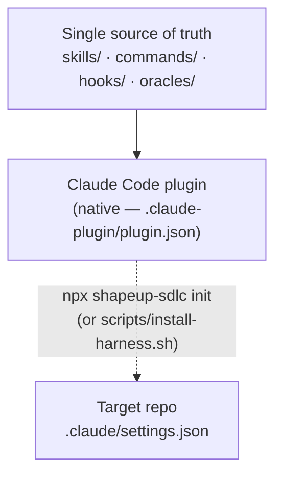

# 03 — System Design

[← Back to index](README.md)

## Components and their contracts

The loop (`building`, run by `/ship` in your own session) is the only stateful component, and its state is the artifacts on disk. Every worker skill is a **pure worker**: it
receives a structured order, does its craft, and returns a structured result — it never reads
or writes the run's shared files directly. Four plugin subagents (`agents/*.md`) carry the workers: each names its tools and preloads exactly one skill, and a dispatch names the agent.

What the runtime holds is five things — the receipt, the gate resolver, the T0 witness, the write fence and the dispatch receipts — and nothing else. Sequencing the phases, applying a result, counting attempts, planning checks, the census and the ship report are the loop's discipline (§3.5 says what was removed and why).

## 3.1 — The envelope port

Every worker dispatch is two JSON documents and two checks, living inside the kernel (`kernel/`, schemas in `kernel/schemas/`):

```mermaid
sequenceDiagram
    participant TL as building (the loop)
    participant OR as harness order open
    participant VE as harness verify envelope (hook)
    participant W as worker agent (fresh)
    participant RC as dispatch-receipt (hook)
    participant FS as run trace<br/>(board · ledger · orders · results)

    TL->>FS: write orders/<stem>.json (substrate + payload)
    TL->>OR: order open — name the live order to the fence
    TL->>W: Agent → shapeup-sdlc-plugin:<worker> --order <path>
    W-->>VE: PreToolUse fires before the dispatch
    VE->>FS: read + schema-validate the order
    alt malformed or missing order
        VE--xTL: deny — never reaches the worker
    else valid
        VE-->>W: allow
        W->>FS: write results/<stem>.json (WorkResult only)
        RC->>FS: append the dispatch receipt (agent, tokens, duration)
        TL->>FS: verify envelope on the result; send back once if invalid
        TL->>FS: apply it — board status, discovery ledger
    end
```

Workers never write boards, ledgers, or run-state. Everything a worker used to write into shared files directly, it **returns as data** in its `WorkResult`; the loop is the single writer, and because it is the only holder of those paths the property is structural even though no script enforces it for the loop itself.

### WorkOrder (in) — key fields

| Field | Purpose |
|---|---|
| `worker` | One of the 4 enumerated worker skills — the order names its own destination — or `building`, the loop itself, on a fence-only `plan` order no sub-agent answers |
| `operation` | The caller knows the pipeline position, the worker never re-derives it |
| `substrate` | The write contract for this order — data the fence enforces, not prose asking the worker to behave |
| `payload` | Worker-specific inputs, as paths where a path will do: scope contract, tasks, prior decisions, digested errors, KB rules path |

### WorkResult (out) — key fields

| Field | Purpose |
|---|---|
| `task_results[]` | Per-task status + AC pass/fail + evidence — the loop flips the board row from this alone |
| `discoveries[]` | Raw discovered lines — appended to the discovery ledger by the loop, never by the worker |
| `verdict` | `spec-evaluator` only — overall PASS/FAIL, per-criterion results, refuted AC boxes, T0 citation hashes |

## 3.2 — Runtime-enforced guardrails (hooks)

Two `PreToolUse` hook scripts and the kernel's envelope check turn the harness's load-bearing rules from things the model is asked to respect into things it cannot get past:

| Hook | Fires on | Enforces |
|---|---|---|
| `safety-spine.mjs` | `Bash` / `Read` / `Edit` / `Write` / `MultiEdit` | Denies the provably destructive operations no session ever legitimately needs: `rm -rf` on unrecoverable targets, force-push and push-to-main, `git reset --hard`, `DROP TABLE`/`TRUNCATE`, and secret-file reads (`.env`, `*.pem`, ssh keys, cloud credentials) via shell readers or the `Read` tool. It guards the **machine**, not the pipeline. The only escape hatch is the human-authored `.shapeup/safety-overrides.json` — mechanically self-protected, and every exercised override is logged. |
| `harness verify envelope` | `Skill` / `Agent` | Denies any worker dispatch whose `--order` file is missing or fails the WorkOrder schema — a malformed envelope never reaches a worker. A dispatch that names no order is never gated. |
| `sandbox-guard.mjs` | `Edit` / `Write` / `MultiEdit` | Denies a write that no **live order's `substrate` block** permits. The `.shapeup/active-order` pointer (set by `harness order open`, retired by `harness order close`) names the RUN; liveness is derived from that run's order set — written, with no result at least as new as the order's own `compiled_at` — so a finished run fences nothing and a re-dispatch is fenced again. `allowed` + `shared` permit, `append_only` permits `Edit` but denies `Write`, and `frozen` denies outright and outranks everything. An order's own paths — its WorkResult first — answer to the sub-agent its dispatch receipt names, so a concurrently-live leg cannot write a sibling's result. It also carries the committed-tier write check: a write into `shapeup/<slug>/` whose **content** names a path into the gitignored `.shapeup/` tier or a `TASK-NNN` board id is refused at the write. |

All of them are deliberately **fail-open** when there is nothing to verify (no active order, unparseable input) and **fail-closed** the instant they can prove a violation. A guard that broke legitimate standalone runs would just get disabled, defeating the point of having it. The one asymmetry is the safety spine's overrides file: a malformed one fails **closed** — treated as absent — because a parse error must never disable the spine.

**The pointer is the single point of failure.** The fence is enforced only while the pointer exists on disk, and with no pointer every write is allowed. So the loop arms and retires it through `harness order`, which reads the pointer back and refuses an order that is not parseable, and a close that cannot retire it says so. The tests arm the fence through the same command, so a fixture cannot pass by writing a pointer the loop never would.

> **Why the fence reads the order, not the scope contract.** Reading the order makes the write contract the loop wrote the same one the hook enforces, for every operation — build, orient, evaluate, hunt, plan — with no per-operation code. The cost is that a substrate the loop writes by hand is only as right as the loop's copy of the contract; the fence still holds the worker to whatever is written.

## 3.2a — The dispatch receipt (PostToolUse, records only)

`dispatch-receipt.mjs` has no deny path. After a dispatch that names an order, it appends `{order_id, run_id, worker_declared, skill_invoked, dispatch_ok, agent_id, agent_type, usage, at}` to `.shapeup/<slug>/receipts/dispatch.jsonl`. The agent is the one the host reports (`agentType`), or, for a background launch whose result carries only an id, the name the accepted call carried; a failed launch names nobody and leaves no row. The host-measured tokens, duration and model are copied as given — a figure the host did not give stays null, never zero. The row exists because a dispatch that fails is answered by the sub-agent improvising the craft, which every other check accepts: the receipt's *existence* is the only evidence the shipped worker ran, so the loop counts an attempt against it.

## 3.2d — The run receipt and the gate answer set

`harness init run` is the act that makes "a run started" a fact on disk. It refuses a model below the floor (`exec` and `eval`: sonnet or above) and a plugin copy whose worker roster does not resolve, then writes `receipt.json` (the run id, the intake's digest, the plugin copy), `run-args.json` (the launch record: models, budgets, answer set, skip switches), `intake.md`, the `active-scope` pointer, and the Intake & Config gate ledger row. A run already open is refused (exit 3) and keeps its record; `--force` resolves every order nobody answered with a self-labelled abandoned marker, retires the fence's pointer and writes a fresh record.

`harness gate --resolve <id>` resolves a gate from an answer set — a preset (`ci`, `guarded`, `interactive`) or a file (`gate --init` writes one naming who authorised it) — or from a live PO answer, and appends a row naming the source to `gates.jsonl`. Exit 0 crossed, 4 stop for the PO, 5 abort. An answer set chooses among the answers a gate allows and never supplies the evidence that makes one allowed: The Round Close gate narrows `proceed` to `ask` over a board with no tasks, and the Ship Sign-off gate narrows `ship` to `ask` unless the census file on disk carries a verdict that clears the run.

## 3.2f — T0 and the ratchet

`harness verify t0 <scope-contract> --round R --attempt A` runs the scope's fixture commands and writes a verdict artifact — each command's exit code, its captured output tail (bounded, marked truncated), whether it ran at all, and an environment fingerprint — then prints its path and sha256. The evaluator must cite that artifact and re-hashes it itself.

The ratchet decides whether the attempt's tree survives: the score (fixtures passed of total) is compared with the last kept attempt, and the tree moves forward only on strict improvement — **including red-but-improved**, which is the point. A kept attempt snapshots the working tree under a shadow ref (`git stash create`); a reverted one restores the scope's own files from it, bounded by the scope's substrate. The limit is real: the snapshot holds **tracked files only**, so a file an attempt *created* is not in it and a revert does not remove it — and an untracked edit is not rolled back. The exit code is not the branch selector: a kept red-but-improved attempt exits 1, so a caller reads `status` from the JSON.

## 3.3 — Two storage roots

Every artifact the harness produces lives in one of two roots, split by a single question: does
this need to survive a `git pull` by a teammate, or can it be rebuilt from what's committed?

| Root | Scope | Contents |
|---|---|---|
| **SHARED** — `shapeup/<slug>/` | Committed — the durable deliverable | `shaping/` (pitch, framing, breadboard, baseline, glossary), `spec/` (domain model, use cases, contracts, ux-behavior, scope-summary), `scopes/*.md`, `wiring-map.md`, `project-profile.md`, `requirements.md`, `REPORT.md` (frozen at the Ship Sign-off gate), and — at the `shapeup/` root — `knowledge-base/<skill>.md` |
| **LOCAL** — `.shapeup/<slug>/` | Gitignored — run trace and machine state | `receipt.json`, `close.json`, `orient/`, `tasks/` (the board), `working/` (spec analysis that is not contract), `orders/` + `results/` (the envelope port), `t0/verdicts/` + `trials.jsonl`, `receipts/dispatch.jsonl`, `evaluation/`, `qa/`, `discovery/ledger.md`, `gates.jsonl`, `run-args.json` (the launch record), and — at the `.shapeup/` root, outside any slug — `active-scope`, `active-order`, `decisions.jsonl`, `metrics/*.jsonl`, `gate-answers.json`, `safety-overrides.json` |

The rule: **prose is the team's, structured data is the machine's.** The three
contracts are the named exception — they are structured, but they are also low-level design a
reviewer must read, so they are converted to markdown rather than hidden. The knowledge base is
the second: it is policy, but coaching rules describe how an agent should work *in this codebase*,
which is a team property. A third exception once covered the migration bookkeeping files; the
upgrade path no longer migrates data, so it was withdrawn with its subject.

The split matters operationally: a second developer who pulls a branch mid-run has the SHARED
spec but no LOCAL board — the loop sees the committed spec tree and no board, and plans the board again from the tree rather than treating a missing file as a broken run. They also see no run
evidence until the run ends: `REPORT.md` is written once, by the loop, before the Ship Sign-off gate and carries the verdict, QA
findings, T0 summary and adjudicated decisions, so the deliverable tier gets the conclusions
without the per-attempt churn.

## 3.4 — Distribution: one source, one runtime



Claude Code is the only delivery target — hooks are a per-CLI mechanism, and without them the
gates degrade from enforced to instructed, which is the property the harness exists to provide.

Scaffolding a target project has two entry points that do the same job. `npx shapeup-sdlc init`
(`bin/init.mjs`) is pure Node and works on Windows; `scripts/install-harness.sh` is the bash
equivalent and the published `curl` URL. Both wire the plugin via `.claude/settings.json` and
write the **permission grant** the pipeline needs: the harness's scripts ship *with the plugin*
and therefore live outside the user's project, so running them needs approval that a headless
session has nobody to give. `migrate.sh` upgrades an existing install by overwriting code only. Both shell paths are a frozen URL
contract (`scripts/FROZEN.md`): they may never be renamed or moved.

## 3.5 — What was removed, and where its job went

An earlier design put a scripted decision engine between the loop and the files: a compiler that built every order, a single writer that applied every result, a state machine that answered "what next", a spec lint, a round build gate, a ship-report generator and a census check. A measured comparison on a three-scope pitch found the scripted sequencing completed 2 of 2 runs and the same loop reading its own phase table completed 0 of 1 at 59% higher cost. The engine was removed anyway, on the PO's decision, to leave the plugin with the five mechanisms above; the decision and the measurement are in [the v4 report](v4/report-v4-2026-11-08.md).

| Was a script | Is now |
|---|---|
| order compiler | the loop writes the order from `resources/orders.md`; the substrate is copied from the scope contract |
| result ingest (single writer, send-back-once, attested-attempt census) | the loop checks the result with `verify envelope` and applies it; attempts are counted from the dispatch receipts |
| "what next" state machine | the phase table in the `building` skill, read against the run's files |
| spec lint at the board review | the planning step reads its own output back against the checklist; the tier rule is still refused at the write |
| round build gate | the loop builds and launches the feature with the profile's commands before it dispatches the evaluator |
| ship report, census check | the loop writes both; the Ship Sign-off gate still reads the census file and the run's QA record, and refuses `ship` without a census that clears the run or over a hunt the run owed and never paid |
| hill reducer and the hill chart | removed |
