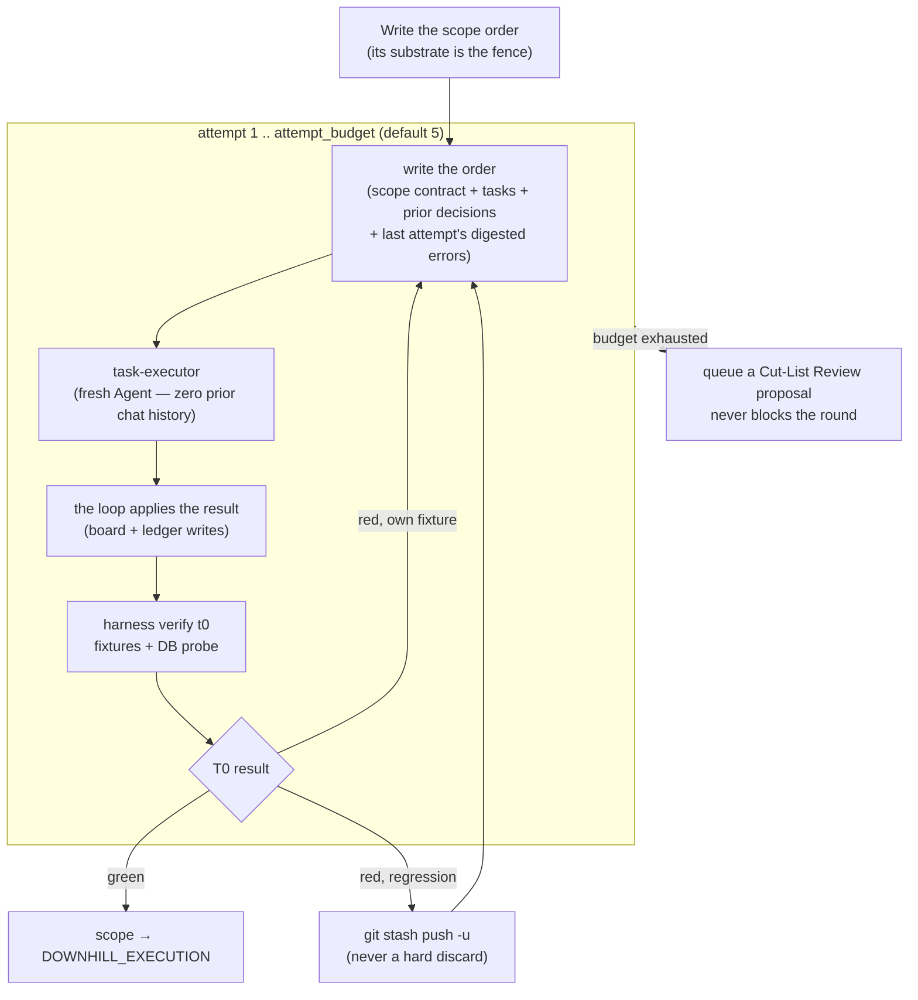

# 04 — Functional Design

[← Back to index](README.md)

## 4.1 — The six skills

| Skill | Role | Behavior |
|---|---|---|
| `shapeup` | Shaper | Set boundaries, breadboard, spike risk, write the pitch (Shape Up steps 1–4). |
| `orient` | Scout | Builder-led recon (step 7): reads the real code, spikes the single riskiest area, emits a code-surface map *before any board exists*, so the board is reality-born. |
| `building` | Loop | Drives a run in the session: opens the run, takes the first phase of its table whose condition holds over the run's files, crosses each gate with the PO, closes. Its `plan` activity is the whole of planning, done in the loop's own context with no sub-agent — requirements registry → linked DDD spec tree + board (BDD scenarios, a system flow, a derived Test Surface) → the committed wiring map at the Wiring Review gate → write-whitelisted scope contracts — under a fence-only `plan` order per substep. The same loop does three more acts itself, as sub-commands: **intake** (a non-English pitch becomes a faithful English `<name>.en.md` plus a glossary, verified before the run opens on it — every downstream step HARD-FAILs on non-English input), **stop** (the Cut-List Review gate: must-have census, every claim naming the file it came from → baseline comparison, never against a perfect ideal → cut list + ship verdict, written as data the Ship Sign-off gate reads; proposes only, a human promotes or ships) and **retro** (turns PO feedback at ship sign-off — or, with `--scan`, the project on disk, or with `--research`, the platform's official documentation, a source and never a verification — into knowledge-base rules filed by reader after asking the PO to categorize each one, never assumed: `task-executor`, `orient`, `qa-edge-hunter`, `plan` and `building` guidance. Guidance never decides a gate). |
| `task-executor` | Generator | Implements a WorkOrder's acceptance criteria exactly. Zero-memory (each attempt is a fresh subagent), substrate-sandboxed, never writes boards or ledgers. |
| `spec-evaluator` | Single judge | Verifies the running app against the committed spec. Skeptical by default; requires a T0 artifact citation on scoped specs; verdict returns as data, never edits anything. |
| `qa-edge-hunter` | Explorer | Post-PASS exploratory hunt through six fixed lenses, outside what the evaluator already probed. Findings go to the ledger as `~`; never blocks ship, never issues a verdict. |

## 4.2 — The build round, in detail

When a spec has scope contracts, BUILD runs an **isolated attempt loop** per scope, riskiest
first:



Two facts make this loop safe to run unattended: **zero-memory handoff** — each attempt is a
fresh subagent that only ever sees what the loop put in the envelope, never
prior chat — and the **build and launch** the loop runs once per round before it dispatches the
evaluator, so a scope that broke its neighbour cannot be mistaken for progress.

> This round is row **2** of the measurement table
> ([§5.1](05-verification-and-quality-strategy.md#51--the-measurement-table)). Its verdicts are
> per-run T0 facts; no acceptance-vs-baseline comparison is maintained. And any acceptance
> observed in an uninterrupted round is a statement about a single context window — it says
> nothing about what survives across one (row 3).

## 4.3 — The circuit breakers

Two breakers, both counting *events*.

| Level | Unit | Default | On exhaustion |
|---|---|---|---|
| Outer — `round_budget` | Build + eval cycles for the whole run | 3 (appetite-informed) | Route to the Cut-List Review gate — ship what is green, with the residual bug list |
| Inner — `attempt_budget` | T0 attempts for one scope, inside one round | 5 | Queue a hammer proposal for the Cut-List Review gate; move on to the next scope — never blocks the round |

Both exits route to **The Cut-List Review gate**, never to a hard stop: the run's ending is always a ship decision made
against what is green, because a run killed from outside ships nothing, including the scopes that already
passed T0.

> The build+eval loop therefore breaks exactly two ways: EVAL PASS → QA → Ship, or the outer
> `round_budget` exhausted.

## 4.4 — Hill position

Progress is reported by Shape Up's Hill position, never by a task count — a 90%-done scope can still be
stuck uphill on the one unknown that matters. The Scout reports an area-level signal at orient, printed at
the Orient Review gate. Nothing derives it after that: an earlier version computed a per-scope phase from T0 facts and
rendered it as a dashboard, and both were removed with the engine (§3.5).

## 4.5 — Gate walkthrough

The numbered gates pause an interactive or `--auto` run; `--unattended` crosses them from the
pre-recorded `ci` answer set (§3.2d) and stops only on PASS, max-rounds, or a hard error. 

```
Gate: Intake & Config
Feature      : [slug]   (kicked-off pitch: [path] + its breadboard, when it has one)
Intake lang  : [English | translated by the loop → <name>.en.md]
Appetite     : [~1 week | ~2 weeks | ~6 weeks | ⚠ missing]
Spec folder  : [path]   (lens: [lite|standard])
Model matrix : orch=[model] exec=[model] eval=[model] qa=[model]
Budgets      : round_budget=[N] (outer)   attempt_budget=[N] (inner, per scope)
```

```
Gate: Orient Review
Breadboard   : [flag | sibling | shaping-dir | shared-root | embedded | none]
🗻 area-level Hill: what's uphill / crest / downhill going into mapping
Spiked area + result — confirm before a single scope is cut
```

```
Gate: Wiring Review
Per-UC reachability chain: engine → seam → entry-point call site → player-visible affordance
Committed wiring-map.md checked against project-profile.md entry_point — no orphaned engine
```

```
Gate: Board Review
UC count + actors · scope board (topology, substrate size) · SPIKE blockers
Deferred Places (breadboard Places this shape will not build) — each needs the PO's yes
Substrate-disjointness and breadboard placement read back by the loop before the gate — any problem is a hard stop
```

```
Gate: Round Close
Board        : [N]/[N] tasks ✅   (derived from the board, advisory)
T0           : [k]/[k] touched scopes T0-green
Build        : [green | red — <failing step> | undeclared]   (the loop runs run_cmd → build_probe → launch_probe)
Ready to EVAL: yes   (a red build ends the round with no EVAL; the failing step is round r+1's bug list)
```

```
Gate: Verdict
🗻 Hill (slice-level) · Verdict: [PASS | FAIL]   bugs: [N]
PASS → QA edge hunt → ship.   FAIL → approve fix round r+1, or stop at max_rounds
```

```
Gate: Ship Sign-off
Feature   : [slug] — [SHIPPED (deployed) | BUILT & VERIFIED — deploy pending (PO)]
Verdict   : PASS (dims evaluated; dims NOT evaluated named explicitly)
QA        : [hunt done — N findings, M promoted | skipped | not-hunted | n/a]   (`ship` is refused over an owed hunt that never ran)
```

> Deploy is deliberately never automatic: the harness distinguishes *built & verified* from
> *deployed*, and only the PO's explicit yes crosses that line.

## 4.6 — Open-loop vs. closed-loop conditions

The gate walkthrough above shows *what* each gate prints, not *when* a human is actually
required to cross it. That turns out to be governed by two independent axes: a **PO-confirmation
policy** (the run's auto level) and a set of **mechanically-enforced preconditions** that hold
no matter what the auto level is.

> **How a crossing is actually produced.** Since the gate-answer set (§3.2d) the auto level is not
> read by the model as a paragraph — each gate resolves through `harness gate` and the
> orchestrator branches on its exit code (`0` cross · `4` stop and put the block to the PO · `5`
> abort). `--auto` implies the `guarded` preset and `--unattended` the `ci` preset unless a set is
> named. Every gate still emits its block and still records a decision; what the preset changes is
> the decision's **source**, which the ledger names.

### Conditions that open the loop (a human is required)

| # | Condition | Behavior |
|---|---|---|
| 1 | Run mode = `interactive` (default) | Every gate — Intake & Config, Orient Review, Board Review, Round Close, Verdict, Ship Sign-off — stops and waits for explicit PO confirmation. Hard rule: "never auto-proceed." |
| 2 | Run mode = `--auto` | Workers run unattended internally, but the loop still pauses at **Orient Review, Board Review, Verdict and Ship Sign-off** per the `guarded` answer set and the Flags table. |
| 3 | Max-rounds exhausted (outer breaker) with FAIL | `r+1 > max_rounds` → hard stop, escalate to the PO with the residual bug list. Fires even under `--unattended` — one of only three conditions that mode stops for. |
| 4 | Discovered tasks reconciled mid-BUILD | Any `discoveries[]` folded into new board tasks routes back to **The Board Review gate** for PO approval before BUILD resumes. |
| 5 | The Cut-List Review gate verdict = CANNOT SHIP | A must-have item fails the census's baseline comparison → do not proceed to SHIP; escalate to the PO honestly, same spirit as a max-rounds stop. |
| 6 | Hard error | A sub-skill fails irrecoverably (spec folder gone, app won't build) → stop and report; never retry blindly. Mode-independent. |
| 7 | Deploy authorization (standing invariant) | Even after a PASS ship, S.5 never auto-deploys. "PO says yes → deploy … otherwise → record deploy pending (PO)." Never becomes closed-loop, in any mode. |
| 8 | User halt | In any mode where gates are live, the PO may stop at any L-gate; state is preserved on disk and `/ship` again resumes. |

> **Which gates `--auto` pauses at.** The answer-set table is authoritative: `--auto` pauses at Orient Review, Board Review, Verdict and Ship Sign-off only.
> Intake & Config is where the auto level is *set*, so the run is necessarily interactive there; the
> Round Close gate carries its board census in the gate block itself (closed-loop row 4 below) and
> advises rather than denies, so an inline "wait for PO confirmation" is the only thing standing there.

### Conditions that allow closed loop (fully autonomous)

| # | Condition | Behavior |
|---|---|---|
| 1 | Run mode = `--unattended` | Auto-confirms all L-gates. Proceeds without a human until PASS, max-rounds, or a hard error — the only three stop conditions in this mode. |
| 2 | Inner breaker (`attempt_budget`) exhausted for one scope | Does **not** stop anything — queues a hammer proposal and moves to the next scope in sequence (DD-9: a struggling scope must not freeze the others). |
| 3 | *(none — see note)* | A worker `ESCALATE` is **not** auto-resolved. The loop records it; a phase that produced no artifact is sent back once and then **stops the run**, naming the phase, because dispatching it again would hit the same wall. Resolving it is a human step in every mode. |
| 4 | The Round Close gate's board census | A different axis entirely — runtime-vs-model, not PO-vs-model. Never asks a human; the gate block carries `green_scopes` and `hammer_proposals` derived from the round's own results, so an EVAL over unfinished work is visible to whoever answers the gate. Advisory — the board is per-machine and the operator asked for the call. |
| 5 | `--no-eval` | PO instruction (or the loop's recommendation) for trivial features — skips the evaluator, goes straight to SHIP with verdict `not-evaluated` recorded. |
| 6 | `--no-qa` | Skips the post-PASS edge hunt; ledger records `qa: skipped`. |
| 7 | BUILD-loop internals (r=1 tasks, r>1 bugs) | Neither requires a human step-by-step — only the round *boundaries* (Round Close, Verdict) are gated per whichever mode is active. |

The practical takeaway: **PO-confirmation policy** and **mechanical preconditions** are
orthogonal. Turning a run fully unattended removes the PO from every *decision* point except the
three unattended stop conditions — it does not, and cannot, remove the hook-enforced
preconditions (`harness verify envelope`, `sandbox-guard.mjs`, `safety-spine.mjs`),
which hold in every mode because they are scripts, not prompts. The Round Close gate's
board-green check is the one that deliberately does *not* hold that way: over unfinished tasks it is
advisory in every mode, and only a board with no tasks at all stops it.

---
[← System Design](03-system-design.md) · [Back to index](README.md) · [Next: Verification & Quality Strategy →](05-verification-and-quality-strategy.md)
