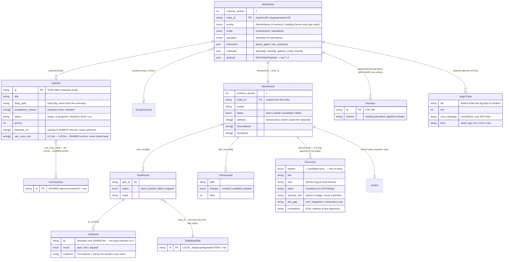
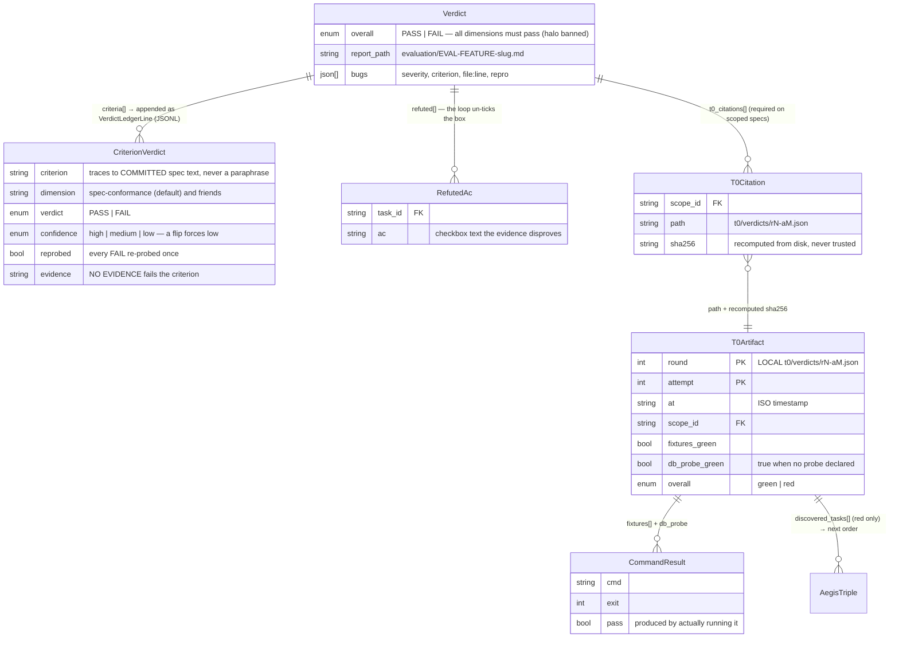
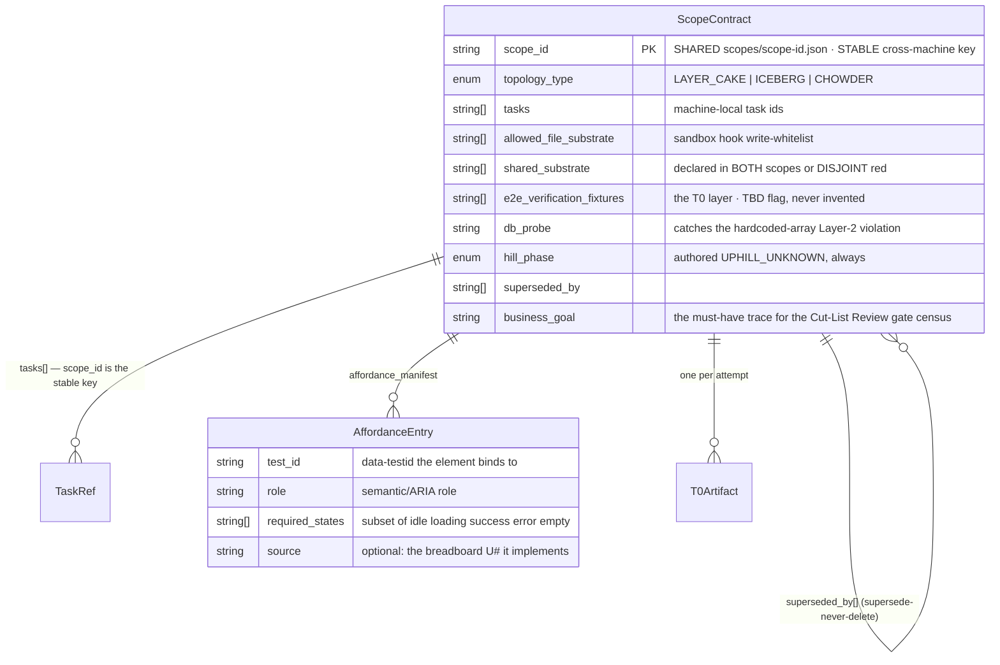

# 07 — Domain ERD

> **Read the writers and readers below with the engine removed.** Where a row names `compile`, `ingest`, `probe` or `reduce`, the loop now does that job; the records `HillShard`, `RoundBuildVerdict`, `ResumeFacts` and `LegRow` are retired and no longer written.

[← Back to index](README.md)

> **Generated from** [`kernel/schemas/domain.schema.json`](../../kernel/schemas/domain.schema.json)
> — the central domain registry (`$defs` = entities, `x-erd` = relationships,
> `x-payload-by-worker` = worker→field map). The schema is the source of truth; when it
> changes, regenerate this page. Structural test #24 guards the schema's internal consistency.

## Legend — storage tiers

| Tier | Meaning | Root |
|---|---|---|
| **SHARED** | Committed, survives clone + crash | `shapeup/` |
| **LOCAL** | Gitignored, regenerable run-trace | `.shapeup/` |
| **EMBEDDED** | Record type that only lives inside another entity | — |

**Join keys.** `<slug>` (the feature) is the aggregate root every path is keyed off.
`scope_id` is the **stable cross-machine key** — hill shards, T0 history, and branches join
on it. `TASK-NNN` ids are **machine-local** (boards regenerate and renumber); never join on
task id across machines.

`run_id` (v1.8) is the **temporal key**: which *execution* a record came from.
`<slug>-<YYYYMMDDTHHMMSSZ>-<8 hex>`, minted by `harness init run` and derived from the receipt, so
any writer holding the receipt recomputes it and a pre-v1.8 receipt backfills to the id it would
have had. It exists because every other id here is *positional* — `order_id`, `(round, attempt,
trial)` and `trial` all identify a record within one run and repeat in the next — so no record
could be attributed to a run and no two runs could be compared. Join `run_id` to group an
execution; join `slug` or `scope_id` to group across executions. `WorkResult` deliberately carries
no `run_id`: it is worker-written, and it reaches the key through `order_id`, which
`validate-envelope` already enforces.

**Tier direction.** Persisted links flow **LOCAL → SHARED only**: a LOCAL artifact must
fully anchor into the committed tier (a task's `use_case_refs`/`linked_docs`, a T0
artifact's `scope_id`, a discovery line's `[UC-NN]` tag), while a SHARED document links
only its committed siblings — never a LOCAL path or a machine-local task id, which would
dangle on every fresh clone. `the loop's planning read-back` enforces both halves mechanically
(`TIER-DIRECTION` red for a `[[tasks/...]]` link in a spec doc, `UC-ANCHOR` red for a task
with an empty or unresolvable anchor).

## 7.1 — The envelope port (WorkOrder → worker → WorkResult)

Everything a worker receives arrives inside a WorkOrder; everything it used to write into
shared files it now returns inside a WorkResult, and the loop is the single
writer that projects the result into shared state.

## 7.2 — The judge and the evidence chain (Verdict → T0)

A verdict on a scoped spec is structurally invalid without a T0 citation; the sha256 is
recomputed from disk — content-addressed evidence the generator cannot fabricate. Both ends are
mechanical: `the loop` hands the evaluator the artifacts to cite (`t0_artifacts`, each
scope's green verdict for the round) and the launch evidence for `[ui]` rows (`build_gate`, the
round's build gate artifact; `launch_cmd`, the profile's launch probe), and `the loop` and `the loop` refuse a
scoped PASS/FAIL that cites none.

## 7.3 — Scope contracts and derived state

The scopes substep of the `plan` activity is the sole writer of ScopeContract; hill phase is derived from
T0/T1 facts, never authored. Superseded contracts are kept, never deleted.

## 7.4 — Standalone artifacts (no relationships beyond the slug root)

| Entity | Tier | Location | Sole writer | Readers |
|---|---|---|---|---|
| `VerdictLedgerLine` | LOCAL | `evaluation/.verdicts-<target>.jsonl` | the loop | spec-evaluator (flip detection) |
| `MetricsRow` | LOCAL | `metrics/<machine-id>.jsonl` | none — the ship-time harvest step retired; rows an earlier release wrote keep this shape | none |
| `ActiveScopePointer` | LOCAL | `.shapeup/active-scope` | harness init run (the Intake & Config gate) — write-once per run, not writable by any worker | the loop. **No hook reads it**: the advisory hooks that once did were retired with the hook diet, and `sandbox-guard` never read it |
| `ActiveOrderPointer` | LOCAL | `.shapeup/active-order` | the loop (published as it writes each order); retired by the loop and harness init run --force | sandbox-guard hook. It names the RUN and nothing more: the guard enforces the substrate of *every* live order for that run — compiled, with no result at least as new as the order's own `compiled_at` — because with scopes building concurrently the writer may not be the order the pointer happens to name, and because an order the pointer named is not thereby still executing |
| `DispatchReceipt` | LOCAL | `<slug>/receipts/dispatch.jsonl` | dispatch-receipt hook (PostToolUse, append-only) — a sub-agent cannot write its own attestation | the loop (refuses an orchestrated result with no matching receipt), the export (a leg's start) |
| `SafetyOverrides` (v1.2) | LOCAL | `.shapeup/safety-overrides.json` | **human PO only** — outside the run-trace carve-out, so no worker can write it | safety-spine hook |
| `RequirementClause` (spine v1.3) | SHARED | `<slug>/requirements.md` | the plan activity's requirements substep (extraction only; a `CUT` is a PO governance edit) | the loop's planning read-back (covers-closure), the loop (the L1b table), human |
| `WiringMap` (spine v1.3) | SHARED | `<slug>/wiring-map.md` | the plan activity's wire substep (SOLE writer, direct — like `scopes/*.md`); `entries[]` are `WiringEntry` | the scopes substep (seam), spec-evaluator |
| `ProjectProfile` (spine v1.3) | SHARED | `<slug>/project-profile.md` | the loop, at the intake gate (not the loop, which stays pipeline-blind) | the loop (`build_probe` + `launch_probe`), the plan activity (wire) |
| `RunArgs` (the launch record) | LOCAL | `<slug>/run-args.json` | harness init run (same act as the receipt; the model floor is enforced as it is written) | the loop, the loop (the no-evaluation guard) |

## 7.4b — Telemetry & resilience read-plane (v1.2)

The absorb-audit additions are all *derived* records: they read the run's files and project
them — none of them is a new write surface for workers, and `the loop` remains the
sole SHARED-state writer.

## 7.5 — Vocabulary enums

| Enum | Values |
|---|---|
| `WorkerName` (4) | task-executor · spec-evaluator · orient · qa-edge-hunter — the loop (`building`) is not a member: it is the `worker` of a fence-only `plan` order, which the order schema accepts beside the roster |
| `Operation` (6) | execute, fix · evaluate · orient · hunt · plan (fence-only: one order per planning substep — `requirements`, `spec`, `wire`, `scopes` — answered by the loop writing `results/plan-<step>.json`, no sub-agent) |

## 7.6 — Payload fields by worker (`x-payload-by-worker`)

Which `WorkOrderPayload` fields each worker may rely on — anything absent from an order is
**unknown**, never inferred. A new cross-boundary field is added to the registry first.

| Worker | Payload fields |
|---|---|
| task-executor | `tasks`, `scope_contract`, `decisions`, `digested_errors`, `trial_history`, `verify`, `kb_rules_path`, `constraints`, `bugs` |
| spec-evaluator | `spec_folder`, `feature`, `dimensions`, `run_cmd`, `launch_cmd`, `build_gate`, `t0_artifacts`, `browser`, `tasks` |
| orient | `pitch`, `breadboard`, `stack`, `spec_folder`, `feature`, `kb_rules_path` |
| qa-edge-hunter | `feature`, `spec_folder`, `eval_report`, `app_url`, `ledger`, `kb_rules_path` |
| building (plan orders) | `feature`, `spec_folder`, `step`, `mode`, `kb_rules_paths` |

## 7.7 — Result fields by worker (`x-result-by-worker`)

Which `WorkResult` fields each worker is allowed to output. Enforces architectural boundaries (e.g., only `spec-evaluator` may return a verdict; only `task-executor` returns task results).

| Worker | Allowed Result Fields |
|---|---|
| task-executor | `task_results`, `files_touched`, `discoveries`, `artifacts`, `assumptions`, `deviations` |
| spec-evaluator | `verdict`, `files_touched`, `artifacts`, `assumptions`, `deviations` |
| qa-edge-hunter | `discoveries`, `files_touched`, `artifacts`, `assumptions`, `deviations` |
| orient | `files_touched`, `artifacts`, `assumptions`, `deviations` |
| building (plan orders) | `artifacts`, `deviations` |
