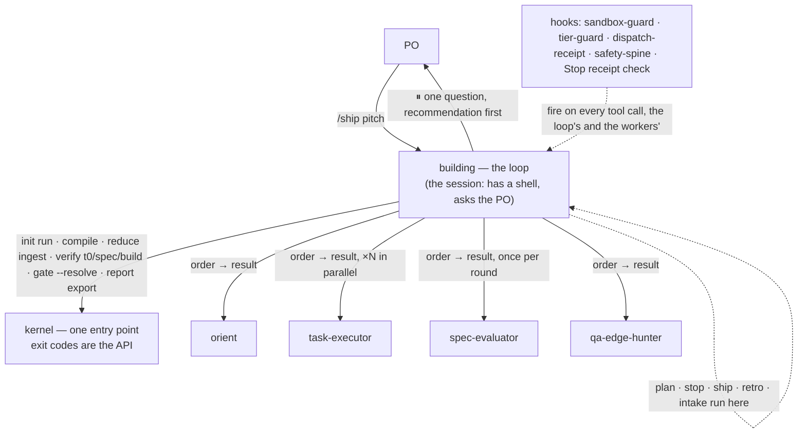
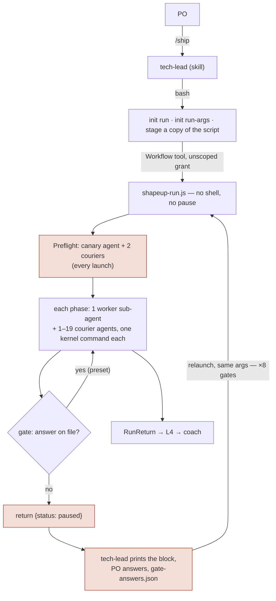
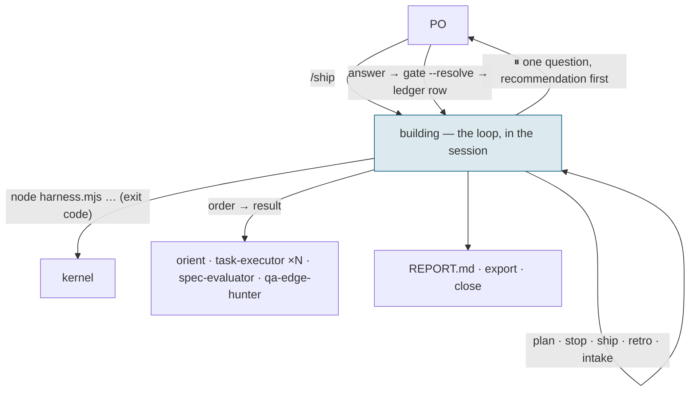

# Plan — the single loop: problem, goals, activities, design, and the workflow before and after

| | |
|---|---|
| **Date** | 2026-11-07 |
| **Baseline** | 3.18.4 at `0081c38`; `npm test` green |
| **Inputs** | `review-2026-11-07-single-loop.md` (what a run is made of, the kernel cut) · `proposal-2026-11-07-activity-layout.md` (skills, hooks, agents) · `constraints-2026-11-07.md` (what in the repo bites this plan) · `requirements.md` |
| **Decisions already taken (PO, 2026-11-07)** | keep the four workers' names · the loop is a thin skill over a kernel `probe next` · the model floor moves into the kernel · planning keeps a fence-only `plan` order · ship as 4.0.0 with ADR-0004 first · intake stays as a resource that still writes the English copy and glossary · `hill-chart` untouched, so `reduce graph` stays · all four planning steps fold at once |
| **Quick view** | `docs/visualize/single-loop-before-after.html` — the two workflows side by side, and what each number changes |
| **Status** | plan, for the Betting Table — **amended 2026-11-07** against `constraints-2026-11-07.md` (see the box below) |

> **Amended 2026-11-07.** The first version of this plan was written before the constraints check
> and carried four wrong claims and three wrong figures. They are corrected in place and listed here
> so the change is not silent. Four of the amendments rest on the constraints report's §6 defaults,
> which the PO confirmed on 2026-11-07 (thin skill over `probe next`; the model floor in the kernel;
> a fence-only `plan` order; 4.0.0 with ADR-0004 first). Each is marked *(confirmed by the PO)*.
>
> | Was | Is | Why |
> |---|---|---|
> | The loop is prose, kernel changes 0 (A1) | A thin skill over a kernel `probe next` verb *(confirmed by the PO)*; the skill obeys the 155-line ratchet at its new path | C1: the ratchet and the script's post-conditions |
> | `gate-zerowork` shrinks to ~60 lines (A4) | Re-keyed to `building` and `/ship`, about 200 lines | C2: its predicate needs the dispatch detector |
> | `init run-args` and `RunArgs` deleted (A5) | A launch record written by `init run` stays; the model floor moves to the kernel *(confirmed by the PO)* | C3: `reduce ship` reads the record as a false-green guard |
> | Planning writes keep every invariant | A fence-only `plan` order *(confirmed by the PO)* | C4: measured, no live order means `allow` |
> | The `Workflow` token is removed by the installer | The installer stops adding it and deletes nothing | C6: it is the user's token |
> | A6 deletes `probe stats`; A4 uses `probe stats --hooks` as its check | The `--hooks` reader stays | C8 |
> | No release step | A9: 4.0.0, ADR-0004, release-candidate check; A0b: ADR first | C5 |
> | 32 → 26 subcommands | 32 → 29 (the earlier table summed to 27, so 26 was also an arithmetic slip) | recount below |
> | 7 → 5 hook files | 6 → 5 hook scripts, plus the shared decision library | the old count mixed the two |
> | ~7,000 lines removed, ~3,600 in kernel and hooks | about 6,500 and 3,200 — arithmetic on the old estimate, not re-measured | the kept reader, the kept hook, the new verb |

## 1. Problem

The plugin's promise is "Shape Up with gates the agent can't talk its way past". What it costs to
deliver that today is mostly not the gates. Every figure is derived; the review's §9 and the
proposal's §7 say how to re-run each.

| # | Problem | Measured |
|---|---|---|
| P1 | **A control plane that cannot act.** The run is a Workflow script with no shell, so every kernel command it needs is run by spawning a sub-agent whose only job is to type one `node` command and relay the exit code | 51 courier call sites in `skills/tech-lead/workflows/shapeup-run.js`, against 11 worker dispatch sites. By phase: Ship 19, Build 11, MapScopes 5, QA 4, Analyze 4, Orient 3, Refute 2, Preflight 2, Eval 2, Wire 1 |
| P2 | **A gate that ends the run.** Eight pause points inside the script (L1a, L1a.5, L1b, L2, L3, QA, H, L4). Interactive mode returns `paused` at each; the PO answers; the orchestrator relaunches. Every launch re-runs Preflight — the canary agent and its evidence courier are not behind the fast-forward — and then re-derives its position | up to 8 relaunches per interactive one-round run, each paying 1 canary agent + ≥ 2 couriers before any work resumes |
| P3 | **State machinery that exists to survive P2.** The fast-forward, the launch/return contract, the staged copy of the script, the unscoped `Workflow` grant | `kernel/probe/resume.mjs` 1,161 lines; `ResumeState` + `RunArgs` + `RunReturn` = 20.7 KB, 22 % of the schema's definitions; `init run-args`, `probe staged`, the `.shapeup/workflows/` staging in `init run` |
| P4 | **Roles instead of activities.** Eleven Building skills named after people, 18 operations, each skill with its own envelope boilerplate; planning is one activity cut into three workers with two handoffs between them; `--tiny` is a second, prose implementation of the loop | 13 skills, 10 workers, 18 operations; `tech-lead` 3,932 lines of which the script is 2,234 and the prose lane 889 |
| P5 | **Guards with no record of guarding** | across 9 archived runs: `gate-intake` 0 denials / 243, `gate-zerowork` 0 / 57, `safety-spine` 0 / 5,268; `sandbox-guard` 22 / 770 |
| P6 | **Measurement blind spots.** The export has no token or cost axis, and a courier leaves no row at all | `report/facts.mjs` tables carry `duration_ms` and nothing about tokens; a courier's only trace is an anonymous `safety-spine` allow row |
| P7 | **The v4 folder's own scaffolding.** The registry points at a README that does not exist; `analysis/02` cites two analyses that do not exist; the drift check cannot see relative links | review §2 |

Who pays: the **PO** waits through relaunches and reads gate blocks that were composed inside a
script; the **maintainer** carries 18,400 lines of kernel and hooks plus 26,600 lines of tests, and
every fix to the run touches the script; the **consumer** grants an unscoped `Workflow` token and
lives under three permission layers the plugin cannot see.

## 2. Goals

Each goal is one outcome a maintainer can observe, and maps to a candidate requirement in the review's §8.

| # | Goal | Solves | Candidate req. |
|---|---|---|---|
| G1 | Every agent a run spawns is a worker with a row in the export. No couriers, no canary | P1, P6 | V4-REQ-3 |
| G2 | A gate is answered in the session that reached it. No relaunch, no fast-forward after an answer; the gate row still carries its source | P2 | V4-REQ-4 |
| G3 | Resume is `/ship` again: the loop reads artifacts on disk and nothing else. One mechanism | P3 | V4-REQ-7 |
| G4 | Opening a run needs the kernel's two Bash rules and nothing more | P3 | V4-REQ-5 |
| G5 | Building has the shape Shaping has: one loop skill, sub-commands per activity, craft in resources, four workers, six operations | P4 | V4-REQ-2 (+11) |
| G6 | Hooks with a record stay; hooks without one go or shrink; the invariants list in `AGENTS.md` is unchanged | P5 | V4-REQ-10 |
| G7 | The export's `leg` table carries tokens and cost per leg | P6 | V4-REQ-8 |
| G8 | Nothing consumer-facing breaks: knowledge-base files, the committed tier, command names, the install URLs, the grant rules | all | V4-REQ-9 |

**Non-goals**, stated so they are not assumed: no change to what any worker writes or where; no
change to T0, the oracles or the ratchet; no new gate; no rename of the four kept workers;
`hill-chart` untouched; no change to the Shaping phase.

## 3. Activities

Nine activities, in the order they land. Each is one or two commits a reader can revert alone, and
`npm test` is green after each. "Touches" is the surgical surface; "done when" is observable.

| # | Activity | Solves | Touches | Done when | Size |
|---|---|---|---|---|---|
| A0b | **Write ADR-0004 first.** Status proposed; `Supersedes` names the "one workflow launch" decision in `docs/design/03-system-design.md` §3.5; records the four decisions of the first round and the four confirmed on the constraints report (thin skill over `probe next`, model floor in the kernel, fence-only `plan` order, 4.0.0 with the ADR first); names the working-record files in `docs/design/v4/` to retire when the change ships, as ADR-0002 prescribes | P7 | `docs/design/adr/` | the ADR is accepted by the PO before A1 starts | S |
| A0 | **Mend the v4 folder.** Write the README the registry points at (method; the `V4-REQ-2` low-level scope); write `analysis/03` and `analysis/04` or remove the seven citations; fill the empty open-questions list; teach the drift check relative links | P7 | `docs/design/v4/`, `tests/structural/08-docs.mjs` | the drift check fails on a relative link to a missing file, then passes | S |
| A1 | **Stand up `building` beside `tech-lead`, over a kernel `probe next`.** The state machine stays in code: `probe next` derives the next step, its exact command and any gate block from the artifact predicates already in `probe resume`, and the "sent back once" post-conditions become its branches, not instructions. The skill is the thin driver in the `shapeup` shape and fits the 155-line ratchet carried to its new path unchanged; `gates.md`, `ledger.md`, `intake.md` move; `/ship` points at it; `tech-lead` stays until a real run has shipped through `building` *(confirmed by the PO)* | P1, P2, P4 | new skill dir; `commands/ship.md`; one new `probe` verb; `tests/structural/08-docs.mjs` (the ratchet's path, same number) | the example pitch under `examples/` ships through `building` with no courier and no relaunch; `legs.jsonl` holds only worker rows; `probe next` has fixtures for every post-condition the script holds today | L (skill), M (verb) |
| A2 | **Fold planning.** `coverage → analyze → wire → map-scopes` as one `plan` activity with `verify spec` between steps; delete the three planner skills; `WorkerName` 10 → 4, `Operation` 18 → 6, the 12 cases and their payload fields leave `kernel/compile.mjs`; the knowledge-base name map (§5.6); **planning keeps a write fence** — one `plan` operation survives as a fence-only order: `compile` stamps the planning substrate, no sub-agent runs, `reduce ingest` closes it *(confirmed by the PO; the rejected alternative was to accept that planning writes are unfenced, which a fixture showed is the state without it)* | P4 | 3 skill dirs, `kernel/compile.mjs`, `kernel/schemas/domain.schema.json`, `kernel/schemas/work-order.schema.json` | `verify skills` reports 4; `compile --operation analyze` exits 2; `verify spec` is green on the example pitch's tree, map and contracts; a `Write` to a frozen planning path is denied during `plan` (the fence, below) | M |
| A3 | **Fold stop, retro, intake.** Delete `scope-hammer`, `coach`, `translator`; `stop.md` cites the three probes; COACH-1 still asks | P4 | 3 skill dirs, `commands/hammer.md`, `commands/retro.md` | a Vietnamese pitch yields `<name>.en.md` + glossary from the loop; the census file is written and L4 reads it | S |
| A4 | **Hooks.** Delete `gate-intake.mjs` from `hooks/`; **re-key** `hooks/gate-zerowork.mjs` — keep the leading `/ship` and `Skill` detectors, rename `tech-lead` to `building`, drop the `Workflow` and Bash-launch arms (about 200 lines, not 60); drop the `SessionStart` echo; `hooks/hooks.json`, `README.md`, `SECURITY.md`, `docs/design/03-system-design.md` in the same commit | P5 | 3 hook files + 3 docs | `probe stats --hooks` lists 6 hooks (it needs C8's reader, kept in A6); the Stop hook still blocks a session that dispatched `building` or led with `/ship` and left no receipt, and does not block one that merely discussed the harness (fixtures) | S |
| A5 | **Retire the control plane.** Delete `tech-lead` and the script; `kernel/init/run-args.mjs` (its record moves into `init run`, below), `kernel/probe/staged.mjs`, the workflow staging in `kernel/init/run.mjs`, the installer's writing of the `Workflow` grant in `bin/lib/grant.mjs` and `bin/init.mjs` (stop adding it; **delete nothing** from a user's settings); shrink `kernel/probe/resume.mjs` to the artifact predicates and `closeRun`; merge `kernel/reduce/snapshot.mjs` into it; drop `RunReturn`, `ResumeState`, `Lane`, `RunSnapshot`; **keep a launch record** (`noEval`, the dials, the run id) written by `init run`, because `reduce ship` refuses to freeze a PASS for a run launched with no evaluation; the model floor moves from the script into the kernel, read at `init run` *(confirmed by the PO)* | P2, P3 | the files named | `init run` stages nothing and writes the launch record; the installer adds two rules and no `Workflow` token; `reduce ship` still refuses a no-eval PASS (fixture); a below-floor model is refused at `init run`; the kill-and-resume probe passes: kill mid-build, run `/ship` again, no finished phase is re-dispatched | M–L |
| A6 | **Projections.** Delete `kernel/probe/concurrency.mjs` and `kernel/reduce/verdict.mjs`; **keep the `--hooks` reader of `kernel/probe/stats.mjs`** (ADR-0001's `warn` verdict exists for it; about 100 of its 477 lines) and drop the rest; keep `reduce graph` and `reduce hill` (decision 3); add tokens and cost to the leg row and the export, nullable, with the source named | P6 | the files named, `kernel/report/facts.mjs`, `kernel/reduce/ingest.mjs` | `node kernel/harness.mjs --help` lists the reduced set; the `leg` table has the two columns, filled where the host reports usage and null where it does not | M |
| A7 | **Tests and the audit.** Treat the 37 structural files that read the script as the acceptance list for the new loop: each assertion is ported to `probe next`, the kernel, or a hook fixture, or retired with a stated reason. Remove the tests of deleted modules; add three: no courier (export leg count equals dispatch receipts), no relaunch (every gate row of a run carries one launch id), grant constant; run the `harness-maintenance-audit` skill | all | `tests/` | suite green; the audit reports no stale count and no leaked internal reference | M |
| A9 | **Release 4.0.0.** `package.json` and `.claude-plugin/plugin.json` together; a `CHANGELOG.md` entry; the shipped `AGENTS.md` block and the four counted docs (`README.md`, `docs/design/03-system-design.md`, `docs/design/README.md`, the generated ERD); `claude plugin validate . --strict`; then, because `hooks/` changed, the release-candidate check `CLAUDE.md` requires: `npm run verify:cross-dir`, and one real nested `claude -p --plugin-dir <repo> --permission-mode acceptEdits` session that must leave a row in `decisions.jsonl` — a missing row means enforcement failed open | C5 | the files named | a tag matching both versions passes the release workflow; the nested session's row is present | M |
| A8 | **Measure.** One run of the archived `envlint` pitch on the new loop, same model class as the fan-out arm, dated; record legs, minutes, tokens; compare to `traces/phase3/fanout-arm-shipped/` (11 legs, 34 min) | G1, G7 | `traces/` | the first dated measurement in the v4 folder; `requirements.md` rows move out of `proposed` on it | S |

A0b and A1 are the gate for everything after them: until the ADR is accepted and a real run has
shipped through `building`, nothing is deleted. A2 to A6 are each reversible on their own. A7 and A8 are what turn the plan's claims
into records.

## 4. High-level design



**The three planes, kept, with one change.** The run script's header names them: CONTROL
sequences and branches on structured returns; EXECUTION is the sub-agents; ARTIFACT is the
kernel. The design keeps all three and changes one property: CONTROL regains I/O. The rule that
forbade it ("nothing in this file reads a model's prose") is still met, because the loop branches
on a kernel exit code or a kernel JSON document and never on its own narration. What goes is the
*courier* that used to carry the exit code across the plane boundary.

**Rent and own**, from `analysis/01`, applied:

| Rented from the host | Owned by the plugin |
|---|---|
| the agent loop, the shell, file tools, sub-agent spawning, compaction | the definition of done: T0 fixtures, the oracles, the judge's criteria |
| asking the user a question | the gate ledger and its source; presets for headless lanes |
| per-model tuning | the write fence and the tier rule, at the write |
| | the envelope for the four dispatches; one writer for shared state; receipts |
| | the export as the measurement substrate |

**Gates.** Interactive: the loop shows the gate block with its recommendation, asks one question,
writes the answer to `gate-answers.json`, and runs `gate --resolve`, which writes the ledger row
with source `PO (live)`. Headless: the same command resolves from the preset; `on_missing: abort`
is unchanged. The ten gate codes and their meanings in `AGENTS.md` do not change.

**Invariants kept.** Measured not claimed (T0, the build gate, the re-hashed citation); writes
refused at the write (`sandbox-guard`, `tier-guard`); one writer (`reduce ingest`); attested not
assumed (`dispatch-receipt`, `verify dispatch`); single judge; every ending records a close and
exports. Each is a kernel subcommand or a hook today, and each survives unchanged.

## 5. Low-level design

### 5.1 The `building` skill

Modelled line for line on `skills/shapeup/SKILL.md`:

| Part | Content |
|---|---|
| frontmatter | triggers: "ship this feature", "run the harness", "build from this pitch"; `DEFAULT: /ship <pitch>` |
| standing rules | RULE 1 ASK, DON'T ASSUME · RULE 2 SIMPLEST FIRST · RULE 3 NON-REGRESSION — the same three, plus RULE 4 THE KERNEL DECIDES THE NEXT STEP: the skill runs `probe next`, does what it returns, and advances on a kernel exit code or JSON, never on its own prose |
| sub-commands | `orient` · `plan` · `build` · `evaluate` · `hunt` · `stop` · `ship` · `retro` · `intake`; `/ship` with no sub-command runs the whole loop |
| resource table | one resource per sub-command, loaded on demand (proposal §3) |
| gate questions | one block per gate, recommendation first, the valid decisions listed; the text of today's `references/gates.md` |
| progress markers | `▶ ORIENT`, `⏸ L1a`, … the same markers the PO sees today |
| the loop | `probe next` → do the step it names → `probe next`; §5.2 is the sequence `probe next` walks, written as the contract its fixtures pin. Length: at most the 155-line ratchet, carried to this file's path with the same number |

### 5.2 The loop, step by step

*(Amended.)* The listing below is the sequence `probe next` walks, and the contract its fixtures
pin; it is not prose the skill is asked to remember. At each step the skill calls `probe next`,
which returns the step, the exact kernel command, and — at a gate — the block. The loop's own text
stays inside the line ratchet, and each "sent back once" rule is a branch of the verb, so a skipped
instruction cannot skip a post-condition.

Every command is `node "<kernel>" …`, the kernel's absolute path from the plugin root (the same
one-line rule the workers follow today). `⏸` is a gate question.

```
0  open      init run --slug <s> --intake-file <f> --auto-level <l> [--gate-answers …]
             exit 3 → a run is open: read the artifact predicates (§5.7) and continue from the first
             unsatisfied step. Nothing below re-runs a step whose artifact is on disk.
             non-English pitch → intake: write <name>.en.md + glossary (resource intake.md)
1  orient    compile --operation orient --slug <s>
             Agent: Skill(orient) --order <path>          ← sub-agent; the receipt hook attests it
             reduce ingest --order <path>
             probe resume --require orient               exit ≠ 0 → dispatch again once, then stop
             ⏸ L1a
2  plan      in this context, resource plan.md:
             requirements.md (coverage) → spec tree + reduce board (analyze) → wiring-map.md (wire)
             → scopes/*.md (map-scopes); verify spec after each step; verify trace (advisory)
             ⏸ L1b   — prints the REQ → AC table; red stops here, as today
3  build     round r: waves from the contracts' write sets (the scheduler's edge rule, moved here)
             per scope, in parallel up to --parallel-scopes:
               compile --scope <contract> --round r --attempt a
               Agent: Skill(task-executor) --order <path>
               reduce ingest --order <path>
               verify t0 --scope … --round r --attempt a   red → next attempt, up to attempt_budget
             verify build --slug <s> --round r             red → the round ends, bugs compile into r+1
             ⏸ L2  (advisory over unfinished tasks, as ADR-0001)
4  evaluate  compile --operation evaluate --slug <s> --round r
             Agent: Skill(spec-evaluator) --order <path>
             reduce ingest --order <path>
             probe eval --slug <s> --round r               refused → sent back once
             ⏸ L3    FAIL → step 3 with payload.bugs;  PASS → step 5
             round_budget or wall_clock exhausted → step 6
5  hunt      compile --operation hunt; Agent: Skill(qa-edge-hunter); reduce ingest; probe hunt
             ⏸ QA
6  stop      probe owner · probe requirements · probe attempts → census (resource stop.md)
             ⏸ H
7  ship      reduce ship --slug <s> → REPORT.md;  ⏸ L4;  report export;  close
8  retro     ⏸ COACH-1 per rule → shapeup/knowledge-base/<name>.md (resource retro.md)
```

What is **unchanged** in this listing: every kernel command, every gate code, the envelope for
the four dispatches, the single-judge rule, the breaker arithmetic. What is **gone**: the courier
around each command, the `paused` return, the relaunch, the preflight canary (the first orient
dispatch leaves the same receipt), the `RunArgs` record.

### 5.3 Kernel surface after the cut

| Verb | Today | After | Notes |
|---|---|---|---|
| `verify` | t0 · budget · envelope · trace · spec · skills · dispatch · build | the same 8 | `skills` derives the roster from the enum; it shrinks to 4 on its own |
| `reduce` | ingest · hill · snapshot · ship · board · verdict · graph | ingest · hill · ship · board · graph | `snapshot` merges into resume's predicates; `verdict` is dead code |
| `probe` | resume · t0 · stats · digest · concurrency · leg · eval · owner · requirements · attempts · hunt | resume (predicates + close) · **next** · t0 · stats (`--hooks` only) · digest · leg · eval · owner · requirements · attempts · hunt; `rounds` stays as a module, `staged` goes | `concurrency` goes; `next` is new |
| `init` | run · fit · run-args | run (no staging; writes the launch record) · fit | `run-args` goes |
| `report` | export | export (+ tokens, cost) | |
| `gate`, `compile` | | the same; `compile` keeps orient/execute/fix/spike/evaluate/hunt | |
| subcommands | 32 | 29 | 8 + 5 + 11 + 2 + 1 + 2; counted from `ROUTES` in the kernel entry point, not from this table |

### 5.4 Schema

| Change | Where |
|---|---|
| `WorkerName` 10 → 4; `Operation` 18 → 6 | `kernel/schemas/domain.schema.json` |
| remove `RunArgs`, `RunReturn`, `ResumeState`, `Lane`, `RunSnapshot`; add a small `ResumeFacts` (the predicate booleans + `next_step`) | same |
| `WorkOrderPayload` drops the planning-only fields (`spec_tree`, `wiring`, `scope_cut` and their siblings) | same, `kernel/schemas/work-order.schema.json` |
| leg row gains `tokens_in`, `tokens_out`, `cost_usd`, all nullable; `export` carries them | `kernel/reduce/ingest.mjs`, `kernel/report/facts.mjs` |

### 5.5 Hooks

| Hook | After | Why |
|---|---|---|
| `sandbox-guard` | unchanged; narrow the `/tmp` scratch class later, measured | 22 denials on record |
| `tier-guard` | unchanged | the loop writes the committed tier more often |
| `dispatch-receipt`, `verify envelope`, `verify dispatch` | unchanged | four dispatches remain |
| `safety-spine` | unchanged, listed as an ablation candidate | 0 denials in 5,268 rows |
| `gate-zerowork` | re-keyed, about 200 lines: blocks Stop when the session dispatched `building` or led with `/ship` and no receipt exists; the `Workflow` and Bash-launch arms go | the predicate is "dispatched AND no receipt"; without the dispatch detector it blocks nothing it should; the narration pathology grows when the orchestrator is the model's own turn |
| `gate-intake` | deleted | it keyed on `Skill(tech-lead)`; there is no such dispatch. Zero denials in 243 rows; the first one before A4 lands moves it back to keep |
| `sandbox-guard` on planning | a fence-only `plan` order (A2) | measured: with no live order a planning write is `allow`, rule `no-round` |
| `SessionStart` echo | deleted | prints a path |

### 5.6 Compatibility

- **Knowledge base.** Files are named after skills (`relKnowledgeBase` in `kernel/lib/paths.mjs`).
  The loop reads `ba-pitch-analyzer`, `scope-architect`, `solution-architect` as `plan` guidance
  and `tech-lead` as `building` guidance, and writes new rules under the activity name. COACH-1's
  category list becomes: `building`, `plan`, `task-executor`, `orient`, `qa-edge-hunter`.
- **Commands.** Nine of eleven keep their names. `/scopes` and `/wire` become one-line aliases to
  `/ship plan` for one release, then go.
- **Committed tier.** No file name, frontmatter field or path changes under `shapeup/<slug>/`.
- **Grant.** Two Bash rules, as `bin/lib/grant.mjs` already emits. The installer stops adding the
  `Workflow` token and removes nothing: the token is unscoped and a project may use it for its own
  scripts, so `docs/upgrading.md` tells the user it is no longer needed.
- **Install URLs.** `scripts/` keeps resolving; its behaviour becomes "run the installer".

### 5.7 Resume predicates

The part of `kernel/probe/resume.mjs` that stays, as the table the loop reads at step 0:

| Step | Satisfied when | Source |
|---|---|---|
| orient | `code-surface.md`, `discovered-seed.md`, `hill-signal.md` (+ a spike file) exist | `ORIENT_REQUIRED` today |
| plan: coverage | `requirements.md` exists | |
| plan: analyze | the spec tree and a board with ≥ 1 task | `hasSpecTree`, `hasBoard` today |
| plan: wire | `wiring-map.md` exists | |
| plan: map-scopes | `scopes/*.md` exist and `verify spec` is green | |
| build, round r | every scope has a green T0 verdict in round r, or the round's build gate is on disk | `trials.jsonl`, `t0/` |
| evaluate, round r | a verdict row for round r | `evaluation/` |
| hunt | a hunt result ingested (leg row) | `legs.jsonl` |
| stop | the census file | |
| ship | `REPORT.md` and the close fields in `harness-run.md` | |

### 5.8 Tests

Remove with their modules: the fan-out scheduler's, `run-args`', `staged`'s, `concurrency`'s,
`verdict`'s; `stats`' keep the `--hooks` cases. Rewrite the resume fixtures against `ResumeFacts` and
port the 37 script-reading files per A7. Add three, named in A7, and one for each of C2, C3 and C4.
The doc-parity checks (`08-docs.mjs` sections 25, 26, 49) stay and are what prove the rename
reached every doc.

## 6. The workflow, before and after

### Before — one interactive, one-round run



### After — the same run



### What each change buys

| | Before | After | Problem |
|---|---|---|---|
| Sub-agent kinds per run | 10 workers + couriers + canary | 4 workers | P1, P4 |
| Agents per interactive one-round run, 4 scopes | 11 worker legs + ~53 courier runs + up to 8 canaries + fast-forward couriers per relaunch: on the order of 70–90 agents for 11 units of work (an estimate from call sites; the record cannot count couriers, which is P6) | 11 worker legs, nothing else | P1, P2 |
| Relaunches | up to 8 | 0 | P2 |
| Permission grant | 2 Bash rules + unscoped `Workflow` | 2 Bash rules written; an existing `Workflow` token left alone | P3 |
| Resume mechanism | fast-forward over `ResumeState`, per launch | `/ship` again, artifact predicates | P3 |
| Skills / workers / operations | 13 / 10 / 18 | 7 / 4 / 6 | P4 |
| Kernel subcommands | 32 | 29 | P3 |
| Hook scripts / `hooks.json` entries | 6 / 8 | 5 / 6 | P5 |
| Lines removed (code + prose) | — | about 6,500 across the script, kernel, hooks, scripts and the prose lane; about 3,200 of it in `kernel/` + `hooks/` (the earlier 7,000 and 3,600 less what is now kept or added; an estimate, re-derived at A8) | P3, P4 |
| What a PO sees at a gate | a block composed in a script, relayed by the orchestrator | the block, the recommendation, one question, in the conversation | P2 |
| Export | duration per leg | duration, tokens, cost per leg; every agent is a leg | P6 |
| Invariants | 7 | 7, unchanged | — |

## 7. Risks, and the check for each

| Risk | Why the loop raises it | Check |
|---|---|---|
| **Narration** — the session describes the run instead of running it | the orchestrator is the model's own turn | RULE 4 (exit codes decide); the Stop receipt check; A7's "no courier" test doubles as "the loop ran the commands itself" |
| **Context size** on a large pitch, with planning in one window | spec tree + wiring map + contracts are the largest artifacts a run writes | A8 measures on `envlint`; the predicates make a compaction a resume, not a loss; if it fails, `wire` and `map-scopes` go back to sub-agents (decision 4 reverses cleanly) |
| **The loop edits during a live order** | the fence covers the loop's own writes only inside a live order's substrate | the loop never edits between `compile` and `reduce ingest` of a build order; `sandbox-guard`'s deny count on the loop is read in A8 |
| **Prompt-cache cost** | the repo's docs say the script's sub-agents share the session's cache; Agent-tool sub-agents may not | A6's token column; A8 compares |
| **Lost "killed session loses nothing"** | no journal resume | the kill-and-resume probe in A5 |
| **The planning fold loses an id, a clause or a seam** | `analysis/02`'s open question 3 | `verify spec` and `verify trace` between the steps; A8's REQ → AC table against the fan-out arm's |

## 8. Done when

| Check | Command |
|---|---|
| No courier, no canary | `legs.jsonl` row count = dispatch-receipt count for the run |
| No relaunch | every `gate_decision` row of the run carries one launch id |
| Grant is two rules | `node -e "import('./bin/lib/grant.mjs').then(m=>console.log(m.pipelineRules()))"`; the installer writes no `Workflow` token and deletes none |
| Roster is four | `node kernel/harness.mjs verify skills --plugin-root .` |
| Kernel surface | `node kernel/harness.mjs --help` lists 29 subcommands |
| Hooks | `ls hooks/*.mjs` lists 5; `node kernel/harness.mjs probe stats --hooks` lists 6 hooks, because the reader stays |
| Guards survived | fixtures: `reduce ship` refuses a no-eval PASS; a below-floor model is refused at `init run`; a frozen planning path is denied during `plan`; Stop blocks a `building` dispatch with no receipt |
| Ratchet | the line ratchet is at the new skill's path with the number 155, not raised |
| Release | tag matches both version files; `verify:cross-dir` passes; the nested session leaves a `decisions.jsonl` row |
| Nothing consumer-facing broke | a consumer repo with `shapeup/knowledge-base/ba-pitch-analyzer.md` sees its rules in the `plan` step's order; `/scopes` still answers |
| Suite and audit | `npm test` green; the maintenance audit reports no stale count |
| Measured | one dated run in `traces/` on the new loop, with tokens, beside the fan-out arm |

## 9. What would change this plan

- A8 showing more tokens per shipped scope than the fan-out arm, by more than the courier savings
  explain: keep the Workflow launch for the build phase only, with the loop around it.
- A real loss at a planning handoff in A8's REQ → AC table: `wire` and `map-scopes` return to
  sub-agents; the `plan` resource stays.
- A denial from `gate-intake` or `gate-zerowork` on a live run before A4 lands: that hook moves to
  "keep".
- The Workflow runtime gaining a shell for the control plane or a pause that does not end the
  launch: A5 is re-read; A1 to A4 stand regardless.
- Evidence that `probe next` cannot carry a post-condition the script holds today (found while
  porting the 37 script-reading tests in A7): that post-condition needs a stated home, and the
  ratchet is re-argued on the record, never weakened to green.
