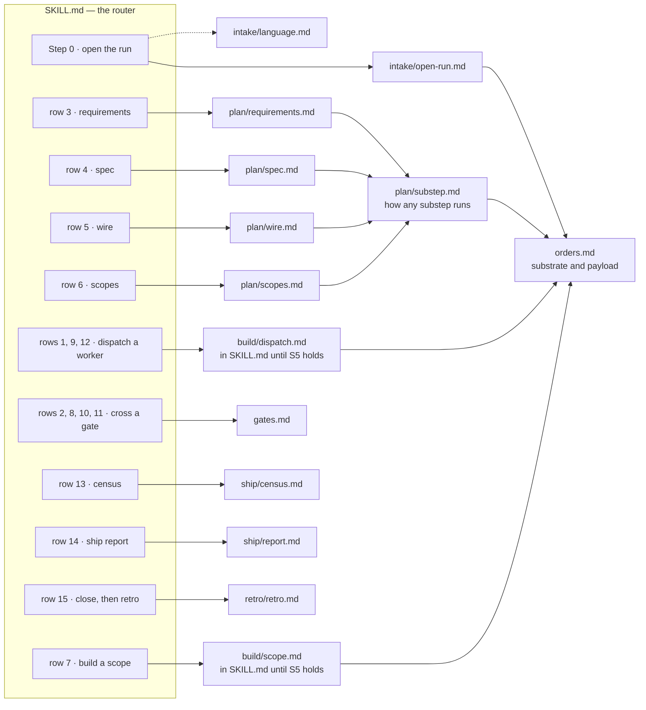
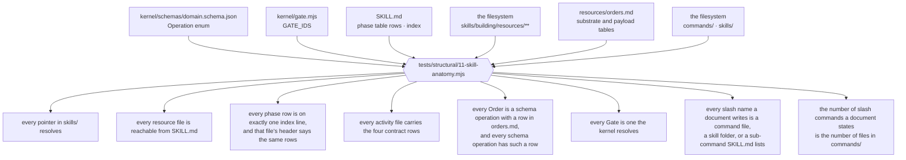
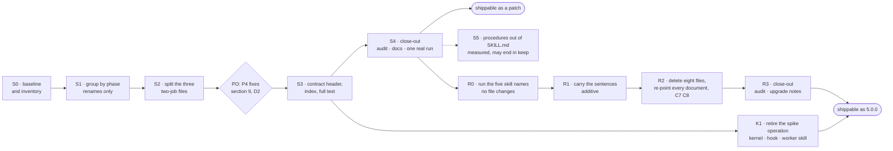

# Plan — the building skill's anatomy and the command surface: one router, one file per activity, two commands, checked by the suite

| | |
|---|---|
| **Date** | 2026-11-09 |
| **Baseline** | `da972b7` on `plan/single-loop` (4.0.0). `npm test`: 228 checks, 0 failures, run 2026-11-09. `skills/building/`: 43 markdown files, 5,103 lines (`find` and `wc -l`) |
| **Question** | The `building` skill carries the whole loop. Can it be cut into smaller, easier-to-manage parts on atomic-design lines without weakening what the runtime enforces? And which of the ten slash commands are still needed once it is? |
| **Answer** | Yes, inside the one skill. Not by splitting it into several skills. The five mechanisms live in `kernel/` and `hooks/` and no stage here touches them; what changes is where each instruction sits, and that the suite starts checking the skill's structure. Eight of the ten command files are a second name for a skill or for a `/ship` sub-command; they go in stages of their own (R0 to R3), and `/ship` and `/retro` stay |
| **Gate on every stage** | `npm test` green, the conservation check of section 6 clean, and `git diff --stat da972b7 -- kernel hooks agents bin` empty in every stage but K1, which exists to change them. `commands/` and `AGENTS.md` are untouched through S4 and change only in R1 and R2 |
| **Rule** | One stage per commit. A stage that only moves text changes no sentence; a stage that adds text removes none. S5 is a measurement and may end in "keep". The R stages start after S4 and start with an executed proof, not a deletion |
| **Quick view** | skill: [before](../../visualize/building-anatomy-before.svg) · [after](../../visualize/building-anatomy-after.svg) · commands: [before and after](../../visualize/building-commands-before-after.svg) |
| **Status** | **S0 to S4 and K1 executed on 2026-11-09**, each on the PO's go-ahead, on branch `plan/building-anatomy`: S1 `20d356d`, S2 `47f1658`, S3 `6ef95ea`, S3a `f8fdc33`, S4 `d7f08e2` and its run's trace `b382d85`, K1 `40f090f` and its session's trace `f47f0d6`. `npm test` is at 238 checks. **Every acceptance row passes, each in a fresh clone: 110 of 110** (S0 to S3a 65, S4 12, S4's run 9, K1 19, K1's session 5). S4's audit row was open until K1 closed the finding it waited on. Two real sessions were run on the consumer project: the planning half of envlint on the regrouped skill (section 4.8), and a scripted write through the fence on the tree without `spike`. S5 and R0 to R3 are not started. D2, D8 and D9 are decided; D10 is open. **No version is bumped and nothing is pushed** |

Every figure is derived from the tree at the baseline or labelled as a projection. Section 7 says what would change the answer.

> **Amended 2026-11-09**, the day it was written, on the PO's instruction that the commands no longer needed be planned for removal too. The change is listed here so it is not silent.
>
> | Was | Is | Why |
> |---|---|---|
> | Non-goal: "a new skill, command, agent, hook or kernel verb"; `commands/` and `AGENTS.md` frozen in every stage | Eight command files are removed in stages R0 to R3; `commands/` and `AGENTS.md` stay frozen through S4 only | section 1, P6 |
> | Ships as a patch on 4.0.0 | The S stages are a patch. The R stages remove published commands, which is a breaking change: one release, 5.0.0 (D8, decided by the PO on 2026-11-09) | the tag `v4.0.0` is on the remote (`git ls-remote`, 2026-11-09) |
> | Six checks, C1 to C6 | Eight: C7 (every slash name a document writes resolves) and C8 (the counted commands) | a removed command must not survive in a document |
> | `spike` with no order row: one of three defects waiting on D2 | Investigated on 2026-11-09 (section 4.7). No version of the plugin has ever written a `spike` order. A stage K1 is proposed to retire the operation; it is the one stage that touches `kernel/` and `hooks/` | 0 of 2,362 archived orders |

## 1. Problem

| # | Problem | Measured at `da972b7` |
|---|---|---|
| P1 | **The router also holds procedures.** `SKILL.md` is the file the loop obeys first, and three procedures live in it beside the phase table | 144 lines, of which lines 86 to 124 (39 lines) are `A dispatch`, `Build a scope` and `The breakers` |
| P2 | **One flat folder, and three files that do two jobs.** `resources/` holds 14 files side by side; nothing in a name says which phase reads it | `intake.md` is opening the run and the language gate (the `intake` sub-command points at "§2" of it); `plan.md` is the substep protocol and the `requirements` substep, while the other three substeps have a file each; `stop.md` is the census (phase row 13) and the ship report (row 14) |
| P3 | **Three ways to write a pointer, none of them checked.** Skill-root paths (`resources/orders.md`), paths relative to `resources/` (`plan-references/ddd-patterns.md`), and bare sibling names (`retro-scan.md`) | the path check in `tests/structural/08-shipped-set.mjs` scans `README.md`, `CONTRIBUTING.md`, `SECURITY.md` and `docs/`. It does not open `skills/` |
| P4 | **Defects that are already there, which no check sees.** Found by a throwaway scan on 2026-11-09 | `plan-references/contract-patterns.md` line 34 points at `assets/templates/contracts/`, a folder the skill does not have · four templates are named by no file in the skill: the three under `plan-templates/contracts/` and `task-spike.tmpl.md` (309 lines together) · `spike` is in the schema's `Operation` enum and `orders.md` has no substrate or payload row for it, so the loop has no template to write a spike order from |
| P5 | **An activity has no stated contract.** Which phase row runs it, which order it opens, which gate follows and what marks it done are spread over the phase table, `orders.md`, `gates.md` and the file itself | adding an activity means editing four places, and nothing fails when one is missed |
| P6 | **Ten commands, eight of them a second name.** Five only say "use the X skill", and the skill already answers to its own name. Three only say "use `building`'s sub-command". The two documents a user reads first disagree on the vocabulary | `commands/` holds 10 files, 198 lines. `shape`, `orient`, `build`, `eval`, `qa` (80 lines) each open with "Use the **X** skill on $ARGUMENTS"; `scopes`, `wire`, `hammer` (24 lines) name a `building` sub-command. `AGENTS.md` writes `/shapeup`, `/task-executor`, `/spec-evaluator`, `/qa-edge-hunter` where `README.md`'s table writes `/shape`, `/build`, `/eval`, `/qa` for the same four. `orient` is both `commands/orient.md` and `skills/orient/`, one name for two files; `claude plugin validate . --strict` passes without a word about it |

**What is not the problem: context cost.** The always-loaded file is 144 lines. `plan-references/` and `plan-templates/` are 3,616 of the skill's 5,103 lines (71 %) and are read only when a planning substep cites them. This plan saves close to no tokens and does not claim to. It buys navigation, a checked structure and a fixed place for the next activity.

## 2. Goals and non-goals

| # | Goal | Observable as |
|---|---|---|
| G1 | One activity per file, grouped by the phase that reads it | a file under `resources/<phase>/` answers one phase row or one sub-command |
| G2 | A pointer that dangles, or a file nothing points at, fails `npm test` | the new module `tests/structural/11-skill-anatomy.mjs` |
| G3 | Every activity file opens with the same four-row contract, checked against the phase table, the schema's `Operation` enum and the kernel's gate list | same module |
| G4 | No sentence is lost or reworded on the way | the conservation check, section 6 |
| G5 | The mechanisms are untouched | the empty `git diff --stat` in the header table |
| G6 | One name per thing a user can type: a command file exists only where it is an entry point that carries something no skill does | `commands/` holds `ship.md` and `retro.md`; C7 fails on a document that writes a slash name nothing answers |

Non-goals: fewer tokens; any change to the phase table's sixteen conditions; any reworded instruction; a new skill, command, agent, hook or kernel verb; any change to what `/ship` or a worker does once it is running.

**Not several skills.** The single-loop cut folded five skills into `building` two days before this plan, because every skill boundary was a handoff that lost state. The knowledge base still reads `tech-lead.md`, `ba-pitch-analyzer.md`, `scope-architect.md` and `solution-architect.md` as aliases of names that no longer exist (`resources/guidance.md`). Splitting again would add a skill load per hop to a loop the v4 report already measured as the dearer arm, would put several descriptions in competition for the same `/ship` trigger, and would still have to keep the literal `building` in three places: the `worker` of a `plan` order (`kernel/schemas/work-order.schema.json`), the knowledge-base reader name, and the skill folder the suite matches against the frontmatter.

## 3. Before


Dashed red boxes are what the plan moves: three procedures inside the router, and three files that each do two jobs.

```
skills/building/                               43 files · 5,103 lines
├── SKILL.md                                   144   rules · facts · phase table · A dispatch · Build a scope · The breakers · sub-commands · resume
└── resources/                                 14 files · 1,343 lines, flat
    ├── gates.md              76               how to put a gate to the PO
    ├── guidance.md           23               which knowledge-base file is read where
    ├── intake.md            157               opening the run  +  the language gate (§2)
    ├── intake-preservation.md 102             translation rules
    ├── orders.md             69               envelope · substrate per operation · payload per operation
    ├── plan.md               98               how a substep runs  +  the requirements substep
    ├── plan-spec.md         102
    ├── plan-wire.md          82
    ├── plan-scopes.md        95
    ├── rounds.md             78               rationale: a round, the attempt loop, the two breakers
    ├── stop.md              127               the census  +  the ship report
    ├── retro.md             225
    ├── retro-scan.md         49
    ├── retro-research.md     60
    ├── plan-references/      7 files · 1,773  the rules each planning phase follows
    └── plan-templates/       21 files · 1,843 one template per artifact
```

What the suite checks about the skill today, read from `tests/structural/02-agents-and-skills.mjs` and `08-shipped-set.mjs`:

| Checked | Not checked |
|---|---|
| the folder name equals the frontmatter `name`, and the description is longer than 40 characters | that a resource `SKILL.md` names exists |
| every kernel command an instruction names is in the routing table (the scan walks `skills/` recursively) | that a resource file is reachable from `SKILL.md` |
| no shipped file cites an internal defect id or a path into `tests/`, `docs/`, `tools/`, `evals/` | that every phase row has a procedure, and every procedure a row |
| every agent preloads a skill that exists | that every operation in the schema has an order template · that a gate an instruction names is one the kernel resolves |

## 4. After


### 4.1 The levels

| Atomic-design level | In this plugin | State |
|---|---|---|
| Atom | one kernel verb or hook: `init run`, `gate`, `order open` and `close`, `verify t0`, `verify envelope`, the fence | exists, executed by tests, **untouched** |
| Molecule | one activity: one file under `resources/<phase>/` that answers one phase row or one sub-command and opens with the contract | exists as prose; this plan gives it one file and one header |
| Organism | one phase: the folders `intake/`, `plan/`, `build/`, `ship/`, `retro/` | new grouping |
| Template | `SKILL.md`: rules, the facts table, the phase table, the index | exists; S3 makes its index checkable, S5 may take the procedures out |
| Page | one run on disk: `.shapeup/<slug>/` and `shapeup/<slug>/` | untouched |

### 4.2 Target tree

```
skills/building/                               47 files after S3 · 49 if S5 holds (projected)
├── SKILL.md                                   rules · facts · phase table · index            (S5: without the three procedures)
└── resources/
    ├── contract.md            NEW  S3         the four-row header every activity file opens with
    ├── orders.md              kept            the single source of every order's substrate and payload
    ├── gates.md               kept
    ├── guidance.md            kept
    ├── intake/
    │   ├── open-run.md        ← intake.md §1, §3 to §7
    │   ├── language.md        ← intake.md §2                                    S2
    │   └── preservation.md    ← intake-preservation.md
    ├── plan/
    │   ├── substep.md         ← plan.md without its Requirements section
    │   ├── requirements.md    ← plan.md "Requirements"                           S2
    │   ├── spec.md            ← plan-spec.md
    │   ├── wire.md            ← plan-wire.md
    │   ├── scopes.md          ← plan-scopes.md
    │   ├── references/        ← plan-references/   (7)
    │   └── templates/         ← plan-templates/    (21)
    ├── build/
    │   ├── round.md           ← rounds.md
    │   ├── dispatch.md        ← SKILL.md "A dispatch"                            S5
    │   └── scope.md           ← SKILL.md "Build a scope" + round.md "The attempt loop, per scope"   S5
    ├── ship/
    │   ├── census.md          ← stop.md without its ship-report section
    │   └── report.md          ← stop.md "The ship report"                        S2
    └── retro/
        ├── retro.md           ← retro.md
        ├── scan.md            ← retro-scan.md
        └── research.md        ← retro-research.md
```

`orders.md`, `gates.md` and `guidance.md` keep their paths on purpose. `orders.md` is cited by `kernel/verify/envelope.mjs` (a deny message), `CONTRIBUTING.md`, `.claude/CLAUDE.md`, the `task-executor` skill and the audit skill's ground-truth reference; leaving it in place keeps S1 out of `kernel/`.

### 4.3 Which file answers which phase row



Row 0 (the run has ended) stays in the router: it is one sentence and reads no file.

### 4.4 The contract every activity file opens with

Four rows, directly under the file's title. Every value is copied from a place that already states it; the header adds no new claim.

```markdown
# Plan — the wiring map

| Contract | |
|---|---|
| Phase | `5` |
| Order | `plan` · `wire` |
| Gate | `L1a.5` |
| Done when | `<run>/results/plan-wire.json` exists and names `<spec>wiring-map.md` |
```

| Row | Allowed values | Checked against |
|---|---|---|
| Phase | phase-table row numbers, `step 0`, or `sub-command` | the rows of the phase table in `SKILL.md`, and this file's line in the index |
| Order | an operation, with the substep for `plan`; or `none` for the acts that carry no order (census, ship report, retro, the language gate) | `Operation` in `kernel/schemas/domain.schema.json`, and a row for it in both tables of `orders.md` |
| Gate | a gate id, or `none` | `GATE_IDS` exported by `kernel/gate.mjs` |
| Done when | the file whose existence the phase table already tests | presence of the row; the wording is not asserted |

There is deliberately no "Writes" row. What an order-bearing activity may write is its row in `orders.md`, which the fence reads; a second copy in the header would be a second thing to drift.

The eight pointer lines that end `SKILL.md` today become the index: one line per activity file, giving its phase rows and its path. It is the same map, in a shape a test can read.

### 4.5 What holds the structure in place



The module reads artifacts and the shipped instruction against the thing it names. It asserts no wording, which is the suite's own rule. C1 to C6 land with the S stages; C7 and C8 land in R2, with the deletion they guard.

### 4.6 The commands


A command file earns its place when it is **an entry point a user starts from, carrying something no skill carries**. By that rule:

| Command | Lines | What the file is | Verdict | What the user types after |
|---|---|---|---|---|
| `/ship` | 63 | the entry point: the interactive default, `--auto`, `--unattended`, every launch flag and where it goes | **keep** | unchanged |
| `/retro` | 31 | `building`'s `retro` sub-command, and the one alias that is started outside a run: `--scan` and `--research` run before the first feature, and the installer prints it as the next step | **keep** (D7) | unchanged |
| `/shape` | 12 | "Use the **shapeup** skill" | remove | `/shapeup`, which is what `AGENTS.md` already writes |
| `/orient` | 11 | "Use the **orient** skill", under the skill's own name | remove | `/orient`, answered by the skill |
| `/build` | 29 | "Use the **task-executor** skill", plus a warning that a whole feature is `/ship` | remove | `/task-executor` |
| `/eval` | 16 | "Use the **spec-evaluator** skill", plus the Round Close warning | remove | `/spec-evaluator` |
| `/qa` | 12 | "Use the **qa-edge-hunter** skill" | remove | `/qa-edge-hunter` |
| `/scopes` | 4 | "Alias of `/ship plan`", stopping once Board Review is crossed | remove | `/ship plan` |
| `/wire` | 4 | "Alias of `/ship plan`", stopping after the wiring map | remove | `/ship plan`; the PO stops at Wiring Review |
| `/hammer` | 16 | `building`'s `stop` sub-command | remove | `/ship stop` |

Before: 10 files, 198 lines. After: 2 files, 94 lines plus the sub-command list `ship.md` gains in R1. Every name carries the `shapeup-sdlc-plugin:` prefix when typed, as today.

What the host's documentation says, read 2026-11-09 (the skills page and the plugin components page of the Claude Code docs): a skill is invoked directly with `/skill-name`, and a plugin's as `/plugin-name:skill-name`; `user-invocable` defaults to true; commands are "the older format, and skills supersede them for new work". Which file answers when a plugin ships a command and a skill under one name is **not documented** (the documented rule, "the skill", covers a project's own `.claude/` folders), and the validator is not documented to report it. That is why R0 executes the five names before anything is deleted.

**Sentences that live only in a command.** Removing a file must not remove an instruction. Read on 2026-11-09; the executor re-reads each file sentence by sentence in R1.

| File | Not found in its target | Goes to |
|---|---|---|
| `commands/build.md` | "Building a whole scoped feature is not this command" (the redirect to `/ship`); with no task id, take the next `ready` task and say which | `skills/task-executor/SKILL.md`, beside its standalone form |
| `commands/eval.md` | round mode crosses Round Close first, and a verdict over unfinished tasks is recorded as a `warn`; `--task` is not a way to assemble a round verdict | `skills/spec-evaluator/SKILL.md`, beside its two invocation forms |
| `commands/orient.md` | with no pitch or spec folder named, ask which feature | `skills/orient/SKILL.md` |
| `commands/qa.md` | with no PASS verdict yet, say so and stop | `skills/qa-edge-hunter/SKILL.md`, the preflight |
| `commands/shape.md` | a pitch that has not been bet on goes to the PO, not to a build | `skills/shapeup/SKILL.md` |
| `commands/scopes.md`, `commands/wire.md` | where `plan` stops | the Sub-commands lines of `skills/building/SKILL.md` |
| `commands/hammer.md` | nothing seen that `resources/stop.md` lacks; confirmed line by line in R1 | none expected |
| `commands/ship.md` (kept) | it names no sub-command at all today | gains one line listing `plan`, `stop`, `retro`, `intake` |

**One second name is left alone.** `building` also answers to its own name, so `/ship` and `/building` both open the loop. The skill's frontmatter could hide it from the menu (`user-invocable: false`); that is a change to the skill the loop loads first and is not in this plan.

**One thing is given up, and it is small.** `/wire` asked for planning to stop after the wiring map with nobody at the gate. After the removal a person stops there by answering Wiring Review; an unattended run has no flag for it. Adding one would be a new feature, which this plan does not do.

### 4.7 What the investigation of `spike` found

Asked on 2026-11-09, to let the PO answer D2: does the loop use the `spike` operation? Every figure below was read off
the tree, the git history or the archived runs on that date.

**There are two things called a spike, and only one of them runs.**

| | The Scout's spike | The `spike` operation |
|---|---|---|
| What it is | part of the `orient` operation: the Scout de-risks the single riskiest area and writes `orient/spike-<area>.md` | an order of its own to `task-executor`, to produce a decision document for a `SPIKE` task |
| Order row in `resources/orders.md` | yes, as `orient` | none |
| Phase-table row that dispatches it | row 1 | none |
| On record | 210 spike files across the archived runs | nothing |

**The record of the operation.**

| Looked at | Found |
|---|---|
| every archived order, in this repository's traces and the consumer project's (2,362 files, all parseable) | 0 with `"operation": "spike"`. By operation: `execute` 936, `plan` 358, `evaluate` 224, `orient` 198, `hunt` 129, `fix` 55, and the retired planning and census operations for the rest |
| a caller that asks for one, at `0081c38` (3.18.4) and at the tag `engine-measured` | none. The compiler had `case "execute": case "fix": case "spike":` for the substrate, so it could build one; no run script, probe or skill ever requested it |
| the `spikes/` workspace the substrate grants | never created, in any archived run. `spikesDir` in `kernel/lib/paths.mjs` has no caller |
| a `SPIKE` task on any board (1,036 task files) | 0. Every task file carries `type: task` |
| the trigger for a `SPIKE` task, an unverified third-party capability | never occurred: 160 contract files exist, none is a third-party contract with a `spike_status`, and no `api-feasibility.md` was ever written |

**Where the word still lives.** The `Operation` enum and two descriptions in `kernel/schemas/domain.schema.json`;
`BUILD_OPERATIONS` in `hooks/sandbox-guard.mjs`; two lines of `skills/task-executor/SKILL.md` ("SPIKE orders produce
a decision document"); `spikesDir`; and the `.shapeup/<slug>/spikes/**` entries of the `execute` / `fix` row in
`resources/orders.md`. The row for the operation itself was lost when the compiler was replaced by the order
templates: the `spike` case was not carried over, and nothing noticed, because nothing used it.

**And if a `SPIKE` task were generated today, no phase would run it.** The planner's rules say one MUST be generated
for an unverified third-party capability (`resources/plan/references/task-generation.md`). A scope takes its tasks
through their `use_case_refs`; the `SPIKE` template carries none. `Build a scope` dispatches `execute` or `fix`. The
worker's decision-document rule is keyed to the order's operation, not the task's type. What the loop does have is
Board Review, which already prints "any spike blockers" and asks "any spike to resolve before build?"
(`resources/gates.md`): an open spike reaches the PO there, and that is the only place it is handled.

**What this licenses:** the operation is vocabulary with no writer, in every version there is a record of. **What it
does not:** a claim that no consumer elsewhere writes one. There is one consumer project on record.

Three ways to answer D2 for `spike`:

| | What changes | Cost | What it leaves |
|---|---|---|---|
| **A. Keep it and write the row** | `resources/orders.md` gains `spike` beside `execute` / `fix`, the substrate the compiler gave it | one line in a skill resource; S3 can ship C5 at once | a template no phase asks for. The check goes green over vocabulary that is still dead |
| **B. Retire the operation** (chosen by the PO, 2026-11-09) | stage K1: the enum, the hook's set, the two worker lines, `spikesDir` and the `spikes/**` entries go. A `SPIKE` task stays a planner's task type and a Board Review blocker, which is what it is in practice | touches `kernel/` and `hooks/`, so it needs the cross-directory check and one nested session; removing an enum member is a breaking schema change and rides in 5.0.0 with the commands | one meaning of "spike" in the plugin: the Scout's |
| **C. Make it real** | a phase-table row that dispatches a `SPIKE` task as a `spike` order before the tasks it blocks | new loop behaviour, and no pitch on record that would exercise it | a feature nobody has asked for, unmeasured |

### 4.8 What S4's real run showed

One nested session, 2026-11-09: `claude -p` with a `git archive` of `d7f08e2` as the plugin, the envlint pitch, unattended
with the `ci` answer set, stopped once Board Review was crossed. Archived at `traces/v4/anatomy-s4-envlint-2026-11-09/`.
The host reported $3.53, 53 turns and 6 minutes of work; the session's model was `claude-opus-5-5` and the one worker,
`orient`, ran on `claude-sonnet-5-5`, which is what the launch record asked for. This is one run of one pitch.

**The loop followed the regrouped skill.** Gate rows L0, L1a, L1a.5 and L1b, each `ok` and `proceed`, the same as the last
archived run of this pitch. All four plan substeps opened an order and left a `done` result. The receipt names the archived
copy as the plugin that answered. These are the plan's exit line for S4, and they hold.

**Which plugin files the loop opened**, read off the session's tool calls. This is a measurement, not a row:

| Opened | Not opened |
|---|---|
| `resources/intake/open-run.md`, `resources/intake/language.md` | `resources/contract.md` |
| `resources/plan/substep.md`, `resources/orders.md`, `resources/gates.md` | `resources/guidance.md` |
| `resources/plan/requirements.md`, `resources/plan/spec.md`, `resources/plan/wire.md`, `resources/plan/scopes.md` | `resources/intake/preservation.md` (the pitch is English) |
| four of the 21 templates, and the first 80 lines of one of the 7 references | the other 17 templates and 6 references |

Every moved intake and plan activity file was opened, each before the work it governs. The loop never opened
`resources/contract.md`: the headers were read as part of each file and needed no explanation. It opened one reference of
the seven that `resources/plan/spec.md` names for its pipeline. That is not a result of the regrouping (there is no earlier
measurement to compare with), and it is worth knowing: the planning library is mostly not read on a small pitch.

**The loop also read the kernel to learn two formats.** It grepped `kernel/lib/contract.mjs` and the domain schema for the
project profile's fields and the scope contract's, and looked for an example in a test file, which exists only because the
copy was a whole tree. The resources did not give it what it wanted there. Not caused by this plan.

**A defect the run exposed, in the hooks, and not new.** While reading resources the loop ran `cd` into the plugin copy three
times, and the shell stayed there. The hooks take as the project root the nearest folder above the shell that has a run
pointer, a `shapeup/` folder or `.git`, and the plugin's own tree has a `shapeup/` folder. So for as long as the shell sat
in the copy, the hooks filed under the copy: 13 of the session's decision rows are in the copy's own ledger, not the run's,
and three writes were judged by the fence against a root that had no order pointer and allowed as "no tracked task
running". No order was live at those three moments, so nothing that should have been refused got through. With a live
order it would have. Two earlier copies in the consumer project carry the same stray ledgers, 17 and 5 rows, so earlier
runs did it too and it went unseen. A missing row is the signal, and this is what it looks like.

## 5. What not to do

1. **Do not create a second skill**, or rename `building`. Section 2 says why.
2. **Do not touch `kernel/`, `hooks/`, `agents/`, `commands/` or `AGENTS.md` in S1 to S4.** If a stage seems to need it, stop: the stage is wrong. `kernel/`, `hooks/`, `agents/` and `bin/` stay untouched in the R stages as well.
3. **Do not reword while moving.** A move and an edit in one commit cannot be told apart by the conservation check, and a "small clarification" to a loop instruction is a behaviour change nobody measured.
4. **Do not change a phase-table condition, a gate id, a kernel command line or the frontmatter description.** The description is the trigger; the test for it only checks length.
5. **Do not make a red check green by weakening it.** C2 and C5 are red on the baseline (P4). They land with the fix the PO picks in section 9, never with an exemption list.
6. **Do not rescale dated figures.** `report-v4-2026-11-08.md` says the skills tree holds 68 markdown files; that was true at its date. Leave it.
7. **Do not add the conservation script to the suite or to the shipped set.** It compares two commits; the suite sees one tree.
8. **Do not read a clean run as proof of the whole.** A run that reaches Board Review says the intake and plan files were found and followed. It says nothing about `ship/` or `retro/`.
9. **Do not delete a command before R0 has shown its replacement answers.** The claim "the skill is typed by its own name" is the host's behaviour, and it is settled by running it, not by reading about it.
10. **Do not delete a command file whose sentences have not been accounted for.** R1 moves; R2 deletes. One commit that does both hides a lost instruction inside a deletion.
11. **Do not leave a stub behind "for now".** D8 chose one release. A file that only says "renamed" is still a tenth name to keep true.
12. **Do not rename a skill to keep a short command name** (`task-executor` to `build`). The worker roster is a schema enum the kernel, the agents and every order carry.

## 6. Stages



**The conservation check, used by S1, S2 and S5.** Take every non-blank line of every `.md` under `skills/building/` at the stage's parent commit and at the stage's commit, as two multisets. Each line present in one and absent from the other must contain a path the move map of section 4.2 rewrites, or be a title line a split had to add. Anything else is a lost or reworded sentence, and the stage is not done. The executor writes the script (about 20 lines of Node, builtins only) into its run workspace.

### S0 — baseline and inventory (no shipped file changes)

| Do | Done when |
|---|---|
| Run `npm test`, `npm run demo`, `claude plugin validate . --strict` for the plugin and for `./.claude-plugin/marketplace.json`, and `npm run verify:cross-dir` | all pass, and the check count is recorded; `git status` is clean after `demo` |
| Write the conservation script and run it with both sides at the baseline | it reports zero differences (a script that cannot say "equal" proves nothing) |
| Write C2 (reachability) and C5 (operations) of section 4.5 on a scratch copy of `tests/structural/11-skill-anatomy.mjs` and run them against the baseline | C2 is red on exactly the four templates P4 names, C5 on exactly `spike`; a check that is red on anything else is wrong, not the tree |

### S1 — group the resources by phase (renames only)

| Do | Done when |
|---|---|
| `git mv` every file in the move map that has an arrow and no stage tag: the three retro files, `intake.md` → `intake/open-run.md`, `intake-preservation.md` → `intake/preservation.md`, `plan.md` → `plan/substep.md`, the three `plan-*.md`, `rounds.md` → `build/round.md`, `stop.md` → `ship/census.md`, `plan-references/` → `plan/references/`, `plan-templates/` → `plan/templates/` | `git diff -M --name-status` lists only renames and modifications, no add or delete, under `skills/building/` |
| Rewrite every pointer inside `skills/` to one form: a path from the skill root, `resources/<group>/<file>.md` | `grep` finds no `plan-references/`, `plan-templates/`, or bare `retro-scan.md`-style sibling name left in `skills/building/` |
| Update the two outside citations: the exemption path in `tests/structural/08-shipped-set.mjs` (`skills/building/resources/retro.md` → `skills/building/resources/retro/retro.md`), and the template folder named in the audit skill's `references/forbidden-content.md` | `npm test` green at the same check count |
| Add `tests/structural/11-skill-anatomy.mjs` to the runner with **C1 only** (every pointer resolves) | C1 is green and fails when one moved file is renamed back by hand |
| Conservation check | every differing line carries a rewritten path |

`contract-patterns.md` line 34 is left as it is in S1: C1 as written resolves `resources/…` pointers, and that line is a different defect, fixed in S3 with the PO's decision.

### S2 — split the three files that do two jobs

| Do | Done when |
|---|---|
| `plan/substep.md`: move the `Requirements` section out to `plan/requirements.md`, and name the four substep files where "The other three substeps" is today | `plan/` holds one file per substep plus the protocol |
| `ship/census.md`: move `The ship report` out to `ship/report.md` | phase rows 13 and 14 in `SKILL.md` point at different files |
| `intake/open-run.md`: move section 2 out to `intake/language.md`; the `intake` sub-command in `SKILL.md` points at the file, no longer at "§2" | no pointer in `skills/building/` names a section number of another file |
| Conservation check | every differing line is a rewritten path or one of three new title lines |
| `npm test` | green; C1 still green |

### S3 — the contract, the index, the rest of the test

D2 was answered on 2026-11-09: the two pointer fixes as written, and the `spike` operation retired in K1. So S3 fixes the pointers and ships C1 to C4 and C6; C5 lands in K1, with the change that makes it green.

| Do | Done when |
|---|---|
| Write `resources/contract.md`: the four rows, their allowed values, and the rule that a value is copied from the table that owns it | the file exists and is on the index |
| Add the contract header to each activity file: `intake/open-run`, `intake/language`, the four `plan/` substeps, `ship/census`, `ship/report`, `retro/retro`, `retro/scan`, `retro/research` | 11 headers; each value traced to the phase table, `orders.md` or `gates.md` in the commit message |
| Replace the eight pointer lines at the end of `SKILL.md` with the index: phase rows · activity · file. Rows the router still answers itself (0, and 1, 7, 9, 12 until S5) are listed as `this file` | every row 0 to 15 and step 0 is on exactly one line |
| Apply the two pointer fixes of D2: point `contract-patterns.md` at the three contract templates in `resources/plan/templates/contracts/`, and name `resources/plan/templates/task-spike.tmpl.md` from the planner's SPIKE Task Rules. `orders.md` gets no `spike` row: the operation is retired in K1 | C2 is green without an exemption |
| Add C2, C3, C4 and C6 to the module (C5 waits for K1) | each is green, and each is shown red once by a deliberate one-line break that is then reverted |
| Additive check: every line of the S2 tree is still present | no line removed except the eight pointer lines the index replaces |

### S4 — close-out

| Do | Done when |
|---|---|
| Run the `harness-maintenance-audit` skill, both passes | no doc drift and no leaked bookkeeping reported, or each finding fixed |
| `.claude/CLAUDE.md` and `CONTRIBUTING.md`: the "new worker skill takes 4 steps" rule gains the index line and, for an activity the loop does itself, the contract header | both name the same steps |
| `CHANGELOG.md` entry; `npm run demo` leaves `docs/assets/demo-gate.svg` unchanged; plugin and marketplace validation; `npm run verify:cross-dir` | all pass |
| **Gate: one real run** on the consumer project with `claude -p --plugin-dir <repo> --permission-mode acceptEdits`, through Board Review at least | the run's `gates.jsonl` carries the same gate rows, in the same order, as the last run of that pitch on the baseline; each of the four `plan` substeps left its result file; `decisions.jsonl` has rows from the fence |
| Version | the PO's call (D4); if bumped, `package.json` and `.claude-plugin/plugin.json` together |

The run through Board Review reads every moved intake and plan file. Taking it to Ship Sign-off also exercises `ship/`; `retro/` is exercised only by a retro.

### S5 — the three procedures leave `SKILL.md` (a measurement)

| Do | Done when |
|---|---|
| Move `A dispatch` to `build/dispatch.md`, `Build a scope` to `build/scope.md` together with `build/round.md`'s "The attempt loop, per scope", and `The breakers` into `build/round.md`. Each leaves one imperative line and a pointer in `SKILL.md`; the index lines for rows 1, 7, 9, 12 change from `this file` to the new files | conservation check clean; `SKILL.md` is about 105 lines (projected); `npm test` green |
| **Measure**: the same pitch, the same worker model by the dispatch receipts, one run on the S4 tree and one on the S5 tree | a comparison file with both runs' gate rows and dispatch receipts |
| Hold S5 to: every dispatch receipt is preceded by an `order open` decision row; no result applied without a `verify envelope` call; no gate skipped; no more attempts spent | all four hold ⇒ keep S5. Any one fails ⇒ revert the S5 commit, leave the procedures in `SKILL.md`, record why |

S5 moves the loop's most repeated procedure out of the file it loads first. The defects the v4 report records for the prose loop were skipped moves of exactly this procedure (an order opened before the schema check, a `cp` around the fence, a QA hunt the loop decided to skip). That is why it is measured and why it is last.

### R0 — run the names before removing anything (no shipped file changes)

Done on a `git archive` copy of the tree at another path, never in this checkout.

| Do | Done when |
|---|---|
| In the copy, give each of the five skills and `commands/orient.md` a first line that says to reply with one fixed word and stop: a different word per file | six sentinels, in the copy only |
| For each of `shapeup`, `orient`, `task-executor`, `spec-evaluator`, `qa-edge-hunter`: one `claude -p --plugin-dir <copy>` session that types `/shapeup-sdlc-plugin:<name>` | each prints its skill's word. The `orient` session's word also records which of the two files answers that name today |
| Record the table: name typed, file that answered | the table is in the run ledger. **Any skill name that does not answer ends the R stages for that command**; it is not worked around |

### R1 — carry the sentences that live only in a command (additive)

| Do | Done when |
|---|---|
| For each of the eight files, mark every sentence `present at <file>:<line>` or `moved to <file>`, starting from the table in section 4.6 | a ledger table with no unmarked sentence |
| Add the moved sentences to their targets, in the words they have today (a `/build` or `/hammer` inside one becomes the name that survives) | the five worker and shaping skills and `skills/building/SKILL.md` gain lines and lose none |
| `commands/ship.md` gains the sub-command line | it names `plan`, `stop`, `retro`, `intake`, the same four `skills/building/SKILL.md` lists |
| `npm test` | green; the ten command files are all still there |

### R2 — delete, and re-point every document

| Do | Done when |
|---|---|
| `git rm` the eight files | `commands/` holds `ship.md` and `retro.md` |
| `README.md`: the command table becomes the two commands and the six skills by name; "10 slash commands" and "the 9 phase commands" are recounted | C8 green |
| `AGENTS.md`: the Cut-List Review line names `/ship stop` alone. This is a product change: a consumer's spliced harness block takes it at their next `npx shapeup-sdlc init` | the one line; `/orient` there needs no edit, the skill answers it |
| `docs/quickstart.md` (`/build`, `/scopes`, `/hammer`), `docs/design/06-appendix.md` (the list of ten), the Sub-commands lines of `skills/building/SKILL.md` | no document writes a removed name |
| `docs/upgrading.md`: a section with the eight-row map of section 4.6, each row in the form the path check already treats as history ("Was `/hammer`") | the map is the only place the old names remain, with `CHANGELOG.md` |
| Add C7 and C8 to `tests/structural/11-skill-anatomy.mjs` | both green; C7 shown red once by writing `/hammer` back into `README.md`, then reverted |
| Re-run R0's five sessions against a copy of this tree | the same five words |
| `claude plugin validate . --strict`, plugin and marketplace | pass |

### R3 — close-out

| Do | Done when |
|---|---|
| `harness-maintenance-audit`, both passes | clean, or each finding fixed |
| `CHANGELOG.md`: a "Removed" entry naming the eight and pointing at the map | written |
| One nested session types `/shapeup-sdlc-plugin:ship` on a scratch project | the run's receipt exists: the entry point still opens a run |
| Version: 5.0.0, the next major (D8) | `package.json` and `.claude-plugin/plugin.json` both say 5.0.0, and the suite's manifest check agrees |

No real run is asked of the R stages beyond that session. They change what a person types to start a skill, and nothing a skill does once started.

### K1 — retire the `spike` operation (D2: chosen by the PO, 2026-11-09; executed the same day as `40f090f`)

The one stage that changes `kernel/` and `hooks/`. It runs after S3, which creates the module C5 is added to, and ships with the R stages in 5.0.0.

| Do | Done when |
|---|---|
| Remove `spike` from the `Operation` enum and from the two descriptions that name it in `kernel/schemas/domain.schema.json` | `verify envelope` refuses a fixture order whose operation is `spike`, naming the enum |
| Remove it from `BUILD_OPERATIONS` in `hooks/sandbox-guard.mjs`; delete `spikesDir` from `kernel/lib/paths.mjs` | `grep -rni spike kernel hooks` returns only lines about the Scout's spike |
| `skills/task-executor/SKILL.md`: the operation list loses `spike`, and the "SPIKE orders" bullet goes | the skill names the operations the schema has |
| `resources/orders.md`: the `execute` / `fix` row loses its two `.shapeup/<slug>/spikes/**` entries | the row grants nothing no order has ever used |
| Add C5 to `tests/structural/11-skill-anatomy.mjs`, both ways: every schema operation has a row in both tables of `orders.md`, and every operation `orders.md` names is in the schema | green, with no exemption; shown red once by putting `spike` back in the enum |
| Every order in this repository's archived traces is checked against the new schema | all validate: none used the member that went |
| `npm test`, `npm run verify:cross-dir`, and one nested session `claude -p --plugin-dir <repo> --permission-mode acceptEdits` that makes one fenced write | the suite is green, and the write's decision is in `decisions.jsonl`. A missing row means the hook failed to load, which fails open |

Not in K1: the planner's `SPIKE` task rules. They stay, with the template named by path in S3. What happens to an open
spike is already written down at Board Review.

## 7. What would change this plan

- **A resource pointer convention the host enforces.** If Claude Code starts resolving or validating a skill's resource links itself, C1 and C2 are redundant and S1's rewrite should follow the host's form.
- **`resources/` paths cited from a consumer's files.** The plan assumes no consumer project names a path inside the plugin's skill. The installer writes none (`bin/init.mjs` splices `AGENTS.md`, which names skills and commands only). A consumer who hand-wrote such a path would see it dangle after S1.
- **A second caller for a planning file.** If `orient` or `task-executor` starts reading `plan/references/`, that folder is shared and belongs at `resources/` root, not under `plan/`.
- **The S5 measurement coming back worse.** Then the router keeps its procedures, and the line "the template holds no procedure" is dropped from section 4.1 as not true of this plugin.
- **A skill name that is not typed directly.** If R0 shows `/shapeup-sdlc-plugin:task-executor` (or any of the five) does not load its skill, that command is the only way in and stays.
- **Completion that hides plugin skills.** `README.md` says the commands make the pipeline "learnable from `/`-completion alone". After the removal that list is the six skill names and two commands. If the host's menu does not list a plugin's skills, the short names were doing work this plan did not see, and the five skill aliases stay.
- **Usage nobody can see.** The plugin makes no network call, so there is no count of who types `/build`. The removal is decided on structure, not on use. A report from a consumer that a removed name is in their scripts is a reason to reopen D8 and take the two-release route, not to keep ten names.
- **A consumer that writes `spike` orders.** Section 4.7 read every order there is a record of and found none, across one consumer project. One report of a real `spike` order turns D2 from B to A: the row is written and the operation stays.
- **A pitch with an unverified third-party API.** It would be the first to generate a `SPIKE` task, and the first evidence of whether Board Review is enough to resolve one. If it is not, option C stops being a feature nobody asked for.

## 8. Risks and rollback

| Risk | Where it would show | Answer |
|---|---|---|
| A sentence lost in a move | conservation check | the stage is not done; nothing merges on a failed check |
| The loop fails to follow a pointer it used to find inline | S4's real run stops at a planning substep | the result file for that substep is missing, which the phase table already treats as "not done"; fix the pointer, re-run from the files |
| An installed copy mixes old and new files | not expected: an install is a copy of the tree at one version. Not verified from this checkout, which runs the plugin from its own working directory | S4's `npm run verify:cross-dir` fires from a `git archive` copy; a pointer that resolves there resolves in a marketplace clone |
| The header drifts from the tables it copies | C3, C5, C6 | red suite |
| The new module slows or flakes the suite | it reads about 50 files and executes nothing | no fixture, no child process |
| S5 lowers compliance | S5's four held conditions | revert one commit |
| A removed name is still typed, by a person or a script | the host answers `Unknown command`, at once and by name | `docs/upgrading.md` carries the map; the failure is loud, which is why no stub is left |
| An instruction is deleted with its command | R1's ledger, before R2 | R2 does not start with an unmarked sentence |
| A document goes on naming a removed command | C7 | red suite |
| A consumer's `AGENTS.md` keeps the old harness block | their file names `/hammer` until they re-run the installer | the upgrade note says to re-run it; `/ship stop` was already written beside it |

Rollback is `git revert` of the stage's commit, in reverse order. No stage writes outside the repository and none changes a consumer's files.

## 9. For the PO to decide

| # | Decision | Default if unanswered |
|---|---|---|
| D1 | Run S0 to S4 as proposed | **S0 to S4 and K1: approved by the PO and run, 2026-11-09.** |
| D2 | The three P4 defects. (a) `contract-patterns.md` line 34: point it at the three contract templates in `resources/plan/templates/contracts/`. (b) `task-spike.tmpl.md`: name it by path from the planner's SPIKE Task Rules. (c) The `spike` operation: A, B or C of section 4.7 | **Decided by the PO on 2026-11-09** ("B: gỡ trong 5.0.0"). (c) is B: the operation is retired in stage K1 and ships in 5.0.0, and C5 lands there. (a) and (b) had no objection and go in S3 as written |
| D3 | S5 at all | **not now.** It moves 39 lines out of a 144-line file for the price of two real runs, and carries the plan's only behaviour risk. Revisit when `SKILL.md` next grows |
| D4 | The version the S stages ship as | patch on 4.0.0: no command, gate, schema or hook changes |
| D5 | How far S4's real run goes | through Board Review |
| D6 | Which commands go | the eight of section 4.6: `shape`, `orient`, `build`, `eval`, `qa`, `scopes`, `wire`, `hammer`. R0 can take a name off this list; nothing adds one |
| D7 | `/retro` | **keep.** It is an alias of `/ship retro` like the three that go, but it is the one started outside a run, and the installer, `AGENTS.md`, the glossary and the upgrade guide all send the user to it. Removing it touches `bin/init.mjs`, which every other stage leaves alone |
| D9 | Found by S3's acceptance, 2026-11-09. `resources/plan/templates/feedback.tmpl.md` lines 75 and 76 told the planner to flag `references/[file].md` and `assets/templates/[file].tmpl.md`: both the layout of a skill that no longer exists | **Decided by the PO on 2026-11-09** ("Có, sửa") and done in `f8fdc33`: the two rows name `resources/plan/references/` and `resources/plan/templates/`. No acceptance row was loosened; the one red row moved to the stage that satisfies it |
| D11 | Found by K1's session, 2026-11-09. The fence's refusal, which is what a person reads when a write is denied, ends "(e.g. via ba --remap)" and opens "Sandbox guard (PA3)". There is no `ba` skill any more, and `PA3` is an internal label. The S4 audit did not catch either: its marker pattern has no shape for them | open. Two strings in `hooks/sandbox-guard.mjs`; fix them in the same stage as D10, and add the shape to the audit's pattern |
| D10 | Found by S4's run, section 4.8. When the session's shell sits inside a folder that looks like a project, the plugin's own tree included, the hooks file their decisions there and the fence looks for its pointer there | open. It is a change to `hooks/` and needs its own stage, with the fixture that reproduces it: a write, with an order live, from a shell inside a nested folder that has a `shapeup/` directory. Until then, a run whose loop `cd`s into the plugin is not fully fenced |
| D8 | How the removal is released. (a) Delete in one release, numbered as the next major, with the map in the upgrade guide. (b) Two releases: the eight become one-line files that name their replacement in a minor, and are deleted at the next major | **Decided: (a), by the PO on 2026-11-09** ("Một bản major"). The eight are deleted in one release, 5.0.0. A typed name that no longer exists fails at once and says so. Whether the S stages go out first as 4.0.1 or ride in 5.0.0 is still D4 |
