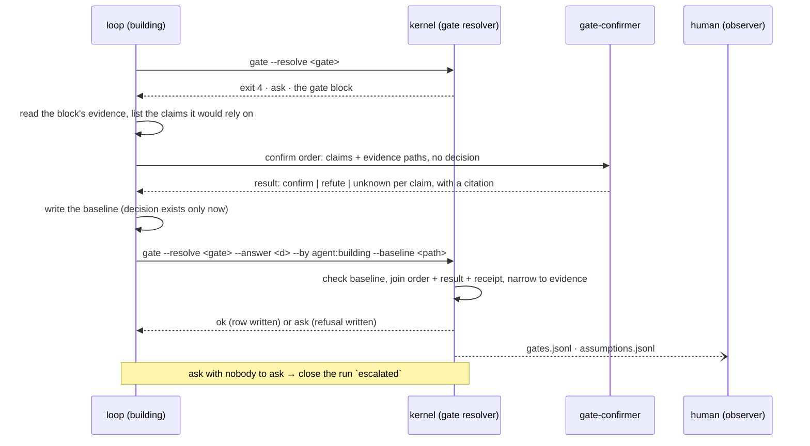
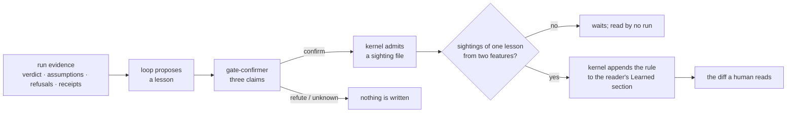

# Plan — human on the loop: an agent answers the gate from a confirmed baseline, the ledger names who decided, and a lesson two features confirm becomes a rule

| | |
|---|---|
| **Date** | 2026-11-11 |
| **Baseline** | `f44984f` on `plan/building-anatomy` (4.1.1). `npm test`: 245 checks, 0 failures, run 2026-11-11. Re-based the day it was written: the plan was first drafted against `6596157` (4.1.0, 241 checks), and 4.1.1 landed on the branch while it was being discussed. Section 4.10 says what that release changes here |
| **Question** | Can a run cross its gates with the human only watching, without the gate becoming a rubber stamp? |
| **Answer** | Yes, as a third decision source beside the two the resolver already has. A gate is answered by the loop, after the evidence exists, from a **baseline** file the resolver checks; every assumption in it was confirmed by a different agent whose dispatch the host attested; the ledger row names the decision maker and the confirmer. The evidence narrowing is untouched: an agent's answer, like a preset's, chooses among the answers the gate allows and supplies none of the evidence |
| **Gate on every stage** | `npm test` green; `claude plugin validate . --strict` clean; `npm run verify:cross-dir` green on any stage that touches `hooks/` or `kernel/lib/paths.mjs`; the three existing lanes resolve every gate exactly as at the baseline (section 6, the lane-parity check) |
| **Rule** | One stage per commit. Every stage is additive: no existing answer set, order, result or ledger row becomes invalid. A stage that fails its acceptance rows is not followed by the next one |
| **Status** | **Proposed.** Nothing is executed. Decided by the PO on 2026-11-11: D2 (an agent may cut, with confirmation) and D3 (the `eval` role's model). D1: the PO asked what the literature says about an agent learning from its own runs (section 4.8) and then decided the learning belongs in this plan, not the next one (section 4.9, stages S5 and S6). D4 to D7 are open |

Every figure is derived from the tree at the baseline. Section 7 says what would change the answer.

## 1. Problem

| # | Problem | Read at `f44984f` |
|---|---|---|
| P1 | **Both decision sources are a human, and one of them answers blind.** A gate resolves from `PO (live)` or from an answer set | `kernel/gate.mjs` builds the live answer at line 669 and discovers a set otherwise. The `ci` preset's answers were written before any run existed; its own note on Ship Sign-off reads "THIS is the one a reviewer should look at first" |
| P2 | **An unattended run's decisions carry no reasoning about the run they decided.** The note on a preset's row is the preset's, the same sentence on every run | `CI_NOTE` is one constant on five gates |
| P3 | **An assumption is invisible.** When the loop crosses a gate on something no artifact states, nothing records that it did | no ledger has a row for it. The answer-set schema reserves `escalation.default: assume-and-record`, declared inert, and `ci` sets it |
| P4 | **Nothing separates the agent that proposes from the agent that agrees.** The dispatch receipts attest which worker produced an artifact; no receipt attests that a second agent looked at a claim | the roster in `kernel/schemas/domain.schema.json` is four workers, none of which answers a question about a claim |
| P6 | **The receipt this design leans on has already gone missing once, unnoticed.** Until 4.1.1 a worker the host launched in the background left no dispatch receipt, and Ship Sign-off read the empty record as a clean one | the 4.1.1 changelog entry. Since that release a dispatched order no receipt names is listed in the gate's row as `models.unattested`, advisory, never a refusal |
| P5 | **Nobody can tell, from the ledger, that an agent decided.** `source` is free text: `PO (live)`, `preset:ci`, `file:…` | `appendGateLedger` writes `source` and `note`; there is no field for who decided |

**What is not the problem.** The gate order, the ten gates, the answers each allows, the evidence narrowing, the write fence, the T0 witness. No stage changes any of them.

## 2. Goals and non-goals

| # | Goal | Observable as |
|---|---|---|
| G1 | A gate can be answered by an agent only where a named human delegated it | an answer set carries `delegated`, a list of gate ids, beside `authorized_by`; an agent answer on a gate outside the list is refused |
| G2 | An agent answer needs a baseline the resolver has checked | `gate --resolve … --by agent:<name> --baseline <path>`; a missing or invalid baseline resolves to `ask` |
| G3 | Every assumption is confirmed by a different agent before the decision is written, and the trace survives | one row per assumption in `assumptions.jsonl`, written by the kernel from the confirm order, its result and its dispatch receipt, never by hand |
| G4 | The ledger names the decision maker | the gate row carries `decision_maker`, `confirmed_by` and the baseline's hash |
| G5 | A gate the agent cannot answer ends the run on a record, never a stall | the run closes `escalated` with the gate and the refusal as its cause; `/ship` over it resumes and the PO answers live |
| G6 | The three existing lanes behave exactly as before | the lane-parity check of section 6 |
| G7 | A run learns from itself without a human, and no rule becomes guidance on one run's word | a lesson is a confirmed sighting; a rule is appended to a reader's file by the kernel only when sightings from two different features agree (section 4.9) |

Non-goals: a new gate; a changed answer vocabulary; an agent that supplies evidence; a cut that no clause of the pitch supports (section 4.7); a rule reaching the live knowledge base on one run's word (D1, section 4.8); any claim that agent confirmation equals human review.

## 3. The four principles as fields

The baseline is one JSON file per gate crossing, in the run trace. Each principle is a field, and the table says honestly which half a script can hold.

| Principle | Field | What the resolver refuses | What stays judgment |
|---|---|---|---|
| **Simplify** | `decision` (one of the gate's allowed answers), `reason` (one sentence, capped), `rejected[]` (each other allowed answer, with why not) | a decision the gate does not take; a missing `rejected` entry for an allowed answer | whether the reason is the simplest true one |
| **Focus** | `evidence[]`: path and sha256 of each file the decision rests on | a path that does not exist; a hash that does not match the file on disk | whether those are the right files, and only those |
| **Minimize surgery** | `changes[]`: what the decision alters in the state already approved (a cut, a deferral, a waived bug). Empty by default | a change that names no confirmed assumption; a cut on the committed plan that `changes[]` does not list; at Cut-List Review, a list that differs from the census file's | whether a change that is listed was the smallest one |
| **Confirm before assuming** | `assumptions[]`: `id`, `claim`, and nothing else. The answer is not the loop's to write | section 4.3 | whether the loop listed every assumption it made |

The last cell is the residual risk of the whole design and section 8 carries it: a script can prove a listed assumption was confirmed; it cannot prove none was left out. Two things narrow it. The judgment gates require at least one assumption (section 4.3, B6). And the observer reads `assumptions.jsonl`, where a gate crossed on zero assumptions is one visible row saying so.

## 4. Design

### 4.1 The sequence at a gate



**The decision is written after the confirmation, not before.** When the confirmer runs, no file on disk holds the answer the loop is leaning towards, so the confirmer cannot be handed a conclusion to agree with. That ordering is the blind brief made structural; an instruction to "not read the baseline" would be a sentence nothing checks.

**The human can still answer any gate.** `PO (live)` is unchanged and outranks nothing: whoever resolves the crossing first writes the row. Watching is the default, not a lock.

### 4.2 The delegation

An answer set gains one optional key. Nothing else in it changes, and every file on disk today stays valid.

```json
{
  "version": 1,
  "preset": "on-loop",
  "authorized_by": "<the human who delegated>",
  "on_missing": "ask",
  "delegated": ["L0", "L1a", "L1a.5", "L1b", "L2", "L3", "QA", "H", "L4"],
  "answers": { "COACH-1": { "decision": "skip", "note": "Retro rules are the PO's to file; none is filed from an on-loop run." } }
}
```

- `--by agent:<name>` on a gate not in `delegated` exits 2. An interactive run's loop cannot start answering its own gates.
- A gate in `delegated` with no agent answer yet resolves to `ask`, exactly as an unanswered gate does today. That exit 4 is the loop's cue to start the sequence above.
- `gate --verify` treats a delegated gate as answered for the unattended lane, so an `on-loop` set is not reported as a stall.
- The launch record's auto level gains `on-loop`. It is `unattended` in every respect but one: the answer set is `on-loop`, not `ci`.

Retro Ownership is `skip` in the preset, the same answer `ci` gives it today, for the same reason (D1).

### 4.3 What the resolver refuses

Each refusal resolves the crossing to `ask`, writes the gate row with a `refused` field, and writes nothing to `assumptions.jsonl` that it has not verified.

| # | Refused when | Read from |
|---|---|---|
| B1 | the baseline is missing or fails `gate-baseline.schema.json` | the `--baseline` path |
| B2 | its `gate`, `run_id` or `round` is not this crossing's | the baseline, the run's receipt, `--round` |
| B3 | its `decision` is not `--answer` | both |
| B4 | an `evidence[]` path is absent, or its hash is stale | the files |
| B5 | an assumption has no confirm order of this crossing, or no result answering its id `confirm`, or no dispatch receipt for that order naming `gate-confirmer` with `dispatch_ok`. All three are needed: a receipt says the host launched the worker, a result says it answered, and neither says the other | `orders/`, `results/`, `receipts/dispatch.jsonl` |
| B6 | the gate is a judgment gate and `assumptions[]` is empty | the gates the `guarded` preset answers `ask`: Board Review, Cut-List Review, Ship Sign-off |
| B7 | the confirmer's receipt names a model below the floor, **or names no model at all** | the model the host resolved, on the receipt; `kernel/lib/floor.mjs` |
| B8 | a `changes[]` entry names no assumption this crossing confirmed, or its citation is not in the staged pitch or breadboard; a requirement marked `CUT (agent-confirmed)` or a Deferred Place that no entry lists; at Cut-List Review, a list that differs from the census | the baseline, `requirements.md`, the Deferred Places table, the census file |

After B1 to B8 the answer goes through `narrowToEvidence` unchanged. A baseline, however well confirmed, cannot make `ship` allowed over a census that does not clear.

**`refute` and `unknown` are both a stop.** A refuted claim may be answered by one revised claim set and one more confirm order per crossing; the second failure is an `ask`. The cap is the number, not a judgment: an agent that may re-ask until it hears yes has no confirmer.

### 4.4 The trace

`assumptions.jsonl`, in the run trace beside `gates.jsonl`, appended by the kernel at resolve time:

```json
{"at":"…","run_id":"…","gate":"L1b","round":null,"id":"A1",
 "claim":"REQ-7 is graded by an acceptance criterion in UC-03",
 "asked_by":"agent:building","confirmed_by":"agent:gate-confirmer",
 "answer":"confirm","citation":{"path":"shapeup/<slug>/spec/usecases/UC-03.md","sha256":"…"},
 "order_id":"<slug>/confirm-L1b-1","model":{"asked":"sonnet","ran":"…"},"attempt":1}
```

A crossing with no assumptions writes one row with `"id": null, "claim": null, "answer": "none-declared"`, so absence is a recorded fact and not a missing line.

The gate row gains three fields and loses none:

```json
{"gate":"L1b","status":"ok","decision":"proceed","source":"agent:building (delegated by <authorized_by>)",
 "decision_maker":"agent:building","confirmed_by":"agent:gate-confirmer","baseline_sha256":"…","assumptions":2}
```

For the two existing sources `decision_maker` is `human:<authorized_by>` or `human:PO (live)`, so the field is total and a reader never has to parse `source`.

### 4.5 The confirmer

A fifth worker, `gate-confirmer`, and a seventh operation, `confirm`. It follows the four-step rule for a worker: skill, schema fields and roster entry, agent definition preloading the skill, and its rows in the `building` skill.

- **Order in:** the gate, the claims (`id`, `claim`), and the evidence paths the claims are about. No decision, no recommendation.
- **Result out:** per claim `confirm`, `refute` or `unknown`, and a citation (path, hash, and the lines that settle it). A `confirm` with no citation is malformed.
- **Its instruction is to look for the refutation.** `unknown` is a correct answer and the skill says so.
- **Substrate:** its own result file. It reads; it writes nothing else, and the fence holds it to that.
- **Model:** the launch record's `eval` role. No new role in the matrix, so no launch record changes shape. In the resolver's worker-to-role map the confirmer gets a key of its own, read against the `eval` model: its receipts must not be counted as the judge's, and a confirm order no receipt names must show up as unattested like any other worker's.
- **Not `spec-evaluator`.** The judge grades a round, once; an agent that also answers the loop's questions about a gate is a second verdict under another name.

### 4.6 What the observer reads

- `gates.jsonl` and `assumptions.jsonl`, as they are written.
- The ship report gains a **Decisions** table: gate by its plain name, decision, decision maker, confirmer, assumptions confirmed of assumptions listed. The report is committed, so it carries the content and no run-trace path.
- A run that ended on a refusal says so in its close record: the gate, and which of B1 to B8.

### 4.7 A cut made by an agent (D2, decided 2026-11-11)

The PO's decision: an agent may cut a requirement or defer a Place at Board Review, with confirmation. A cut is the one change that makes a board green by removing what it was graded on, so it is the change held hardest.

- **A cut is a `changes[]` entry and an assumption, both.** `{ "kind": "cut" | "defer" | "waive", "target": "REQ-7", "assumption": "A2" }`, where A2 claims that a named clause of the pitch permits it: a no-go, a rabbit hole, or the appetite.
- **The confirmer's citation must land in the pitch.** A `confirm` that cites the plan, the board or the scope contracts is not a confirmation of a cut: those are the loop's own work. B8 checks the path against the staged pitch and breadboard, which the planning fence already freezes.
- **The marker is its own.** `CUT (agent-confirmed)` joins the requirement status enum in `kernel/schemas/domain.schema.json` beside `CUT (PO-approved)`. A reader of `requirements.md` never mistakes one for the other, and the planning read-back accepts both.
- **A cut nobody listed is refused.** B8 reads the committed plan: every `CUT (agent-confirmed)` row and every Deferred Place must be a `changes[]` entry of this crossing.
- **The ship report's first lines name them.** The Decisions table lists each cut with the pitch clause it rests on, above the Requirements table, so "shipped" is never read without "minus these".

What this does not hold: a pitch clause loose enough to permit a cut the PO would not have made. Two agents of one model can agree on a generous reading, and the first place a human meets it is the report (section 8).

### 4.8 Learning from its own runs — what the literature says

Five findings, each with what it means here. The numbers are the papers' own; where a figure was read from a secondary summary and not the paper, it is left out.

| Finding | Source | What it means for the retro |
|---|---|---|
| Insights extracted in natural language from past trials, kept across tasks, improve later runs with no weight update | ExpeL (Zhao et al., AAAI 2024, arXiv:2308.10144) | the knowledge base is already this shape; the missing part is extraction with no human |
| Failures are as useful a source as successes, and the agent's own judgment of which was which can stand in for labels | ReasoningBank (Ouyang et al., ICLR 2026, arXiv:2509.25140) | this harness has better than self-judgment: the judge's verdict, the T0 witness, a confirmer's `refute`, a gate refusal. A rule should rest on one of those, never on the loop's opinion of its own run |
| A model rewriting its own context repeatedly collapses it: detail is lost and accuracy can fall below no adaptation at all. Splitting generation, reflection and curation, and merging small deltas by non-model logic, avoids it | ACE (Zhang et al., ICLR 2026, arXiv:2510.04618) | a rule is a delta the kernel appends. No agent ever rewrites a knowledge-base file |
| An agent follows a retrieved experience closely, so a wrong record is copied and amplified; checking an entry before it is stored is the mitigation that worked | Xiong et al., arXiv:2505.16067 | admission, not retrieval, is where to spend the check |
| An agent can be led, through ordinary inputs, to write a harmful record into its own memory | MINJA (arXiv:2503.03704) | a rule's evidence must be a run artifact with a hash, never text that arrived in a pitch or a fetched page |

What none of them solves for this setting: attributing a later run's outcome to a rule. The design below uses recurrence because recurrence needs no attribution.

### 4.9 Learning on the loop (D1, decided 2026-11-11: in this plan)

**Learn on probation, promote on recurrence.** One run can only produce a *sighting*. A *rule* is what two different features both saw.



**No gate is added and no answer changes.** Retro Ownership is the PO deciding which skill owns a piece of the PO's feedback; an on-loop run has no such feedback and answers it `skip`, as `ci` does. Learning is a separate act of the loop with no decision in it that a gate could hold: the one thing that makes guidance, promotion, is arithmetic the kernel does.

**It runs before every close, not only a ship.** The retro skips a run that ended `escalated` or `aborted`. Those are the runs with the most to teach, so the learn activity runs before the close whatever the status, while the run is still open and a confirm order can still be dispatched.

**A lesson.** Written by the loop, one file per lesson, in the run trace:

| Field | Holds | Checked by the kernel at admission |
|---|---|---|
| `reader` | `task-executor`, `plan`, `orient` or `qa-edge-hunter` (D6) | one of the four |
| `rule`, `why` | one sentence each, capped | length |
| `evidence` | `kind`, a path in this run's trace, its sha256, and the excerpt that shows it | the path is inside this run's ledgers, verdicts, results or receipts; the hash matches; the excerpt is in the file. A path into the pitch, the breadboard or anything fetched is refused |
| `same_as` | the id of an earlier sighting this one repeats, or null | that sighting exists |

`kind` is one of: a criterion graded FAIL and later PASS; an assumption a confirmer refuted; a gate refusal; a scope that exhausted its attempt budget; a QA finding with a repro. Each is a signal some party other than the loop produced.

**Three claims per lesson**, in one confirm order, with the lesson's evidence and no recommendation:

1. the excerpt shows what the rule says it shows;
2. the rule adds a check, a question or a habit, and does not answer, skip, reorder or relax a gate, widen a substrate, or touch a probe, a fixture or a hill;
3. when `same_as` is set, the two sightings are one lesson. `refute` or `unknown` here admits the sighting with `same_as: null`; it does not discard it.

Claims 1 and 2 must both come back `confirm`, joined to a dispatch receipt by the same function that checks an assumption (B5, B7).

**A sighting.** The kernel writes one file per admitted lesson under `shapeup/knowledge-base/sightings/`, named by run and ordinal, never appended to or edited. One file per sighting is what lets two teammates' runs land on one branch with no merge conflict, and it is why recurrence can count a colleague's feature as the second. The file carries the lesson, the run's id, the intake's digest, the confirmer and both models, and the excerpt, since the trace it came from is gitignored and will not be there on the next machine. No run reads this folder as guidance.

**Promotion.** `learn --promote` groups sightings through `same_as` and promotes a group that spans **two different intake digests** (D7). Two runs of one feature are one feature seeing itself twice and count once. Promotion appends one line to a `## Learned` section of `shapeup/knowledge-base/<reader>.md`:

```markdown
## Learned
- **KB-TE-L001** — <rule>. _(why: <reason>)_  ·  from recurrence (<run_id>, <run_id>)
```

- **The kernel is the only writer of that section**, and it only appends or removes a whole line by id. The retro already keeps its lineages apart ("a rewrite of one never touches the other two"); recurrence is a fourth, and the retro's consolidating rewrite leaves it alone.
- **No read-side change.** Each reader already loads its own file.
- **A cap of five learned rules per reader** (D7), separate from the retro's fifteen. At the cap a promotion is refused and the group waits; nothing is rewritten to make room.
- **Retirement is a command**, `learn --retire <id> --why "…"`, that removes the line and writes a tombstone sighting. A human runs it, or the PO's `/retro` does.

**A mechanism at fault is not a lesson.** When the evidence blames a hook, a gate or two contracts that disagree, the lesson's reader is `harness-defect` and its sighting is appended to the defect register at once. The register is read by no reader, so nothing waits on recurrence.

**What the observer gets.** The ship report's Decisions section gains three lines: sightings admitted by this run, rules promoted by it, and any learned rule whose own lesson was sighted again *after* promotion. The last is the only effect signal this design has, and it is only a flag: a rule that keeps being re-learned is not working, and whether to retire it is a human's call.

**What stays out.** `building`: a learned rule there would add checks to gates the same agent now answers, which is the loop editing its own decision procedure (D6). `Suggested run config`: a value there is confirmed with the PO at Intake & Config, and recurrence is not a PO. `spec-evaluator` and the census, as today.

### 4.10 What 4.1.1 changes here

The release fixed a hole in the mechanism this plan builds on, and the fix is evidence about how that mechanism fails.

- **A receipt can be absent for every dispatch of a run and nothing stops.** That is what was measured before the fix. Ship Sign-off now writes the absence down and still does not refuse, which is right for a gate a human reads.
- **A confirmation is the opposite case.** The receipt is not corroboration of a decision a human made; it is the whole of the second agent's standing. So B5 and B7 refuse where Ship Sign-off advises: no receipt, or a receipt with no model, is `ask`. The cost is honest and visible: on a host that stops reporting, every on-loop gate escalates. That is the lane telling the truth about what it can prove.
- **A background launch is attested at launch.** The host's result arrives before the worker has done anything. A receipt alone therefore proves a confirmer was started, never that it answered, which is why B5 names three files and not one.
- **Reading the hook was not enough to know this.** The defect was found by a measured run. S0 therefore fires one real nested dispatch and reads the row, before any stage depends on what the row holds.

## 5. What not to do

- **Do not soften B5 or B7 to an advisory because Ship Sign-off's version is one.** An unattested confirmation is an unconfirmed assumption.
- **Do not let `--by` be self-declared authority.** Without `delegated` in a human-authored set, the flag is refused. The delegation is the human's signature; the baseline is the agent's work.
- **Do not let an agent rewrite a knowledge-base file to add what it learned.** A rule is one line the kernel appends. Repeated rewriting by a model is the collapse section 4.8 cites, and it would also let one run's wording displace another's.
- **Do not count a feature twice.** Recurrence is over intake digests, not runs; a resumed or re-opened run of one feature is one witness.
- **Do not let the loop write a confirmation.** The loop writes claims. Answers come from a result file behind a dispatch receipt, joined by the kernel.
- **Do not activate `assume-and-record`.** It is the opposite of the fourth principle. When worker-raised questions are built, the value to build is confirm-then-record, and that is a later plan.
- **Do not add a per-gate list of allowed evidence paths yet.** It would be a second copy of what `resources/gates.md` says each gate reads, and nothing has shown the need. B4 checks existence and hash; section 7 says what would add the list.
- **Do not rescale or reuse a measured number.** No acceptance or confirmation rate goes into a document until a dated run with a named model produced it.
- **Do not weaken an existing check to make room.** The empty-board refusal, the census read and the model floor fire on an agent's answer as they do on a preset's.

## 6. Stages

```mermaid
flowchart LR
  S0["S0 · baseline, lane parity,<br/>two experiments"] --> S1["S1 · baseline schema,<br/>`delegated` key"]
  S1 --> S2["S2 · the confirmer worker<br/>and the `confirm` operation"]
  S2 --> S3["S3 · the resolver's agent path,<br/>B1–B8, the two ledgers"]
  S3 --> S4["S4 · the loop's guidance,<br/>the `on-loop` lane"]
  S4 --> S5["S5 · the kernel's `learn` verb:<br/>admit, promote, retire"]
  S5 --> S6["S6 · the loop's learn activity,<br/>before every close"]
  S6 --> S7["S7 · documents, audit"]
  S7 --> S8["S8 · real runs,<br/>and the probes that must fail"]
  S8 --> REL(["release: the PO's word"])
```



**The lane-parity check, used by S1 to S7.** A script in the executor's workspace resolves all ten gates under `ci`, `guarded` and `interactive`, and with a live `--answer`, against one fixture run, and records exit code, `status`, `decision` and `source` per crossing. Its output at a stage's commit must equal its output at the baseline, apart from the added `decision_maker` field from S3 on.

### S0 — baseline, fixture and two experiments (no shipped file changes)

The two experiments are the assumptions this plan would otherwise meet in its last stage. Both are cheap, neither needs a line of kernel code, and either one failing changes the design, so they run first.

| Do | Done when |
|---|---|
| Run `npm test`, `npm run demo`, `claude plugin validate . --strict` for the plugin and the marketplace file, `npm run verify:cross-dir` | all pass; the check count is recorded; `git status` is clean after `demo` |
| Write the lane-parity script and run it twice at the baseline | the two outputs are identical (a script that cannot say "equal" proves nothing) |
| Read how the launch record's auto level selects an answer set, how a dispatch receipt keys its order, and which phase row closes a run | each is written into this plan as file and line, or the section that assumed otherwise is corrected |
| **Experiment 1, the receipt.** From a `git archive` copy at another path, drive one nested headless session that dispatches a throwaway fifth agent type against a scratch project | a receipt row exists for the order, names that agent, and carries a model. A row with no model, or no row, is recorded as found and section 7 applies |
| **Experiment 2, the confirmer.** With a throwaway agent definition carrying the brief of section 4.5, put at least six claims to it over a fixture run: half true, half false in ways a careless reader would pass (a requirement no criterion grades, a hash that is stale, a citation that says the opposite) | every false claim comes back `refute` or `unknown`, and no true one comes back `refute`. The model, the date and the count go into this document. A false claim confirmed re-opens D3 before S1 starts |

### S1 — the baseline schema and the delegation (additive)

| Do | Done when |
|---|---|
| Add `kernel/schemas/gate-baseline.schema.json` (section 3's fields) | a valid and five invalid fixtures behave as named in a new block of `tests/structural/06-gate.mjs` |
| Add `CUT (agent-confirmed)` to the requirement status enum | the planning read-back's fixtures accept it; no existing `requirements.md` fixture changes |
| Add optional `delegated` to the answer-set schema and to `validate()`; add `on-loop` to the preset enum and to `PRESETS` | every answer set fixture in the suite still validates; `gate --list --preset on-loop` prints the set |
| No resolver behaviour changes | lane parity clean; `--by agent:x` is still just the `--init` author string |

### S2 — the confirmer (the four-step rule)

| Do | Done when |
|---|---|
| `skills/gate-confirmer/SKILL.md`; `gate-confirmer` in `WorkerName` and `confirm` in `Operation`, with the order payload and result fields; `agents/gate-confirmer.md` preloading the skill; its substrate and payload row in `resources/orders.md` and its line on the `building` index | `npm test` green, including the roster and skill-anatomy modules reading the new member from the schema |
| A `confirm` order for a fixture claim passes the envelope check; one without `claims` is denied | executed against the hook, not read from it |
| Nothing dispatches it yet | lane parity clean |

### S3 — the resolver's agent path (the kernel stage)

| Do | Done when |
|---|---|
| `--baseline <path>` in `ARGV_SPEC`; `--by agent:<name>` with `--resolve --answer` builds the agent source; refuse when the gate is not `delegated` | exit 2 with the gate named |
| A key for the confirmer in the resolver's worker-to-role map, read against the `eval` model | a confirm order with no receipt appears in `models.unattested`; a confirmer receipt is not counted under the judge's role |
| B1 to B8 as one exported function beside `narrowToEvidence`, applied before it | one test per refusal, each from a fixture run that is valid but for that one fault |
| `assumptions.jsonl` through a new resolver in `kernel/lib/paths.mjs`; `decision_maker`, `confirmed_by`, `baseline_sha256`, `assumptions` on the gate row | a full fixture crossing writes both; a refused one writes the gate row with `refused` and no confirmed assumption row |
| `gate --verify` counts a delegated gate as answered | an `on-loop` set verifies for the unattended lane |
| `npm run verify:cross-dir` | green |

### S4 — the loop's guidance and the lane

| Do | Done when |
|---|---|
| A shared resource in the `building` skill for answering a gate on the loop (the sequence of 4.1, the four principles, when to close `escalated`), linked from `resources/gates.md` and listed on the index | the skill-anatomy module finds it reachable |
| `on-loop` as an auto level in the launch record and in `resources/intake/open-run.md`; the model floor and roster preflight cover the confirmer | opening a fixture run with `--auto-level on-loop` writes the record; opening it with the confirmer's skill removed is refused at preflight |
| The ship report's Decisions table in `resources/ship/report.md` | a fixture report renders it from the two ledgers |

### S5 — the kernel's `learn` verb

| Do | Done when |
|---|---|
| A lesson schema and a sighting schema in `kernel/schemas/`; `learn --admit <lesson>`, `--promote`, `--retire <id>` as one kernel verb; the sightings folder through `kernel/lib/paths.mjs` | each has a test from a fixture run in a new structural module |
| Admission reuses S3's join of order, result and receipt, and refuses evidence outside the run's own ledgers | a lesson citing the staged pitch is refused; one citing a verdict with a stale hash is refused |
| Promotion groups by `same_as` and counts distinct intake digests | two sightings from one digest promote nothing; two from two digests append exactly one line; a sixth promotion for one reader is refused |
| Appending and removing a line leaves every other byte of the reader's file as it was | a byte comparison of the file outside the changed line |
| `npm run verify:cross-dir` | green |

### S6 — the loop's learn activity

| Do | Done when |
|---|---|
| One activity file under `resources/retro/` opening with the four-row contract, its line on the index, and the phase row that reaches it before the close; S0 names that row | the skill-anatomy module reads the three against each other |
| The lesson's three claims as a payload of the `confirm` order in `resources/orders.md` | an order carrying them passes the envelope check |
| `resources/retro/retro.md` names recurrence as the fourth lineage and says its rewrite leaves `## Learned` alone | the sentence is there, and no other sentence of the retro changes |
| The ship report's three learning lines | a fixture report renders them |

### S7 — documents and audit

| Do | Done when |
|---|---|
| `AGENTS.md`: the gate resolver's paragraph gains the agent source and the confirmation trace; the "Who answers" column and the Setup section say what on-loop delegates; the worker and operation counts are re-derived | gates are named by plain name throughout; the ids stay in the one table |
| `README.md`, `docs/glossary.md`, `docs/upgrading.md`, the changelog | each new term has one definition |
| Run `harness-maintenance-audit` | both passes clean, or its findings are fixed in this stage |

### S8 — real runs, and the probes that must fail

This is the cheap check a candidate can be held to. It is evidence about the phases it reaches and silence about the rest.

| Do | Done when |
|---|---|
| From a `git archive` copy at another path, drive one nested session on the consumer project in the `on-loop` lane, with `delegated` holding only the gates the `guarded` preset already pre-approves and Board Review | the run crosses at least Board Review with `decision_maker: agent:building`, and each assumption row joins to a receipt naming `gate-confirmer` with a model |
| Widen `delegated` to Cut-List Review and Ship Sign-off only after that run's rows have been read | a second run, or a recorded decision not to widen yet |
| Record three numbers per run: gates crossed by the agent against gates that escalated; cuts made; confirm dispatches and their tokens from the receipts | in the dated section below, each with the model and the date. None is a rate until more than one run stands behind it |
| Probe 1: delete the confirm result before resolving | `ask`, B5, and the run closes `escalated` |
| Probe 2: resolve with `--by agent:building` under the `guarded` preset | exit 2 |
| Probe 3: an on-loop `ship` over a census that does not clear | `ask` from the existing narrowing, whatever the baseline says |
| Probe 4: a cut whose confirming citation is a scope contract, not the pitch | `ask`, B8 |
| One real sighting: a run on the consumer that ends, shipped or escalated, with an admitted lesson | one sighting file, joined to a receipt. Promotion is proved on fixtures in S5; a second real feature promoting it is recorded when it happens and is not waited for |
| Probe 6: the first feature run twice | no promotion |
| Probe 7: a lesson whose rule answers a gate ("cross Round Close when the build is green") | claim 2 comes back `refute` or `unknown` and nothing is admitted; a `confirm` is a finding of section 7's kind |
| Probe 5: a planted false claim in a confirm order | the confirmer answers `refute` or `unknown`; a `confirm` is the finding section 7 names |
| Record what the run showed in this document, including anything it did not reach | a dated section, with the model that ran |

## 7. What would change this plan

- **Experiment 1 of S0 finds no receipt, or a receipt with no model, for a fifth agent type in a nested headless session.** Then S2 does not start, and the confirmer becomes a second dispatch of an existing worker type under a new operation, which costs the role separation of 4.5 and needs the PO's yes.
- **S8 shows baselines citing files a gate has no business reading.** Then the per-gate evidence roots of section 5 are added, as one table the resolver and `resources/gates.md` both read.
- **The confirmer answers `confirm` to a planted false claim** in experiment 2 of S0, or in probe 5 or probe 7 of S8. Then the design's central assumption is wrong for that model, and the lane does not ship until the confirm order runs on a different model than the loop's, recorded on the row.
- **Most on-loop runs end `escalated` at one gate.** Then the human is still in the loop, only later, and that gate's refusals are read before anything is loosened: a refusal that keeps firing on honest work is a defect in the check, and one that keeps firing on weak baselines is the check working.
- **A run needs more than one revision per crossing to get through honestly.** Then the cap of 4.3 is a launch-record number, not a constant.

## 8. Risks and rollback

| Risk | What holds it | What does not |
|---|---|---|
| The loop leaves an assumption out | B6 on the judgment gates; the `none-declared` row; the observer | nothing mechanical proves completeness |
| The confirmer agrees because it is the same model | the decision does not exist when it runs; it is asked for the refutation; both models are on the row | correlated error between two runs of one model |
| The loop reads `refute` as licence to rephrase until yes | one revision per crossing, counted by the kernel from the orders | a rephrasing that is honestly a different claim |
| Two agents agree on a generous reading of the pitch and cut what the PO wanted | the citation must be in the pitch; the marker is distinct; the report names every cut in its first lines | the reading itself. A human meets it after the fact |
| The host stops reporting a receipt or its model | B5 and B7 turn every on-loop gate into `ask`; the run escalates and says why | the lane is unusable until the host reports again. Deliberate |
| The lane escalates so often it saves no attention | the three numbers of S8; `delegated` widened one step at a time | unmeasured until S8 |
| Cost: one more dispatch per gate | one order carries all of a crossing's claims | a run with ten gates pays about ten confirm dispatches; unmeasured until S8 |
| A wrong lesson becomes a rule | evidence from a party other than the loop; three confirmed claims; two features; five per reader; a diff a human reads | two features that share one bad habit will agree with each other |
| The same lesson is not recognised the second time | the confirmer answers `same_as`; an unrecognised repeat is still admitted and can be matched later | a rule that is true and never promoted. It errs on the quiet side on purpose |
| An existing lane changes behaviour | lane parity on every stage | — |

**Rollback.** Every stage is additive and one commit. Reverting S6 removes the learn activity and leaves the sightings on disk, inert. Reverting S4 removes the lane and leaves the resolver's agent path unreachable from the loop; reverting S3 leaves a worker nothing dispatches. No ledger written by a later stage is unreadable to an earlier one.

## 9. For the PO to decide

| # | Decision | Recommended | Why |
|---|---|---|---|
| D1 | Does an on-loop run learn from itself? | **Decided 2026-11-11: yes, in this plan.** Section 4.9, stages S5 and S6 | the PO's decision. The recommendation had been a plan of its own after the first real run |
| D2 | May an agent cut a requirement or defer a Place at Board Review? | **Decided 2026-11-11: yes, with confirmation.** Section 4.7 | the PO's decision. The recommendation had been to escalate |
| D3 | Which model answers a confirm order? | **Decided 2026-11-11: the `eval` role's** | no new role in the launch record. Section 7 names what would force a different one |
| D4 | The name of the lane and preset | `on-loop` | it says where the human is |
| D5 | The release number | 4.2.0, on top of 4.1.1 | additive: one worker, one operation, one preset, one kernel verb, no removal. The lane is usable after S4, so a release there and the learning in the one after is open to the PO without rewriting a stage |
| D6 | May a learned rule be filed under `building`? | **No, in this version** | it would add checks to the gates the same agent answers. The PO's `/retro` can still file one |
| D7 | The two numbers: features needed to promote, and learned rules per reader | 2 and 5 | two is the least that is not one run's word; five keeps a reader's file inside what it already loads. Both are constants until a run shows they are wrong |
