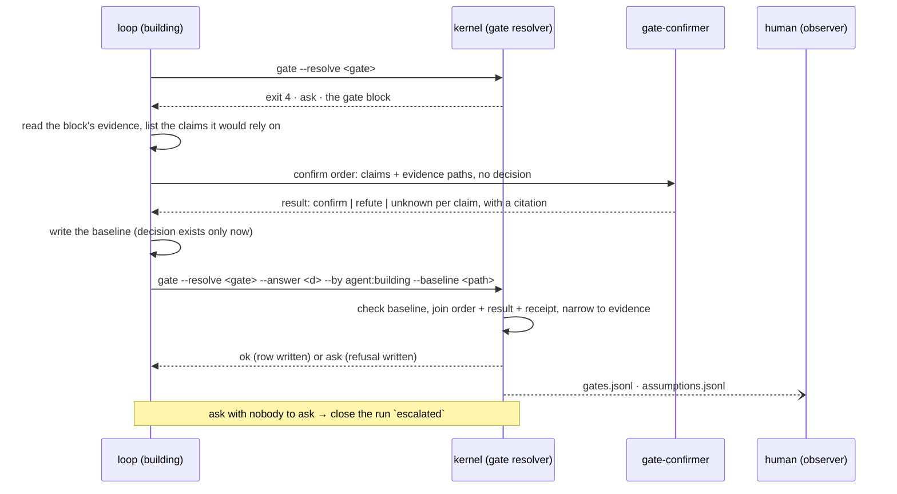
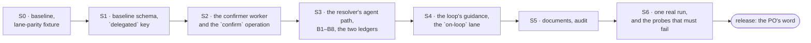

# Plan — human on the loop: an agent answers the gate from a confirmed baseline, and the ledger names who decided

| | |
|---|---|
| **Date** | 2026-11-11 |
| **Baseline** | `6596157` on `plan/building-anatomy` (4.1.0). `npm test`: 241 checks, 0 failures, run 2026-11-11 |
| **Question** | Can a run cross its gates with the human only watching, without the gate becoming a rubber stamp? |
| **Answer** | Yes, as a third decision source beside the two the resolver already has. A gate is answered by the loop, after the evidence exists, from a **baseline** file the resolver checks; every assumption in it was confirmed by a different agent whose dispatch the host attested; the ledger row names the decision maker and the confirmer. The evidence narrowing is untouched: an agent's answer, like a preset's, chooses among the answers the gate allows and supplies none of the evidence |
| **Gate on every stage** | `npm test` green; `claude plugin validate . --strict` clean; `npm run verify:cross-dir` green on any stage that touches `hooks/` or `kernel/lib/paths.mjs`; the three existing lanes resolve every gate exactly as at the baseline (section 6, the lane-parity check) |
| **Rule** | One stage per commit. Every stage is additive: no existing answer set, order, result or ledger row becomes invalid. A stage that fails its acceptance rows is not followed by the next one |
| **Status** | **Proposed.** Nothing is executed. Section 9 lists what the PO decides first |

Every figure is derived from the tree at the baseline. Section 7 says what would change the answer.

## 1. Problem

| # | Problem | Read at `6596157` |
|---|---|---|
| P1 | **Both decision sources are a human, and one of them answers blind.** A gate resolves from `PO (live)` or from an answer set | `kernel/gate.mjs` builds the live answer at line 651 and discovers a set otherwise. The `ci` preset's answers were written before any run existed; its own note on Ship Sign-off reads "THIS is the one a reviewer should look at first" |
| P2 | **An unattended run's decisions carry no reasoning about the run they decided.** The note on a preset's row is the preset's, the same sentence on every run | `CI_NOTE` is one constant on five gates |
| P3 | **An assumption is invisible.** When the loop crosses a gate on something no artifact states, nothing records that it did | no ledger has a row for it. The answer-set schema reserves `escalation.default: assume-and-record`, declared inert, and `ci` sets it |
| P4 | **Nothing separates the agent that proposes from the agent that agrees.** The dispatch receipts attest which worker produced an artifact; no receipt attests that a second agent looked at a claim | the roster in `kernel/schemas/domain.schema.json` is four workers, none of which answers a question about a claim |
| P5 | **Nobody can tell, from the ledger, that an agent decided.** `source` is free text: `PO (live)`, `preset:ci`, `file:…` | `appendGateLedger` writes `source` and `note`; there is no field for who decided |

**What is not the problem.** The gate order, the ten gates, the answers each allows, the evidence narrowing, the write fence, the T0 witness. No stage changes any of them.

## 2. Goals and non-goals

| # | Goal | Observable as |
|---|---|---|
| G1 | A gate can be answered by an agent only where a named human delegated it | an answer set carries `delegated`, a list of gate ids, beside `authorized_by`; an agent answer on a gate outside the list is refused |
| G2 | An agent answer needs a baseline the resolver has checked | `gate --resolve … --by agent:<name> --baseline <path>`; a missing or invalid baseline resolves to `ask` |
| G3 | Every assumption is confirmed by a different agent before the decision is written, and the trace survives | one row per assumption in `assumptions.jsonl`, written by the kernel from the confirm order, its result and its dispatch receipt, never by hand |
| G4 | The ledger names the decision maker | the gate row carries `decision_maker`, `confirmed_by` and the baseline's hash |
| G5 | A gate the agent cannot answer ends the run on a record, never a stall | the run closes `escalated` with the gate and the refusal as its cause; `/ship` over it resumes and the PO answers live |
| G6 | The three existing lanes behave exactly as before | the lane-parity check of section 6 |

Non-goals: a new gate; a changed answer vocabulary; an agent that supplies evidence; an agent that cuts a requirement (D2); a rule the PO has not seen reaching the knowledge base (D1); any claim that agent confirmation equals human review.

## 3. The four principles as fields

The baseline is one JSON file per gate crossing, in the run trace. Each principle is a field, and the table says honestly which half a script can hold.

| Principle | Field | What the resolver refuses | What stays judgment |
|---|---|---|---|
| **Simplify** | `decision` (one of the gate's allowed answers), `reason` (one sentence, capped), `rejected[]` (each other allowed answer, with why not) | a decision the gate does not take; a missing `rejected` entry for an allowed answer | whether the reason is the simplest true one |
| **Focus** | `evidence[]`: path and sha256 of each file the decision rests on | a path that does not exist; a hash that does not match the file on disk | whether those are the right files, and only those |
| **Minimize surgery** | `changes[]`: what the decision alters in the state already approved (a cut, a deferral, a waived bug). Empty by default | a non-empty `changes[]` at any gate but Cut-List Review, where it must equal the census file's cut list | whether a change that is listed was the smallest one |
| **Confirm before assuming** | `assumptions[]`: `id`, `claim`, and nothing else. The answer is not the loop's to write | section 4.3 | whether the loop listed every assumption it made |

The last cell is the residual risk of the whole design and section 8 carries it: a script can prove a listed assumption was confirmed; it cannot prove none was left out. Two things narrow it. The judgment gates require at least one assumption (section 4.3, B6). And the observer reads `assumptions.jsonl`, where a gate crossed on zero assumptions is one visible row saying so.

## 4. Design

### 4.1 The sequence at a gate



**The decision is written after the confirmation, not before.** When the confirmer runs, no file on disk holds the answer the loop is leaning towards, so the confirmer cannot be handed a conclusion to agree with. That ordering is the blind brief made structural; an instruction to "not read the baseline" would be a sentence nothing checks.

**The human can still answer any gate.** `PO (live)` is unchanged and outranks nothing: whoever resolves the crossing first writes the row. Watching is the default, not a lock.

### 4.2 The delegation

An answer set gains one optional key. Nothing else in it changes, and every file on disk today stays valid.

```json
{
  "version": 1,
  "preset": "on-loop",
  "authorized_by": "<the human who delegated>",
  "on_missing": "ask",
  "delegated": ["L0", "L1a", "L1a.5", "L1b", "L2", "L3", "QA", "H", "L4"],
  "answers": { "COACH-1": { "decision": "skip", "note": "Retro rules are the PO's to file; none is filed from an on-loop run." } }
}
```

- `--by agent:<name>` on a gate not in `delegated` exits 2. An interactive run's loop cannot start answering its own gates.
- A gate in `delegated` with no agent answer yet resolves to `ask`, exactly as an unanswered gate does today. That exit 4 is the loop's cue to start the sequence above.
- `gate --verify` treats a delegated gate as answered for the unattended lane, so an `on-loop` set is not reported as a stall.
- The launch record's auto level gains `on-loop`. It is `unattended` in every respect but one: the answer set is `on-loop`, not `ci`.

Retro Ownership is `skip` in the preset, the same answer `ci` gives it today, for the same reason (D1).

### 4.3 What the resolver refuses

Each refusal resolves the crossing to `ask`, writes the gate row with a `refused` field, and writes nothing to `assumptions.jsonl` that it has not verified.

| # | Refused when | Read from |
|---|---|---|
| B1 | the baseline is missing or fails `gate-baseline.schema.json` | the `--baseline` path |
| B2 | its `gate`, `run_id` or `round` is not this crossing's | the baseline, the run's receipt, `--round` |
| B3 | its `decision` is not `--answer` | both |
| B4 | an `evidence[]` path is absent, or its hash is stale | the files |
| B5 | an assumption has no confirm order of this crossing, or no result answering its id `confirm`, or no dispatch receipt for that order naming `gate-confirmer` with `dispatch_ok` | `orders/`, `results/`, `receipts/dispatch.jsonl` |
| B6 | the gate is a judgment gate and `assumptions[]` is empty | the gates the `guarded` preset answers `ask`: Board Review, Cut-List Review, Ship Sign-off |
| B7 | the confirmer ran below the model floor by its receipt | `usage.model` on the receipt, `kernel/lib/floor.mjs` |
| B8 | `changes[]` is non-empty outside Cut-List Review, or differs from the census there | the baseline, the census file |

After B1 to B8 the answer goes through `narrowToEvidence` unchanged. A baseline, however well confirmed, cannot make `ship` allowed over a census that does not clear.

**`refute` and `unknown` are both a stop.** A refuted claim may be answered by one revised claim set and one more confirm order per crossing; the second failure is an `ask`. The cap is the number, not a judgment: an agent that may re-ask until it hears yes has no confirmer.

### 4.4 The trace

`assumptions.jsonl`, in the run trace beside `gates.jsonl`, appended by the kernel at resolve time:

```json
{"at":"…","run_id":"…","gate":"L1b","round":null,"id":"A1",
 "claim":"REQ-7 is graded by an acceptance criterion in UC-03",
 "asked_by":"agent:building","confirmed_by":"agent:gate-confirmer",
 "answer":"confirm","citation":{"path":"shapeup/<slug>/spec/usecases/UC-03.md","sha256":"…"},
 "order_id":"<slug>/confirm-L1b-1","model":{"asked":"sonnet","ran":"…"},"attempt":1}
```

A crossing with no assumptions writes one row with `"id": null, "claim": null, "answer": "none-declared"`, so absence is a recorded fact and not a missing line.

The gate row gains three fields and loses none:

```json
{"gate":"L1b","status":"ok","decision":"proceed","source":"agent:building (delegated by <authorized_by>)",
 "decision_maker":"agent:building","confirmed_by":"agent:gate-confirmer","baseline_sha256":"…","assumptions":2}
```

For the two existing sources `decision_maker` is `human:<authorized_by>` or `human:PO (live)`, so the field is total and a reader never has to parse `source`.

### 4.5 The confirmer

A fifth worker, `gate-confirmer`, and a seventh operation, `confirm`. It follows the four-step rule for a worker: skill, schema fields and roster entry, agent definition preloading the skill, and its rows in the `building` skill.

- **Order in:** the gate, the claims (`id`, `claim`), and the evidence paths the claims are about. No decision, no recommendation.
- **Result out:** per claim `confirm`, `refute` or `unknown`, and a citation (path, hash, and the lines that settle it). A `confirm` with no citation is malformed.
- **Its instruction is to look for the refutation.** `unknown` is a correct answer and the skill says so.
- **Substrate:** its own result file. It reads; it writes nothing else, and the fence holds it to that.
- **Model:** the launch record's `eval` role. No new role in the matrix, so no launch record changes shape.
- **Not `spec-evaluator`.** The judge grades a round, once; an agent that also answers the loop's questions about a gate is a second verdict under another name.

### 4.6 What the observer reads

- `gates.jsonl` and `assumptions.jsonl`, as they are written.
- The ship report gains a **Decisions** table: gate by its plain name, decision, decision maker, confirmer, assumptions confirmed of assumptions listed. The report is committed, so it carries the content and no run-trace path.
- A run that ended on a refusal says so in its close record: the gate, and which of B1 to B8.

## 5. What not to do

- **Do not let `--by` be self-declared authority.** Without `delegated` in a human-authored set, the flag is refused. The delegation is the human's signature; the baseline is the agent's work.
- **Do not let the loop write a confirmation.** The loop writes claims. Answers come from a result file behind a dispatch receipt, joined by the kernel.
- **Do not activate `assume-and-record`.** It is the opposite of the fourth principle. When worker-raised questions are built, the value to build is confirm-then-record, and that is a later plan.
- **Do not add a per-gate list of allowed evidence paths yet.** It would be a second copy of what `resources/gates.md` says each gate reads, and nothing has shown the need. B4 checks existence and hash; section 7 says what would add the list.
- **Do not rescale or reuse a measured number.** No acceptance or confirmation rate goes into a document until a dated run with a named model produced it.
- **Do not weaken an existing check to make room.** The empty-board refusal, the census read and the model floor fire on an agent's answer as they do on a preset's.

## 6. Stages



**The lane-parity check, used by S1 to S5.** A script in the executor's workspace resolves all ten gates under `ci`, `guarded` and `interactive`, and with a live `--answer`, against one fixture run, and records exit code, `status`, `decision` and `source` per crossing. Its output at a stage's commit must equal its output at the baseline, apart from the added `decision_maker` field from S3 on.

### S0 — baseline and fixture (no shipped file changes)

| Do | Done when |
|---|---|
| Run `npm test`, `npm run demo`, `claude plugin validate . --strict` for the plugin and the marketplace file, `npm run verify:cross-dir` | all pass; the check count is recorded; `git status` is clean after `demo` |
| Write the lane-parity script and run it twice at the baseline | the two outputs are identical (a script that cannot say "equal" proves nothing) |
| Read how the launch record's auto level selects an answer set, and how a dispatch receipt keys its order | both are written into this plan's section 4.2 and 4.3 as file and line, or the sections are corrected |

### S1 — the baseline schema and the delegation (additive)

| Do | Done when |
|---|---|
| Add `kernel/schemas/gate-baseline.schema.json` (section 3's fields) | a valid and five invalid fixtures behave as named in a new block of `tests/structural/06-gate.mjs` |
| Add optional `delegated` to the answer-set schema and to `validate()`; add `on-loop` to the preset enum and to `PRESETS` | every answer set fixture in the suite still validates; `gate --list --preset on-loop` prints the set |
| No resolver behaviour changes | lane parity clean; `--by agent:x` is still just the `--init` author string |

### S2 — the confirmer (the four-step rule)

| Do | Done when |
|---|---|
| `skills/gate-confirmer/SKILL.md`; `gate-confirmer` in `WorkerName` and `confirm` in `Operation`, with the order payload and result fields; `agents/gate-confirmer.md` preloading the skill; its substrate and payload row in `resources/orders.md` and its line on the `building` index | `npm test` green, including the roster and skill-anatomy modules reading the new member from the schema |
| A `confirm` order for a fixture claim passes the envelope check; one without `claims` is denied | executed against the hook, not read from it |
| Nothing dispatches it yet | lane parity clean |

### S3 — the resolver's agent path (the kernel stage)

| Do | Done when |
|---|---|
| `--baseline <path>` in `ARGV_SPEC`; `--by agent:<name>` with `--resolve --answer` builds the agent source; refuse when the gate is not `delegated` | exit 2 with the gate named |
| B1 to B8 as one exported function beside `narrowToEvidence`, applied before it | one test per refusal, each from a fixture run that is valid but for that one fault |
| `assumptions.jsonl` through a new resolver in `kernel/lib/paths.mjs`; `decision_maker`, `confirmed_by`, `baseline_sha256`, `assumptions` on the gate row | a full fixture crossing writes both; a refused one writes the gate row with `refused` and no confirmed assumption row |
| `gate --verify` counts a delegated gate as answered | an `on-loop` set verifies for the unattended lane |
| `npm run verify:cross-dir` | green |

### S4 — the loop's guidance and the lane

| Do | Done when |
|---|---|
| A shared resource in the `building` skill for answering a gate on the loop (the sequence of 4.1, the four principles, when to close `escalated`), linked from `resources/gates.md` and listed on the index | the skill-anatomy module finds it reachable |
| `on-loop` as an auto level in the launch record and in `resources/intake/open-run.md`; the model floor and roster preflight cover the confirmer | opening a fixture run with `--auto-level on-loop` writes the record; opening it with the confirmer's skill removed is refused at preflight |
| The ship report's Decisions table in `resources/ship/report.md` | a fixture report renders it from the two ledgers |

### S5 — documents and audit

| Do | Done when |
|---|---|
| `AGENTS.md`: the gate resolver's paragraph gains the agent source and the confirmation trace; the "Who answers" column and the Setup section say what on-loop delegates; the worker and operation counts are re-derived | gates are named by plain name throughout; the ids stay in the one table |
| `README.md`, `docs/glossary.md`, `docs/upgrading.md`, the changelog | each new term has one definition |
| Run `harness-maintenance-audit` | both passes clean, or its findings are fixed in this stage |

### S6 — one real run, and the probes that must fail

This is the cheap check a candidate can be held to. It is evidence about the phases it reaches and silence about the rest.

| Do | Done when |
|---|---|
| From a `git archive` copy at another path, drive one nested session on the consumer project in the `on-loop` lane | the run crosses at least Board Review with `decision_maker: agent:building`, and each assumption row joins to a receipt naming `gate-confirmer` |
| Probe 1: delete the confirm result before resolving | `ask`, B5, and the run closes `escalated` |
| Probe 2: resolve with `--by agent:building` under the `guarded` preset | exit 2 |
| Probe 3: an on-loop `ship` over a census that does not clear | `ask` from the existing narrowing, whatever the baseline says |
| Record what the run showed in this document, including anything it did not reach | a dated section, with the model that ran |

## 7. What would change this plan

- **The host cannot dispatch a fifth agent type from a nested headless session.** Then S2 stops, and the confirmer becomes a second dispatch of an existing worker type under a new operation, which costs the role separation of 4.5 and needs the PO's yes.
- **S6 shows baselines citing files a gate has no business reading.** Then the per-gate evidence roots of section 5 are added, as one table the resolver and `resources/gates.md` both read.
- **The confirmer answers `confirm` to a planted false claim** in a probe added to S6. Then the design's central assumption is wrong for that model, and the lane does not ship until the confirm order runs on a different model than the loop's, recorded on the row.
- **A run needs more than one revision per crossing to get through honestly.** Then the cap of 4.3 is a launch-record number, not a constant.

## 8. Risks and rollback

| Risk | What holds it | What does not |
|---|---|---|
| The loop leaves an assumption out | B6 on the judgment gates; the `none-declared` row; the observer | nothing mechanical proves completeness |
| The confirmer agrees because it is the same model | the decision does not exist when it runs; it is asked for the refutation; both models are on the row | correlated error between two runs of one model |
| The loop reads `refute` as licence to rephrase until yes | one revision per crossing, counted by the kernel from the orders | a rephrasing that is honestly a different claim |
| Cost: one more dispatch per gate | one order carries all of a crossing's claims | a run with ten gates pays about ten confirm dispatches; unmeasured until S6 |
| An existing lane changes behaviour | lane parity on every stage | — |

**Rollback.** Every stage is additive and one commit. Reverting S4 removes the lane and leaves the resolver's agent path unreachable from the loop; reverting S3 leaves a worker nothing dispatches. No ledger written by a later stage is unreadable to an earlier one.

## 9. For the PO to decide

| # | Decision | Recommended | Why |
|---|---|---|---|
| D1 | Does an on-loop run file retro rules? | **No.** Retro Ownership stays the PO's, answered `skip` in the preset | a rule is inherited by every later run; the gate sits after Ship Sign-off, so holding it for a human blocks nothing |
| D2 | May an agent cut a requirement or defer a Place at Board Review? | **No, in this version.** A plan that needs a cut resolves to `ask` and the run escalates | the marker is `CUT (PO-approved)`, and an agent that can cut scope can make any board green. This is "minimize surgery" as a refusal (B8) |
| D3 | Which model answers a confirm order? | the `eval` role's | no new role in the launch record. Section 7 names what would force a different one |
| D4 | The name of the lane and preset | `on-loop` | it says where the human is |
| D5 | The release number | 4.2.0 | additive: one worker, one operation, one preset, no removal |
