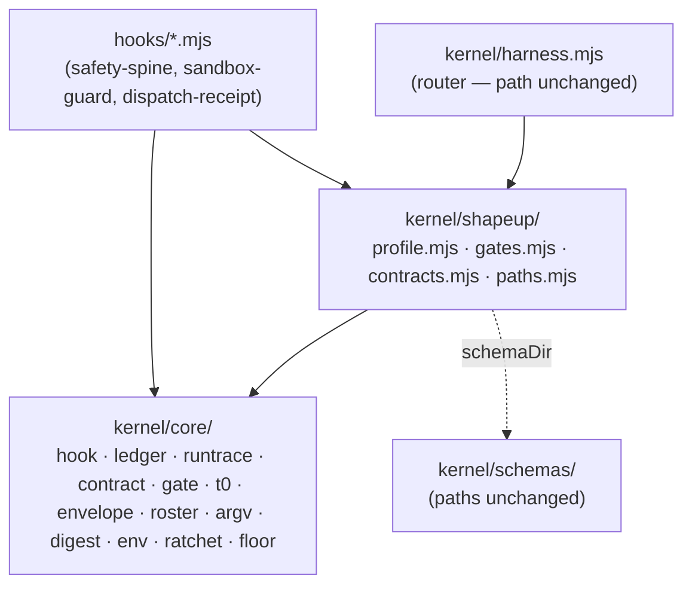

# Plan — split the kernel into a domain-free core and a Shape Up adapter, so the core is reusable

| | |
|---|---|
| **Date** | 2026-11-13 |
| **Baseline** | `2501808` on `main` (5.0.0). `npm test`: 251 checks, 0 failures; `npm run verify:cross-dir` green; `npm run demo` regenerates `docs/assets/demo-gate.svg` byte-identical; `claude plugin validate . --strict` and the same for `./.claude-plugin/marketplace.json` pass. All run 2026-11-13 |
| **Goal** | The five things the runtime holds (receipt, gate resolver, T0 witness, write fence, dispatch receipts) live in a layer that knows nothing about Shape Up, so a second workflow could drive them by handing in its own data |
| **Answer** | Two layers inside `kernel/`: `kernel/core/` (domain-free mechanism) and `kernel/shapeup/` (the data Shape Up hands the core: root names, gate table, evidence rules, contract specs, schema dir). The adapter is **plain data plus a few functions**, never a plugin or registry mechanism. Every path a consumer or a shipped file names stays where it is; the old modules become re-export facades until the last stage |
| **Gate on every stage** | `npm test` green; `claude plugin validate . --strict` clean; `npm run verify:cross-dir` green (every stage touches `kernel/lib/paths.mjs` or `hooks/`) |
| **Rule** | One stage per commit. S1–S7 are additive or move-with-facade. The only removal is S8 |
| **Status** | **Executed S0–S8 on branch `plan/reusable-kernel`, 2026-11-13**, with Q1 = (a) and Q2 = no rename. Deviations and one unrun check are in section 9 |

Words used here. **Core**: `kernel/core/`, imports only `node:` builtins and other core modules. **Adapter**: `kernel/shapeup/`, the Shape Up data the core is called with. **Profile**: the one object the adapter exports and the core receives. **Facade**: an existing module reduced to re-exports, kept so no caller changes in the same stage.

## 1. What the tree does today

Read from the tree at the baseline. Kernel: 4 298 lines of `.mjs`; hooks: 1 529.

| # | Fact | Read at |
|---|---|---|
| F1 | The kernel depends on the hooks: the envelope check imports the hook runtime | `kernel/verify/envelope.mjs:28` imports `runHook, readStdin, settle` from `hooks/lib/decision.mjs` |
| F2 | Opening a run imports the gate module only for its ledger append | `kernel/init/run.mjs:36` → `kernel/gate.mjs:343` `appendGateLedger` |
| F3 | The gate resolver hard-codes the ten Shape Up gates and their allowed answers | `kernel/gate.mjs:30` `GATE_IDS`, `:34-45` the decision table |
| F4 | The evidence narrowing (empty board at Round Close; census, QA record and model floor at Ship Sign-off) is Shape Up rules inside the generic resolver path | `kernel/gate.mjs:62-306`, `narrowToEvidence` at `:248` |
| F5 | The path resolver mixes generic run-trace paths (orders, results, active-order, decisions, metrics, run id) with Shape Up artifacts (wiring map, breadboard, scopes, use cases, hammer census) | `kernel/lib/paths.mjs:40-339` |
| F6 | The consumer-facing root names are constants | `kernel/lib/paths.mjs:40` `SHARED = "shapeup"`, `:43` `LOCAL = ".shapeup"`, `:50` `LEGACY` |
| F7 | The contract parser (frontmatter, tables, coercion) is generic; the three specs it is called with are Shape Up | `kernel/lib/contract.mjs:157-481` vs `:54` `SCOPE_CONTRACT`, `:79` `WIRING_MAP`, `:86` `PROJECT_PROFILE` |
| F8 | T0 scoring and the keep-or-revert ratchet are generic; where the fixtures come from is a scope contract | `kernel/verify/t0.mjs:202-380` vs `:45-46`, `:578`, `:644` |
| F9 | The validator already takes a schema directory as a parameter | `kernel/verify/envelope.mjs:44` `validate(data, schema, schemaDir = SCHEMAS_DIR)` |
| F10 | The envelope schemas `$ref` the domain registry for worker, operation, substrate and payload; the roster is read from the same file | `kernel/schemas/work-order.schema.json:41-62`, `kernel/verify/skills.mjs:48` |
| F11 | Domain-free in imports and literals: `lib/argv.mjs`, `probe/digest.mjs`, `verify/env.mjs` (one doc comment names a Shape Up path), the router in `harness.mjs` | the imports of each file, and `grep` for `shapeup`, `refs/`, gate ids |
| F11a | Domain-free in imports but **not** in literals: `verify/ratchet-tree.mjs` publishes kept trees under a hard-coded `refs/shapeup/<scope>/kept` and stashes with a `shapeup:` message; `lib/floor.mjs` hard-codes the model-floor policy (`BELOW_FLOOR`) and the roles it applies to | `kernel/verify/ratchet-tree.mjs:52`, `:84`; `kernel/lib/floor.mjs` `BELOW_FLOOR`, `floorProblems` |
| F13 | The hook runtime reaches the path resolver: `runHook` records every decision through `record` → `decisionsPath` → `decisions(projectRoot(…))`, and resolves the run through `resolveRun`; `projectRoot` probes `activeScope` and `sharedDir` | `hooks/lib/decision.mjs:48-49`, `:88-150`, `:222-276` |
| F12 | Paths a consumer or a shipped file depends on: `kernel/harness.mjs` (13 references in shipped markdown, the permission grant, `hooks/hooks.json`), `kernel/schemas/work-result.schema.json` (`skills/building/SKILL.md:103`), `kernel/lib/paths.mjs` (`bin/init.mjs:28`), and the hook files named in `hooks/hooks.json` | `bin/lib/grant.mjs:27-28`, `hooks/hooks.json` |

## 2. Goals and non-goals

| # | Goal | Observable as |
|---|---|---|
| G1 | The core knows no domain | a structural check: no file under `kernel/core/` imports from `kernel/shapeup/`, `hooks/`, or names `domain.schema.json`, a gate id, `SHARED`/`LOCAL` literals, or a Shape Up artifact name |
| G2 | The core is driven by a second workflow | `tests/structural/13-core-profile.mjs` (so `npm test` runs it): a toy profile (two gates, one evidence rule, one fence contract, one fixture, its own root names and ref namespace) opens a run, fences a write, runs a T0 ratchet, resolves a gate and closes the run — importing only `kernel/core/` |
| G3 | Nothing a consumer has changes | `kernel/harness.mjs`, the schema paths, the hook paths, the grant, the root names `shapeup/` and `.shapeup/`, every exit code and every ledger row shape are unchanged; `npm run demo` output is byte-identical |
| G4 | The runtime does not grow | `kernel/` + `hooks/` `.mjs` line count after S8 ≤ 5 827 (4 298 + 1 529; counted together because the hook runtime moves from `hooks/` into `kernel/core/`). The toy profile lives in `tests/` and is not counted. If it grows, the report says by how much and why |
| G5 | Dependencies point one way | `hooks/` → `kernel/core` and `kernel/shapeup`; `kernel/shapeup` → `kernel/core`; never the reverse |

Non-goals. A separate npm package (it would be a dependency; zero dependencies is load-bearing). A plugin or registry mechanism in the core. Changing what any gate decides, any hook enforces, or any refusal says. Renaming the consumer's directories. Generalising the skills, agents or commands — they are the Shape Up product and stay so.

## 3. The trade-off, said once

The unattended-run plan set **less kernel** as a goal (its G6), because kernel checks guarantee form and not substance. A layered kernel can easily become more kernel: an interface, a loader, a registry. This plan does not add any. The profile is an object literal; the core's functions take it as an argument. What the split costs is one level of indirection at each seam (section 4.2). What it buys is a boundary a test can hold, and a core another workflow could copy or vendor without carrying Shape Up with it.

## 4. Design

### 4.1 Layers

### 4.2 The seams

| Seam | Core takes | Shape Up adapter supplies |
|---|---|---|
| Run trace | `runTrace({ shared, local, legacy })` → path builders for receipt, run-args, orders, results, active-order, decisions, dispatch receipts, trials, metrics, run id; `projectRoot` probing the pointer and tier the trace names | `{ shared: "shapeup", local: ".shapeup", legacy }` and its own builders for wiring map, breadboard, scopes, use cases, census |
| Hook runtime | `runHook(name, fn, trace)`, `settle`, `readStdin`, `HookDecision`; records into the decisions path the trace gives (F13) | the Shape Up trace from the row above |
| Gate | `resolveGate(table, gate, decision, source, note)` and `narrow(row, rules, ctx)`; `appendLedger(path, row)` — the core takes the file, the adapter computes `gates.jsonl` | the ten-gate table and the four evidence rules (empty board, census, QA record, model floor) as functions |
| Ratchet and floor | `snapshot/restore(key, cwd, { refNamespace, stashLabel })`; `belowFloor(model, patterns)` | `refNamespace: "refs/shapeup"`, `stashLabel: "shapeup"`; the `BELOW_FLOOR` patterns and the `exec`/`eval` roles (F11a) |
| Contract | frontmatter and table parsing, `parseContract(md, spec)` | `SCOPE_CONTRACT`, `WIRING_MAP`, `PROJECT_PROFILE` |
| T0 | `runFixtures`, `score`, `better`, ratchet keep/revert, artifact hash | `fixturesFor(contractPath)` and `profilePathFor(contractPath)` |
| Envelope and roster | `validate(data, schema, schemaDir)` (exists, F9); roster from `$defs/<name>` of a named file | `schemaDir` = `kernel/schemas/`, roster def = `WorkerName` |

The envelope seam needs no schema change: the core never opens `domain.schema.json`, it validates against whatever directory the profile names. The schemas stay at their paths (F12).

### 4.3 What stays where it is

`kernel/harness.mjs` (the router imports the adapter's profile and passes it down), `kernel/schemas/*`, `hooks/*.mjs`, `kernel/lib/paths.mjs` (a facade re-exporting core + adapter, kept because `bin/init.mjs` and every hook import it, and because `verify:cross-dir` exercises it). Whether the other facades (`kernel/gate.mjs`, `kernel/lib/contract.mjs`, `kernel/verify/*.mjs`) stay after S8 is decided in S8 by what still imports them.

## 5. What not to do

- Move `kernel/harness.mjs` or any schema file. Every consumer's grant and a shipped skill name them.
- Make the core read a profile from disk or an environment variable. A missing file would fail open silently, exactly the class `verify:cross-dir` exists for. The profile is imported.
- Change a refusal's text while moving it. The gate and fence messages are part of what the gate agent reads; a stage that moves code changes no string.
- Make the boundary check green by allow-listing. S0 records today's violations as a shrinking expected list; a stage may only remove entries.
- Generalise a rule because it might be useful. If the toy profile in S7 does not need it, the core does not get it.
- Cite `tests/`, `docs/` or `tools/` in a comment under `kernel/core/` or `kernel/shapeup/`. Both ship; a comment keeps the rationale and drops the evidence.
- Move a module into `kernel/core/` while it still imports `kernel/lib/paths.mjs`. Once that file is a facade over the adapter, the import points core at Shape Up (F13). The run trace is split first for this reason.

## 6. Stages

| Stage | What | Observable as |
|---|---|---|
| **S0** | Baseline and the boundary check. Add `tests/structural/12-layers.mjs`: lists every import edge and every domain literal (`shapeup`, `refs/shapeup`, gate ids) under `kernel/` and `hooks/`, fails on any one not in an explicit expected-violations list. Capture every refusal and denial string the gate, fence and envelope can emit (by running them against fixtures) into a golden file under `tests/`. No shipped file changes | suite green plus the new layer check; the list and the golden file are committed |
| **S1** | Run trace first, because everything else reaches it (F13). `kernel/core/runtrace.mjs` (parameterised, including `projectRoot`) + `kernel/shapeup/paths.mjs`; `kernel/lib/paths.mjs` becomes a facade over both | every hook test and `verify:cross-dir` green with no hook edited |
| **S2** | Invert F1 and F2. Hook runtime → `kernel/core/hook.mjs`, taking the trace as an argument; `hooks/lib/decision.mjs` becomes a facade that binds the Shape Up trace. Ledger append → `kernel/core/ledger.mjs`, taking the file path; `gate.mjs` re-exports a bound `appendGateLedger` | two entries leave the list; `verify:cross-dir` green |
| **S3** | Move `argv`, `digest`, `env` as they are (F11) into `kernel/core/`; move `ratchet-tree` and `floor` with their literals turned into parameters (F11a), the values into the adapter. Facades behind | entries leave the list; demo byte-identical; existing kept refs still resolve (same namespace) |
| **S4** | Contract. Parser to `kernel/core/contract.mjs`; the three specs to `kernel/shapeup/contracts.mjs` | entries leave the list |
| **S5** | Gate. Resolver and narrowing driver to `kernel/core/gate.mjs`; gate table and the four evidence rules to `kernel/shapeup/gates.mjs`; `kernel/shapeup/profile.mjs` assembles the profile; the router passes it | `06-gate.mjs` unchanged and green; S0's golden refusal strings byte-identical |
| **S6** | T0 and envelope/roster. Fixture source and profile path become profile functions; `skills.mjs` reads its roster def from the profile | `05-t0.mjs`, `07-envelope.mjs`, `09-init.mjs` green; golden strings identical |
| **S7** | The second workflow. `tests/structural/13-core-profile.mjs` drives the core end to end (G2), importing nothing from `kernel/shapeup/` or `hooks/`. The S0 list is now empty | G1 and G2 hold, measured by `npm test` |
| **S8** | The only removal: delete facades nothing imports any more; keep `kernel/lib/paths.mjs`. Count kernel lines (G4). Run `harness-maintenance-audit` and one nested session (`claude -p --plugin-dir <repo> --permission-mode acceptEdits`) and confirm the decision reached `decisions.jsonl` | G3, G4; audit clean; a ledger row from the nested session |

S1–S7 are each revertible by one `git revert`, since every move leaves a facade.

## 7. Risks, what would change this plan, and rollback

| Risk | Why it matters | Mitigation |
|---|---|---|
| A cross-directory import breaks where the plugin is installed | an enforcement hook that fails to load fails **open**, silently | `verify:cross-dir` on every stage, plus the nested-session check in S8; a missing ledger row is the signal |
| Module identity: a facade and its target both evaluated, two copies of module state (e.g. `REF_DOC_CACHE`) | duplicated caches, divergent state | facades are `export … from`, never copies; S0's check flags a file that both defines and re-exports |
| The profile seam leaks: core needs one more Shape Up fact at runtime | G1 fails late | S7 is the test of that; a leak found there goes into the profile, not back into the core |
| The kernel grows | contradicts the PO's earlier goal | G4 measured in S8; if it grows the plan reports it rather than hides it |

What would change the plan: if the PO wants the core usable by another *repository* (not only another workflow inside this one), S9 (section 8, Q1) becomes needed. If no second workflow is wanted at all, stop after S2 — a parameterised run trace and the hooks-to-kernel edge inverted are worth having on their own.

Rollback: revert stage commits in reverse order; every stage before S8 leaves the old import paths working.

## 8. For the PO to decide

| # | Question | Recommendation |
|---|---|---|
| Q1 | Who is the core reusable *by*? (a) a second workflow inside this plugin, (b) another plugin that copies or vendors `kernel/core/`, (c) a published package | (a) now; (b) as optional **S9** — a `tools/` script that exports `kernel/core/` + its tests as a tarball, nothing published. (c) breaks zero dependencies and is out |
| Q2 | Rename the consumer roots (`shapeup/`, `.shapeup/`) as part of this? | No. They become parameters in the core; their values do not change. A rename is a migration with its own plan |

## 9. Execution report

Executed 2026-11-13 on `plan/reusable-kernel`, one commit per stage (S0 to S7, plus a docs commit for S8). PO answers: Q1 = (a), Q2 = no rename. Nothing pushed.

| Stage | Result |
|---|---|
| S0 | `tests/structural/12-layers.mjs` (import edges, domain literals, define-and-re-export) with a shrinking expected list, and `tests/golden/refusals.json` (31 captured gate, fence, order and envelope outputs, normalised for run ids, timestamps, scratch dirs). Stable over repeated runs |
| S1 | `kernel/core/runtrace.mjs` (`runTrace`, including `projectRoot`, run key, decision path) and `kernel/shapeup/paths.mjs`; `kernel/lib/paths.mjs` is a one-line facade. All 61 original exports still resolve |
| S2 | `kernel/core/hook.mjs` and `kernel/core/ledger.mjs`; `kernel/shapeup/hook.mjs` binds the trace; `hooks/lib/decision.mjs` is a facade. The `verify envelope` to `hooks/` edge is gone. Gate and T0 ledger appends use the shared ledger |
| S3 | `argv`, `digest`, `env` moved unchanged; `ratchet` and `floor` take their namespace, label, denylist and roles as parameters, values in `kernel/shapeup/{ratchet,floor}.mjs` |
| S4 | `kernel/core/contract.mjs` (parser) and `kernel/shapeup/contracts.mjs` (three layouts and the scope-to-use-case join) |
| S5 | `kernel/core/gate.mjs` (`resolveGate`, `narrow`) and `kernel/shapeup/gates.mjs` (table, four evidence rules as `emptyBoard`, `censusRule`, `qaRule`, `modelRule`, the ledger path, `gateNote`). `kernel/gate.mjs` keeps the CLI. Golden strings byte-identical |
| S6 | `core/t0.mjs`, `core/envelope.mjs`, `core/roster.mjs`; the old `verify/*` paths are adapters that bind them (they are router targets) |
| S7 | `tests/structural/13-core-profile.mjs` with a toy profile; 30 checks. Mutation-checked: importing the adapter into the core, or hard-coding the ref namespace, turns the suite red |
| S8 | See below |

**Gates.** `npm test`: 251 checks at the baseline, 286 now, 0 failures. `claude plugin validate . --strict` and the marketplace manifest pass; `npm run verify:cross-dir` green and `npm run demo` leaves `docs/assets/demo-gate.svg` unchanged at every stage. The S0 expected-violations list is `{}` after S6. G1 and G5 are held by the layer check; G3 by the golden file and the demo.

**G4.** `kernel/` + `hooks/` `.mjs` lines: 5 827 at the baseline, 5 824 now. The runtime did not grow; the fence, order and run seams were paid for by dropping unused imports, an unused hook export, stale comment paragraphs and banner-only comment lines.

### Deviations from the plan, said plainly

1. **G2 holds, with the Shape Up rules left on the Shape Up side.** The core now holds opening a run (`kernel/core/run.mjs`: intake, receipt, launch record, run pointer), the write fence's decision (`kernel/core/fence.mjs`) and arming and retiring an order (`kernel/core/order.mjs`). The toy profile opens a run, arms an order, judges writes (inside, outside, frozen) and closes the run through the core alone. What stays Shape Up's, because it is a rule and not a mechanism: what its receipt and launch record contain, the refusals before a run opens (roster, floor, launch record) and the guard's committed-tier check.
2. **No `kernel/shapeup/profile.mjs`.** Each adapter module binds its piece directly, so nothing would consume an assembled object; adding one would be the registry the plan said not to build.
3. **Moves without facades.** `argv`, `digest`, `env`, `ratchet`, `floor` and `contract` moved with their importers rewritten (including the four shipped oracles and a few comments) instead of leaving a facade each. Each stage is still one commit and reverts alone. S8 therefore deleted nothing: the only facades left, `kernel/lib/paths.mjs` and `hooks/lib/decision.mjs`, are imported by consumers and stay.
4. **S0's edge list was honest rather than empty-by-construction.** Moving the path resolver made the not-yet-moved modules import a Shape Up facade, so S1 to S5 recorded those as edges; each left the list when its module moved.
5. **The nested real session was not run.** `claude -p --plugin-dir <repo> --permission-mode acceptEdits` returned an account billing error twice, a few hours apart, so no decision row from a real nested session was observed. `verify:cross-dir` (hook fired from a `git archive` copy at another path against a scratch project) stands in and passes at every stage; it is the weaker evidence. Run the nested session before a release.
6. **S9 (vendoring script for another repository)** is optional under Q1 = (a) and was not built.

### Audit (`harness-maintenance-audit`)

Fixed: the README layout block (new `kernel/core/` and `kernel/shapeup/`, thirteen test modules, the hook runtime), `SECURITY.md` claim 6 (named the old module as the exit path), two core comments naming Shape Up gates. Checked: version parity (5.0.0 both), `AGENTS.md` harness block names no `.mjs` path, no `docs/`, `tests/` or `tools/` citation in the new kernel files (the one `docs/shapeup-sdlc` hit is the legacy root name, pre-existing). Code defects found and not fixed: none new.
