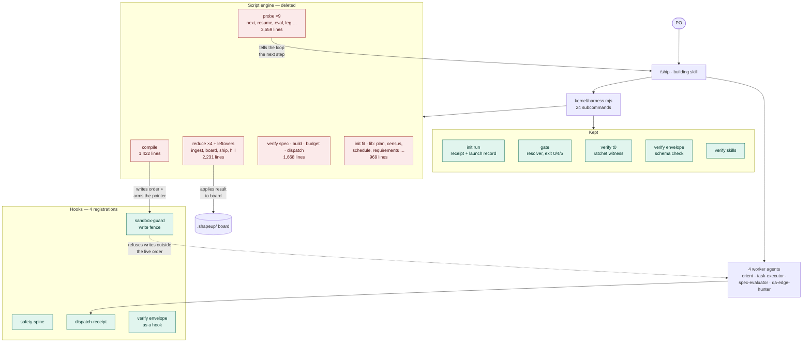
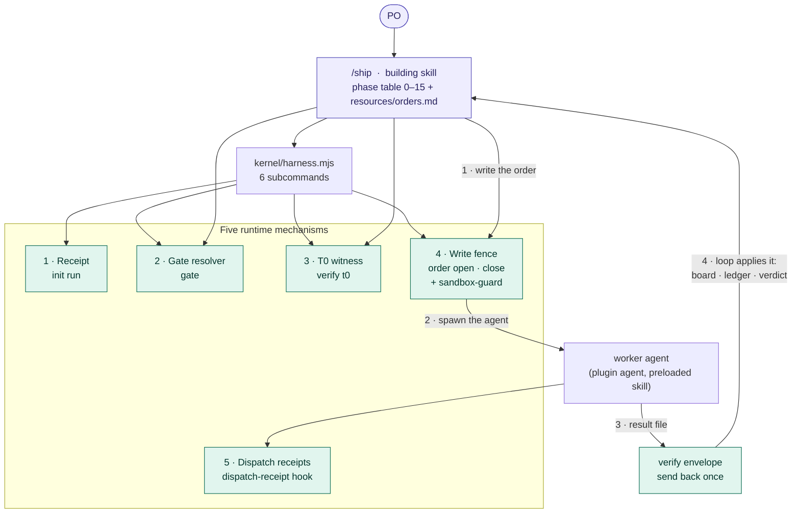

# The plugin before and after the engine removal

Two states of the same plugin: the tag `engine-measured` (the tree S3 measured, with the scripted engine) and `plan/single-loop` (the
engine removed). Counts are derived from the trees (`git ls-tree` and `wc -l` at the tag, `find` and `wc -l` now), not copied from prose.
Status and the open PO decision are in `execution-native-first-2026-11-08.md`, section "S4, restated".

## 1. Where the code is

| Group | Before: files / lines | After: files / lines | What happened |
|---|---|---|---|
| `kernel/compile.mjs` | 1 / 1,422 | — | deleted; `order open` replaces the one thing it did that nothing else could (publish the pointer the fence is armed by) |
| `kernel/reduce/` (`ingest`, `board`, `ship`, `hill`, `leftovers`) | 5 / 2,231 | — | deleted; the loop applies a result itself |
| `kernel/probe/` (ten verbs) | 10 / 3,559 | — | deleted; `digest.mjs` stays as a library (118) |
| `kernel/verify/` `spec`, `build`, `budget`, `dispatch` | 4 / 1,668 | — | deleted; `t0`, `envelope`, `skills`, `env`, `ratchet-tree` stay |
| `kernel/init/fit.mjs` | 1 / 203 | — | deleted; `init run` stays and shrinks 774 → 386 |
| `kernel/lib/` `breadboard`, `census`, `plan`, `ratchet`, `requirements`, `schedule` | 6 / 766 | — | deleted; `argv`, `contract`, `floor`, `paths` stay (`contract` 852 → 768, `paths` 553 → 509) |
| `kernel/order.mjs`, `hooks/lib/tier.mjs` | — | 2 / 163 | new |
| the 19 kept modules (`harness`, `gate`, `init run`, `verify` ×5, three hooks and `decision`, `argv`, `contract`, `floor`, `paths`, `digest`, installer, grant) | 19 / 6,692 | 19 / 6,111 | kept; net −581: `init run` −388, `contract` −84, `harness` −45, `paths` −44, `sandbox-guard` −23, `gate` +3 |
| **Kernel, hooks, installer** | **46 / 16,541** | **21 / 6,274** | −10,267 lines = 9,849 deleted whole files + 581 trimmed − 163 added |
| `tests/structural/` modules | 110 / 19,954 | 10 / 779 | 994 lines with the runner and two helpers; 208 checks |
| Kernel subcommands | 24 | 6 | `verify t0 \| envelope \| skills`, `gate`, `init run`, `order` |
| Hook registrations | 4 | 4 | the same four |
| Plugin worker agents | 4 | 4 | the same four |

Not removed: the four worker agents, the oracles, the installer and the skills tree apart from one skill (`skills/` holds 68 markdown files
at both ends). The `hill-chart` skill and the `/hill` command were removed with the only writer of their data.

## 2. Before — the scripted engine (tag `engine-measured`)

The loop skill drove a script layer: it called verbs to compile an order, run the worker, reduce the result onto the board, probe what
to do next, and verify the build. The scripts held the sequencing; the model followed it.

## 3. After — one loop, five mechanisms (`plan/single-loop`)

The loop skill sequences the phases itself, in the session. The kernel keeps only what a prompt cannot be trusted to do: the receipt, the
gate answer, the T0 witness, the fence and the dispatch receipt.

## 4. What moved from a script to the loop

| Step | Before (script) | After (the loop, in its own session) | Still checked mechanically? |
|---|---|---|---|
| open a run | `init run` | `init run` | yes — receipt, floor and roster refusals |
| write and arm an order | `compile` | write from the template, then `order open` | yes — schema check, time stamp, pointer read back |
| decide the next step | `probe next`, `probe resume` | the phase table in the skill | no |
| apply a worker's result to the board | `reduce ingest`, `reduce board` | the loop edits the board | no — result shape only, via `verify envelope` |
| lint the spec | `verify spec` | the loop reads the plan back | no |
| count attempts against a budget | `verify budget`, `probe attempts` | the loop | no |
| build and launch before EVAL | `verify build` | the loop runs the profile's commands | no |
| census and ship report | `reduce ship` | the loop, in `stop.md` | the L4 gate reads the census file |
| T0 per scope | `verify t0` | `verify t0` | yes — ratchet, artifact hash |
| gates | `gate` | `gate` | yes |
| end a run | `reduce ship` | `order close` (writes `close.json`, retires the pointer) | yes |

The right-hand column is the cost of the removal in one line: seven rows moved from "script" to "loop's discipline, checked by the PO and
the evaluator". The one real run on the new tree shipped, at $18.2 against $5.4 for the engine's runs, with QA skipped by the loop's own
call (one repetition; not a rate).
