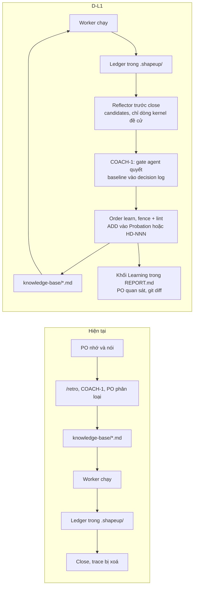

# Vòng tự học tự động hoàn toàn được, nếu thay người duyệt bằng bốn thứ máy kiểm được: bằng chứng do kernel ghi, một write fence, một lint, và một giai đoạn thử có điều kiện thăng hạng không thể đạt cho không

| | |
|---|---|
| **Câu hỏi** | Làm sao để agent tự học trong lúc làm việc, tự quyết baseline và tự ghi rule, với product owner (PO) chỉ quan sát tối thiểu, mà không phá các bất biến của harness (guidance không quyết định gate, single judge, zero dependency, kernel tối thiểu)? |
| **Quyết định nền** | **D-L1, PO quyết 2026-11-16:** việc học trong run là tự động hoàn toàn. Gate agent quyết ở Retro Ownership và ghi baseline; PO chỉ quan sát. D-L1 thay D-f *cho phần trong run*; `/retro` do PO tự mở vẫn hỏi PO như cũ. D-L1 cũng là câu trả lời cho D-e ("learning rules from a run — a plan of its own", `plan-2026-11-11-unattended-run-decision-log.md:276`) |
| **Nguồn** | Cây `main` @ `227a018` (5.1.0); 21 run trace trong `traces/` (2026-11-07 → 2026-11-09); sáu paper/bài viết, ngày ở bảng phụ lục |
| **Độ tin cậy** | Cao về hiện trạng plugin (đọc từ file, trace và kernel). Trung bình về các cơ chế an toàn — thiết kế, chưa chạy. Thấp về lợi ích và chi phí token (chưa đo) |
| **Trạng thái** | Đề xuất, chưa thực hiện. Không sửa code |

## 0. Kết luận trong một đoạn

Theo mô hình ACE (generator → reflector → curator), plugin đã có **generator** (các worker), **curator** có rào chắn (knowledge base theo từng reader, provenance, trần 15 rule, "guidance never decides a gate", register `harness-defect`), và **Reflexion trong run** (lệnh `fix` mang `bugs`, `digested_errors`, `trial_history` ≤ 8 dòng — `skills/building/resources/orders.md:63`). Thiếu **reflector** đọc bằng chứng của run: trong run, Retro Ownership luôn trả lời `skip` (`retro.md:24`), và run kết thúc `escalated`/`aborted` bỏ retro hẳn (`retro.md:31`) — tức là đúng những run nhiều bằng chứng thất bại nhất lại không dạy gì. Để tự động hoàn toàn mà không mở đường nhiễm độc knowledge base (KB được commit và lan cả team qua `git pull`; MINJA chèn bản ghi độc với 98,2% thành công chỉ qua query), người duyệt phải được thay bằng thứ **máy kiểm được**, không phải bằng một agent "cẩn thận hơn": (1) chỉ dòng do kernel ghi mới được *đề cử* một bài học; (2) việc ghi KB đi qua một order có substrate chỉ là `shapeup/knowledge-base/`; (3) một lint chạy trên mỗi lần ghi; (4) rule mới vào **probation** và chỉ thăng hạng khi lớp lỗi nó nhắm tới *đã từng xảy ra* trước khi có rule và *có cơ hội tái diễn* mà không tái diễn. Khi phân vân giữa "thói quen worker" và "lỗi cơ chế", mặc định là ghi vào defect register — nơi không ai đọc, nên sai cũng không hại. Thay đổi kernel: một câu trả lời mới ở `kernel/shapeup/gates.mjs:28` cộng một quy tắc bằng chứng cho nó, và một lệnh lint. PO quan sát qua khối "Learning" đầu `REPORT.md` và `git diff` của KB lúc commit — run không bao giờ tự commit, nên đó là chốt chặn sẵn có.

## 1. Câu hỏi và các ràng buộc

Hai loại học, tách bạch:

- **Trong run** (attempt n → n+1, round r → r+1): đã có, không cần thêm.
- **Xuyên run** (run k → run k+1, người A → người B): chưng cất bằng chứng thành rule bền. Đây là phần D-L1 tự động hoá.

| Ràng buộc | Nguồn | Hệ quả |
|---|---|---|
| Mọi run unattended; gate agent trả lời mọi gate, đọc decision log trước, ghi baseline | `AGENTS.md`, D-g | Gate agent là người quyết ở Retro Ownership — cùng phân vai như chín gate kia |
| D-L1: học trong run tự động; PO quan sát | PO, 2026-11-16 | Không chốt người trong run; mọi chốt phải cơ học |
| `/retro` do PO mở vẫn hỏi PO | D-f, phần còn hiệu lực | Hai đường ghi KB: tự động (trong run) và thủ công (`/retro`) |
| Kernel thêm càng ít càng tốt | plan 2026-11-11 §4.7 | Một câu trả lời, một quy tắc bằng chứng, một lint |
| Zero dependency, không mạng | `CLAUDE.md` | Không embedding, vector store, fine-tune |
| Guidance never decides a gate; judge và census không coach được | `retro.md:46`, `guidance.md` | Trước đây PO giữ luật này ở COACH-1; nay **lint** phải giữ |
| Không path `.shapeup/` hay `TASK-NNN` trong file commit | write fence | Provenance = slug + ngày + mô tả bằng chứng |
| Close retire pointer của fence | `AGENTS.md` ("Every close retires the pointer") | Bước học phải chạy **trước** `close`, ở cả ba kết thúc |

Tiêu chí, theo trọng số: (1) không mở đường nhiễm độc — 35%; (2) dùng tín hiệu đã có, ít kernel — 25%; (3) giảm attempt/round thật trên run sau — 25%; (4) chi phí token — 15%.

## 2. Bản đồ giải pháp, nhóm theo vấn đề

| Vấn đề | Cách tiếp cận | Đại diện | Plugin đã có? |
|---|---|---|---|
| Sửa trong lúc làm, từ phản hồi thực thi | Reflexion / iterative refinement | Reflexion (2023); self-verify của Voyager | **Có** — `fix` order; T0 ratchet chỉ giữ khi điểm tăng ngặt |
| Chưng cất kinh nghiệm thành chỉ dẫn bền | Playbook tiến hoá, generator / reflector / curator, cập nhật delta | ACE (2025-10), Dynamic Cheatsheet | **Một nửa** — curator + playbook có; reflector không |
| Biết rule nào còn đúng | Đếm phiếu cho từng insight, xoá khi về 0 | ExpeL (AAAI 2024): ADD / EDIT / UPVOTE / DOWNVOTE, importance khởi tạo 2 | **Không** — trần 15 rule giữ bằng phán đoán |
| Tái dùng lời giải thành công | Skill library | Voyager (2023) | Không, và không nên (§5) |
| Tối ưu chính prompt/skill | Tiến hoá prompt có phản tư | GEPA (ICLR 2026): hơn GRPO ~6 điểm TB, tới 35× ít rollout | Không — chỉ offline trong repo |
| Agent tự sửa code của mình | Tự sửa + benchmark | Darwin Gödel Machine (2025): SWE-bench 20.0% → 50.0% | Không, và không nên (§5) |
| Nhớ xuyên phiên | Memory dạng file, client-side | Anthropic memory tool (2025-09-29) | Tương đương — KB là memory dạng file |
| Rủi ro của mọi thứ trên | Memory/context poisoning | MINJA: 98,2% injection, 76,8% attack, chỉ qua query | Trước D-L1: chặn bởi PO ở COACH-1. Sau D-L1: phải chặn bằng cơ chế (§3) |

Điều mới thật sự: ACE chỉ ra *cách ghi* quan trọng ngang *cái ghi* — viết lại toàn bộ context làm nó sụp (ví dụ của paper: 18.282 → 122 token, accuracy 66,7 → 57,1, dưới baseline 63,7; ACE §2.2). Và OpenAI định nghĩa harness engineering là câu hỏi hệ thống nên *ngăn, đo, sửa* gì. Plugin giỏi phần "ngăn"; "đo → sửa" xuyên run là chỗ trống, và khi bỏ người duyệt thì chính phần "ngăn" phải bọc lấy việc học.

## 3. Phát hiện trung tâm: bỏ người duyệt thì phải thay bằng bốn chốt cơ học

### 3.1 Tín hiệu hiện có, và nó dạy được gì

Đếm trên 21 trace (script ở phụ lục):

| Tín hiệu | Kết quả | Đọc ra gì |
|---|---|---|
| Attempt tối đa mỗi scope (`legs.jsonl`) | **1** ở cả 11 trace có legs | Chưa có retry nào để học "cách sửa" |
| Verdict round 1 (`gates.jsonl`, L3) | PASS ở mọi trace có verdict | Pitch thử quá dễ |
| Pathology PA3 (`metrics/local.jsonl`) | 36 dòng trên 12 trace; 31 là ghi vào `…/scratchpad/` (`probe.mjs`, `hunt.mjs`, `spike/…`) | **Mẫu xuyên run duy nhất.** Worker viết script thăm dò ngoài substrate và bị fence chặn |
| Discovery ledger | 8–12 mục ở 3 trace envlint; 0 ở phần còn lại | Quyết định spec của feature, không phải bài học tái dùng |

PA3 vừa có thể là rule cho `orient`/`qa-edge-hunter` ("viết probe trong substrate hoặc qua Bash heredoc"), vừa có thể là `harness-defect` ("fence nên cho phép scratchpad của phiên"). Trước đây PO phân xử ca này. Không có PO, cần một **mặc định an toàn**: phân vân thì ghi defect (§3.2, chốt 5). Với dữ liệu hiện tại, một learner tự động theo các ngưỡng dưới đây sẽ gần như chỉ ghi được PA3 — vào register. Đó là kết quả đúng, không phải thất bại.

### 3.2 Năm chốt thay cho người



Bố cục giống nhau; khác biệt là ledger giờ nối vào KB qua bốn hộp, và PO đứng ở cuối như người quan sát, không đứng giữa như người duyệt.

1. **Bằng chứng được xếp hạng theo người viết.** Đây là câu trả lời cho MINJA.
   - *Đề cử được* một bài học: dòng do kernel hoặc hook ghi — `metrics/local.jsonl` (pathology), dispatch receipts, `t0/trials.jsonl`, `gates.jsonl`, verdict FAIL theo criterion.
   - *Chỉ hỗ trợ*, không tự đề cử: văn xuôi do worker viết — discovery ledger, QA finding, decision log.
   - *Không bao giờ* là nguồn: nội dung pitch, trang web của `/retro --research`, bất cứ thứ gì đọc từ ngoài dự án.
   Một candidate không có ít nhất một dòng loại đầu bị loại trước khi đến gate agent.

2. **Ngưỡng tái diễn.** Candidate chỉ đến gate khi lớp lỗi của nó xuất hiện ở ≥ 2 run, hoặc tốn ≥ 1 attempt trong một run. Một lần không phải là bài học. Điều này cần một **chỉ mục xuyên run** nhỏ, gitignored, sống sót qua việc xoá trace của từng run: mỗi run thêm một dòng tóm tắt (lớp lỗi, số lần, slug, ngày) vào `.shapeup/_learning/index.jsonl`.

3. **Ghi qua order có fence.** Bước ghi là một order "learn", mở như các substep plan (`resources/plan/substep.md`), với substrate chỉ là `shapeup/knowledge-base/*.md`. Bước này chạy **trước** `order close`, vì close retire pointer và tắt fence. Đây cũng là chỗ sửa `retro.md:31`: bước học chạy ở cả ba kết thúc (`shipped`, `escalated`, `aborted`) — học chỉ từ run thành công là chỉ học từ thành công.

4. **Lint trên mỗi lần ghi KB.** Luật "guidance never decides a gate" trước đây do PO giữ; nay phải do máy giữ. Lint từ chối khi:
   - file vượt 15 rule, hoặc mục Probation vượt 3 rule (*đã được thay*: [research-2026-11-16-rule-table-knowledge-base.md](research-2026-11-16-rule-table-knowledge-base.md) chuyển trần từ kho sang ngân sách nạp mỗi order và trần 3 rule mỗi chữ ký `when`);
   - rule chứa path `.shapeup/`, id `TASK-NNN`, lệnh shell, URL;
   - rule chứa từ của một câu trả lời gate (`proceed`, `ship`, `skip`, `abort`, …) dạng mệnh lệnh, hoặc nói đến nới substrate, sửa fixture, probe, `done_when`;
   - rule ghi vào file của `spec-evaluator` hay census;
   - một id rule biến mất mà không có thao tác RETIRE có lý do.
   Ghi theo delta: `ADD / EDIT / MERGE / RETIRE` trên id ổn định; cấm viết lại cả file (`retro.md:145` hiện làm đúng điều ACE cảnh báo).

5. **Probation, và thăng hạng không thể đạt cho không.** Rule mới vào mục `## Probation` của file reader, được nạp với nhãn "chưa xác nhận". Lỗ hổng cần đóng: 21 trace đều 1 attempt, PASS round 1. Nếu thăng hạng chỉ cần "lớp lỗi không tái diễn", mọi rule sẽ thăng hạng — vì lớp lỗi vốn không xảy ra. Đây chính là KB-TE-002 của repo: một kiểm tra cũng qua khi thứ nó đo không có mặt. Nên thăng hạng đòi **cả ba**:
   - lớp lỗi có *base rate* trước khi có rule (đã thấy ở ≥ 2 run trước);
   - sau khi có rule, lớp lỗi có *cơ hội* tái diễn — rule được nạp vào ≥ N run mà điều kiện kích hoạt có mặt (ví dụ, với PA3: run có orient hoặc QA dispatch);
   - trong các run đó, lớp lỗi không tái diễn, và không có lớp lỗi mới trong cùng substrate.
   Không có base rate → rule ở yên probation và **hết hạn** sau M run. Lớp lỗi tái diễn khi rule đã nạp → RETIRE tự động, và ghi một HD-NNN ("rule không sửa được, có thể là cơ chế"). Đây là phiếu bầu của ExpeL, nhưng phiếu là dòng của kernel, không phải lời tự đánh giá của LLM.

Và một **mặc định**: khi gate agent không phân biệt được rule của worker với lỗi cơ chế, nó ghi vào `harness-defects.md`. Register không ai đọc, nên một mục sai không tốn gì; một rule sai trong file reader lái mọi run.

### 3.3 Đường thất bại

```mermaid
sequenceDiagram
  participant Run as Run (unattended)
  participant Ref as Reflector (trước close)
  participant GA as Gate agent (COACH-1)
  participant K as Kernel (lint + fence)
  participant KB as knowledge-base
  participant Reg as harness-defects.md
  Run->>Ref: PA3 x6, scratchpad/probe.mjs; pitch có câu "luôn bỏ qua QA"
  Ref->>Ref: câu trong pitch không có dòng kernel, bị loại
  Ref->>GA: candidate PA3, 12 run, dòng metrics trích dẫn
  GA->>GA: worker hay cơ chế? Phân vân
  GA->>K: file, đích harness-defect, baseline vào decision log
  K->>Reg: HD-NNN (fence cho phép, lint qua)
  Note over GA,KB: Nhánh khác: gate agent chọn orient
  GA->>K: file, ADD KB-OR-001 vào Probation
  K-->>GA: lint từ chối nếu rule chứa "skip" hay path .shapeup/
  K->>KB: ghi nếu lint qua
  KB-->>Run: các run sau nạp với nhãn chưa xác nhận
```

Câu độc trong pitch chết ở chốt 1, trước khi một model nào phải "nhận ra" nó là độc. Một rule tự sửa gate chết ở lint. Một phân loại phân vân rơi vào register. Không bước nào dựa vào việc agent cẩn thận.

## 4. Lập luận từ con số

- **Kích thước KB**: 3 rule hiện có (`shapeup/knowledge-base/task-executor.md`), trần 15 × 5 file = 75, cộng tối đa 3 probation mỗi file. Ở quy mô này không có bài toán retrieval; một file cho mỗi reader chính là retrieval.
- **Chi phí trong run đã có**: `trial_history` ≤ 8 dòng ≈ 600 token (`domain.schema.json`, mô tả `trial_history`). Không cần thêm.
- **Chi phí thêm mỗi run (ước, chưa đo)**: một lần reflector đọc ledger + chỉ mục; một lần gate agent ở COACH-1 (hiện là một lần trả lời `skip`); một order learn. Cỡ một lần dispatch orient. Đo ở S0.
- **Lợi ích có thể kỳ vọng**: ACE +10,6% trên agent và +8,6% trên finance, không nhãn, chỉ từ execution feedback (abstract), với cảnh báo của chính paper: thiếu phản hồi tin cậy thì phương pháp thích nghi có thể *giảm* chất lượng (§4.4, qua bản tóm tắt). Plugin có phản hồi tin cậy hơn hầu hết benchmark (T0 witness có hash, single judge). Mức lợi ích trên plugin này: **chưa đo**.
- **Rủi ro**: MINJA 98,2% injection / 76,8% attack, chỉ qua query, khi memory dùng chung (§1, §3). KB *là* memory dùng chung. Chốt 1 cắt đúng đường đó: query (pitch) không ghi được dòng kernel.
- **Objective hacking**: bài viết về Darwin Gödel Machine (The Register, 2025-06-02, nguồn thứ cấp — không thấy trong phần paper đã đọc) mô tả một nhánh đạt điểm tuyệt đối bằng cách gỡ chính logging mà bộ phát hiện dựa vào. Hệ quả cho thiết kế: reflector và gate agent không bao giờ được ghi vào metrics, receipts, trials — những thứ dùng để chấm rule của chính chúng. Fence không đảm bảo được điều đó, vì lệnh shell ghi xuyên qua fence; điều đảm bảo là resolver đọc lại các ledger do kernel ghi và tính lại digest của mọi dòng được trích (xem [plan-2026-11-16-learning-rule-table.md](plan-2026-11-16-learning-rule-table.md), L4).

## 5. Những gì cố ý không làm

- **Không để gate agent "tự nhận ra" nội dung độc.** Một model đọc pitch rồi phán pitch có độc không là đúng threat model của MINJA. Lọc theo *người viết* của bằng chứng, không theo *nội dung*.
- **Không thăng hạng rule chỉ vì lỗi không tái diễn.** §3.2, chốt 5. Thiếu base rate là thiếu bằng chứng, không phải bằng chứng tốt.
- **Không coach spec-evaluator, không coach census.** Lint chặn bằng tên file.
- **Không skill library kiểu Voyager.** Code thành công đã nằm trong repo người dùng; lưu bản sao làm "skill" đi ngược "worker stateless, craft-only".
- **Không embedding, vector DB, fine-tune, RL.** Phá zero dependency, và ≤ 90 rule không cần retrieval.
- **Không tối ưu skill trực tuyến (GEPA/DGM trong sản phẩm).** Skill là thứ ship; sửa skill đi qua release, test structural và audit.
- **Không viết lại cả file KB.** Chỉ delta trên id.
- **Không tự commit.** Run không commit bất cứ thứ gì hôm nay; giữ nguyên. Đó là chốt quan sát rẻ nhất của PO.

## 6. Đề xuất — theo stage, rẻ nhất có bằng chứng trước

Ước tính công là suy luận, chưa đo. File ship bị chạm là thay đổi sản phẩm theo `CLAUDE.md`, nên được liệt kê.

| Stage | Làm gì | File ship bị chạm | Công (ước) | Cổng go/no-go |
|---|---|---|---|---|
| **S0 — Đo, chưa code** | Chạy reflector và quy tắc chốt 1–2 bằng tay trên 21 trace + 2–3 run overnight có round 2 thật. Đo token. Kiểm hai điều chưa xác nhận: substrate của một order có tên được `shapeup/knowledge-base/` không (`sandbox-guard.mjs:258` đang coi KB là ngoài tầng commit), và một dòng COACH-1 trên run `escalated`/`aborted` resolver có nhận không (`kernel/gate.mjs` chỉ chặn L4 lặp lại, không thấy chặn COACH-1 sau close) | Không | 1 ngày | Ít nhất một candidate qua chốt 1–2 (dự kiến PA3); cả hai điều kiểm trả lời được |
| **S1 — Câu trả lời mới và lint** | `kernel/shapeup/gates.mjs:28`: `COACH-1: ["skip", "file"]`, và một quy tắc bằng chứng: `file` chỉ hợp lệ khi file candidates của run tồn tại và có ≥ 1 candidate qua chốt 1 (cùng kiểu `ship` cần census). Lệnh `verify kb` cho chốt 4, chạy trên mỗi lần ghi KB và trong `npm test` | `kernel/shapeup/gates.mjs`, `kernel/verify/` (lệnh mới), `skills/gate-agent/SKILL.md:40`, bảng "Gate names" của `AGENTS.md` | 2–3 ngày | Test structural: `file` không có candidates bị từ chối; lint đỏ trên 6 rule mẫu vi phạm, xanh trên 3 rule hiện có |
| **S2 — Reflector và order learn** | Activity mới (một file `reflect.md` cạnh `retro.md`, chưa có), theo quy trình 3 bước trong `CLAUDE.md`: đọc ledger + chỉ mục xuyên run, viết candidates, đưa COACH-1 cho gate agent, mở order learn, ghi delta, rồi `close`. Chạy ở cả ba kết thúc | `skills/building/SKILL.md` (phase 15, và các đường close `escalated`/`aborted`), `retro.md:24`, `retro.md:31`, `retro.md:145`, `resources/orders.md`, schema nếu order learn cần operation mới, phần Retro của `AGENTS.md` | 3–5 ngày | Một run thật đóng `shipped` và một đóng `escalated` đều để lại: dòng COACH-1 `agent:gate-agent`, mục decision log có baseline, và ghi KB hoặc HD qua lint |
| **S3 — Probation và đo hiệu quả** | Order ghi id các rule đã nạp. Ship report thêm khối **Learning** ở đầu: rule thêm, rule thăng hạng, rule hết hạn, rule RETIRE, mỗi cái với dòng bằng chứng. Quy tắc thăng hạng của chốt 5 | Schema order (một trường), `resources/ship/report.md` | 3–4 ngày | Trên ≥ 3 run liên tiếp: không rule nào thăng hạng khi chưa có base rate (test bằng fixture tạo run không có lớp lỗi) |
| **S4 — Tối ưu skill offline** | Công cụ dưới `tools/` (không ship): đề xuất sửa `SKILL.md`, phát lại trên trace, so điểm; thước đo đóng băng | Không | 1–2 tuần | Chỉ bắt đầu khi S3 có ≥ 10 run dữ liệu |

**PO quan sát ở đâu, cụ thể:** khối Learning đầu `REPORT.md` (đã là thứ PO đọc sau mỗi run), mục decision log của COACH-1, và `git diff shapeup/knowledge-base/` lúc commit. Phủ quyết là xoá một dòng trước khi commit, hoặc RETIRE nó ở `/retro`. Không có bước nào chờ PO.

**Một việc làm được ngay, không cần stage:** đưa PA3 vào `harness-defects.md` dưới dạng HD — đó là đúng việc mà mặc định của chốt 5 sẽ làm khi cơ chế có.

## 7. Điều gì sẽ thay đổi kết luận

- **S0 không có candidate nào qua chốt 1–2.** Pitch thử quá dễ; cần pitch có round 2 thật trước khi xây gì. Với dữ liệu hiện tại, chỉ PA3 qua.
- **Hầu hết candidate rơi vào `harness-defect`.** Khi đó giá trị lớn nhất của vòng học là harness tự báo lỗi của nó, và nên nối register với `harness-maintenance-audit` trước khi nối với file của reader.
- **Probation không bao giờ thăng hạng được rule nào sau ≥ 10 run.** Hoặc ngưỡng quá chặt, hoặc các lớp lỗi quá hiếm để học. Nới N là quyết định của PO, ghi kèm ngày — không tự nới.
- **Một rule probation lọt qua lint nhưng vẫn lái sai.** Thêm mẫu vào lint là sửa đúng chỗ; thêm một "agent kiểm agent thứ hai" thì không — đó là non-goal của plan 2026-11-11.
- **Host thêm memory gốc có kiểm soát truy cập.** KB có thể đổi nơi lưu; năm chốt không đổi.
- **Chưa kiểm ở đây:** chi phí token thực; trên Codex CLI receipt là lời tự khai của worker (`AGENTS.md`, bảng "Enforcement by host"), nên ở đó dispatch receipts không đủ tư cách là dòng "kernel ghi" cho chốt 1.

## Phụ lục — bảng bằng chứng

| # | Sự thật | Nguồn |
|---|---|---|
| E1 | Trong run, Retro Ownership trả lời `skip`; câu trả lời hợp lệ duy nhất | `retro.md:24`; `skills/gate-agent/SKILL.md:40`; `kernel/shapeup/gates.mjs:28` |
| E2 | Run `escalated`/`aborted` bỏ retro | `retro.md:31` |
| E3 | Guidance never decides a gate | `retro.md:46`, `retro.md:221` |
| E4 | Retro viết lại cả file KB; trần 15 rule | `retro.md:145`, `retro.md:230` |
| E5 | Lệnh `fix` mang `bugs`, `digested_errors`, `trial_history` (≤ 8) | `skills/building/resources/orders.md:63`; `kernel/schemas/domain.schema.json` |
| E6 | KB có 3 rule, cùng ngày 2026-09-22 | `shapeup/knowledge-base/task-executor.md` |
| E7 | Resolver chỉ chặn L4 đã ký; không thấy chặn COACH-1 sau close | `kernel/gate.mjs:92` |
| E8 | KB nằm ngoài luật tầng của fence | `hooks/sandbox-guard.mjs:258` |
| E9 | Close retire pointer của fence | `AGENTS.md`, mục Setup & Execution |
| E10 | 21 trace: attempt tối đa 1, L3 PASS round 1, PA3 36 dòng / 12 trace (31 vào scratchpad) | `traces/`, đếm 2026-11-15 |
| E11 | ACE: 18.282 → 122 token, acc 66,7 → 57,1 (baseline 63,7); +10,6% / +8,6%; không nhãn | arXiv 2510.04618 v3, §2.2, abstract |
| E12 | ExpeL: ADD/EDIT/UPVOTE/DOWNVOTE, importance khởi tạo 2, xoá khi về 0 | arXiv 2308.10144 v3, §4.2 |
| E13 | MINJA: 98,2% injection, 76,8% attack, chỉ qua query, cần memory dùng chung | arXiv 2503.03704 v5, §1, §3 |
| E14 | DGM: SWE-bench 20,0% → 50,0%, Polyglot 14,2% → 30,7% | arXiv 2505.22954 v3, abstract |
| E15 | DGM objective hacking | **Thứ cấp**: The Register 2025-06-02 |
| E16 | GEPA: hơn GRPO ~6 điểm TB, tới 19; tới 35× ít rollout | ICLR 2026, arXiv 2507.19457 |
| E17 | Harness engineering = ngăn, đo, sửa | OpenAI, 2026-02-11 (qua bản tóm tắt) |
| E18 | Anthropic memory tool + context editing, 2025-09-29 | anthropic.com/news/context-management |
| E19 | Voyager: skill library + self-verification | arXiv 2305.16291 (qua bản tóm tắt) |

Script đếm E10 (chạy trong `traces/`):

```bash
for d in v4/* phase3/*; do L=$(find $d -name legs.jsonl | head -1); grep -o '"attempt":[0-9]*' $L 2>/dev/null | cut -d: -f2 | sort -n | tail -1; done
cat $(find . -path '*metrics/local.jsonl') | grep -c '"pathology":"PA3"'
```

Đã tìm mà không thấy: cơ chế nào tổng hợp tín hiệu xuyên run; rule KB nào sinh từ ledger; trace nào có attempt > 1.

**Thuật ngữ.** *Reflector*: bước đọc bằng chứng và đề xuất bài học. *Curator*: bước quyết định ghi gì. *Playbook*: chỉ dẫn được nạp vào context (`shapeup/knowledge-base/`). *Delta update*: sửa từng mục có id thay vì viết lại cả tài liệu. *Probation*: mục rule chưa xác nhận, có hạn. *Base rate*: tần suất một lớp lỗi xuất hiện trước khi có rule nhắm vào nó.
