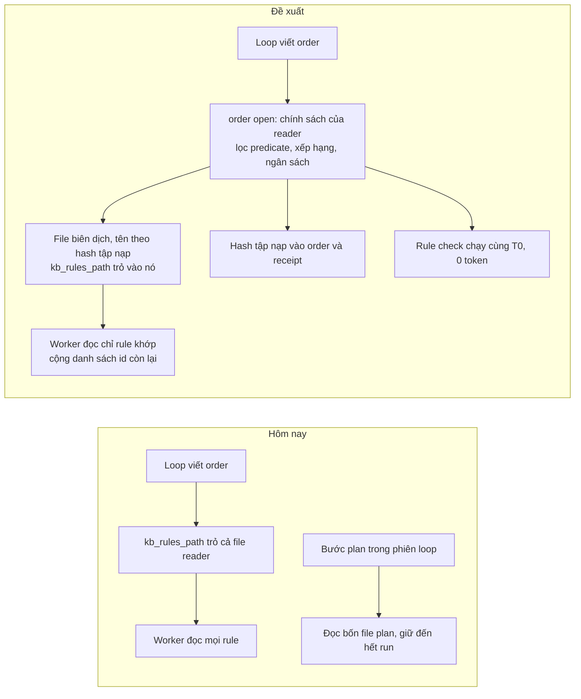

# Luận điểm đúng về cấu trúc, cần sửa ba chỗ: knowledge base nên là một bảng rule (predicate → hành động, kiểu FizzBuzz mở rộng), mỗi rule một file, do kernel chọn lúc mở order — không phải Strategy, và không để agent tự chọn

| | |
|---|---|
| **Câu hỏi** | Khi việc học tự động (D-L1) làm số rule tăng dần mà plugin không đổi, cấu trúc knowledge base nào giữ được chi phí nạp, độ liên quan và khả năng làm việc nhóm? Luận điểm của PO: tách rule thành file riêng, xếp thành chuỗi constraint/thực thi như bài FizzBuzz, dùng strategy pattern để agent nạp đúng loại |
| **Tiếp nối** | [research-2026-11-15-self-learning-agents.md](research-2026-11-15-self-learning-agents.md) (D-L1). Báo cáo này **thay** trần "15 rule mỗi file" ở chốt 4 của báo cáo đó bằng ngân sách nạp theo order (§6) |
| **Nguồn** | Cây `main` @ `227a018` (5.1.0); 21 trace trong `traces/`; tài liệu Claude Code memory (đọc trực tiếp 2026-11-16); Anthropic Agent Skills (2025-10-16, đọc trực tiếp); Cursor rules, Chroma "Context Rot" (2025-07-14), OpenAI harness engineering (qua bản tóm tắt — trang gốc trả 403) |
| **Độ tin cậy** | Cao về hiện trạng và về khoá chọn nào có thật trong schema. Trung bình về thiết kế (chưa chạy). Thấp về mức tăng rule theo thời gian — không có số đo, nên báo cáo dùng điểm hoà vốn thay vì dự báo |
| **Trạng thái** | Đề xuất. Phá cấu trúc hiện tại có chủ đích: bản major (6.0.0) kèm migration. Không sửa code |

## 0. Kết luận trong một đoạn

Luận điểm **đúng về cấu trúc**, nhưng lý do mạnh nhất không phải token. Ở quy mô hôm nay một rule tốn khoảng 160 token, trần 15 rule là ~2,4 nghìn token, tức 4–6% của một dispatch 40–70 nghìn token đo được trong trace — chưa phải nút thắt. Ba lý do thật sự buộc phải đổi: (1) **git** — dưới D-L1, run trên máy của nhiều người cùng ghi vào một file reader, nên mỗi `git pull` là một xung đột merge; một rule một file loại bỏ hẳn loại xung đột này; (2) **cửa sổ của chính loop** — các bước plan chạy trong phiên của loop, không có sub-agent, nên guidance plan đã đọc nằm lại trong context đến hết run; (3) **độ liên quan** — nạp tất cả nghĩa là nạp cả rule không liên quan, và nội dung không liên quan làm giảm độ chính xác (Chroma), còn trần 15 rule chỉ đổi phình to lấy gộp mất chi tiết (ACE). Ba chỗ cần sửa trong luận điểm: **mẫu thiết kế** không phải Strategy (chọn một) mà là **bảng rule** — mọi rule có predicate khớp đều chạy và hợp lại, giống FizzBuzz mở rộng (Specification + open/closed); Strategy chỉ đúng ở hai chỗ hẹp là chính sách chọn của từng reader và một registry kiểm tra đóng của kernel. **Người chọn** không phải agent mà là kernel, lúc `order open`, xác định và ghi lại được. Và **khoá chọn** phải là thứ đã có trong schema, cộng một bộ từ vựng tín hiệu lỗi mới — nếu không rule sẽ khoá trên chữ tự do và không khớp được gì. Tên file mang một id cố định tạo từ hash lúc sinh rule, không mang hash hiện tại; chỉ mục là dữ liệu dẫn xuất, không commit.

## 1. Câu hỏi thực sự và tiêu chí

Câu hỏi cần trả lời: lưu trữ có thể lớn không giới hạn, mà mỗi lần nạp vẫn nhỏ, liên quan, và ghi lại được — trên nhiều máy cùng ghi.

| Tiêu chí | Trọng số | Vì sao |
|---|---|---|
| Chi phí nạp mỗi dispatch không tăng theo kích thước kho | 25% | Đây là điều kiện để học mãi mãi |
| Độ liên quan của tập được nạp | 25% | Nội dung lạc đề làm giảm chất lượng, không chỉ tốn token |
| Không xung đột git khi nhiều máy cùng học | 20% | D-L1 biến mỗi run thành một người ghi |
| Ghi lại được rule nào đã nạp | 15% | Đo hiệu quả rule (D-L1 S3) cần biết tập đã nạp |
| Ít kernel, chạy được trên Codex | 15% | Ràng buộc đã quyết |

Ràng buộc giữ nguyên từ báo cáo D-L1: zero dependency, guidance never decides a gate, judge và census không coach được, file commit không chứa path `.shapeup/` hay `TASK-NNN`.

## 2. Hiện trạng và các phương án

### 2.1 Cách nạp hôm nay, đọc từ cây

| Reader | Nạp gì | Khi nào | Nguồn |
|---|---|---|---|
| `task-executor`, `orient`, `qa-edge-hunter` | Cả một file `<reader>.md` | Mỗi dispatch, qua `payload.kb_rules_path` | `orders.md:61-65`, `guidance.md:14` |
| `plan` | Bốn file (`plan.md` và ba tên cũ) | Mỗi bước plan trong bốn bước, **trong phiên của loop** | `orders.md:66`, `guidance.md:13` |
| `building` | `building.md`, rồi `tech-lead.md` | L0 | `guidance.md:12` |

Không chỗ nào lọc theo ngữ cảnh: thứ được nạp là cả file. Order do loop viết theo `orders.md`; kernel chỉ có `order open` và `order close` (`kernel/order.mjs:86`, `:93`).

### 2.2 Cách cả ngành đã đi

- **Claude Code `.claude/rules/`**: rule có `paths` trong frontmatter chỉ nạp khi Claude Read, Write hay Edit một file khớp; rule không có `paths` nạp lúc khởi động; `paths` là trường duy nhất được đọc (tài liệu memory, mục "Path-specific rules", "Rule frontmatter reference").
- **Cursor rules**: bốn chế độ — luôn nạp, nạp theo glob, nạp khi agent thấy mô tả liên quan ("Apply Intelligently"), nạp thủ công.
- **Anthropic Agent Skills**: progressive disclosure ba tầng — `name` và `description` của mọi skill vào system prompt lúc khởi động, thân `SKILL.md` khi liên quan, file kèm theo khi cần.
- **OpenAI harness engineering** (qua bản tóm tắt): một AGENTS.md lớn thất bại; thay bằng một AGENTS.md ngắn làm mục lục trỏ vào `docs/`, và linter tuỳ biến có thông báo lỗi viết như chỉ dẫn sửa cho agent.

Cả ngành đã hội tụ về **nạp có điều kiện**. Khác biệt là *ai chọn*: theo path (Claude Code, Cursor glob), theo agent tự đánh giá mô tả (Cursor "Apply Intelligently", Skills). Không hệ nào trong số đó biết ngữ cảnh chính xác như harness này: lúc mở một order, kernel biết reader, operation, round, attempt, substrate của scope, archetype của dự án và lỗi của attempt trước.

### 2.3 Bảng so sánh

| Phương án | Chi phí nạp | Liên quan | Xung đột git | Ghi lại tập nạp | Codex | Kernel thêm |
|---|---|---|---|---|---|---|
| A. Giữ file phẳng, không trần | Tăng tuyến tính | Giảm dần | Cao dưới D-L1 | Chỉ biết tên file | Có | Không |
| B. File phẳng, trần 15 (hôm nay) | ≤ ~2,4k | Giảm dần | Cao dưới D-L1 | Chỉ biết tên file | Có | Không |
| C. `.claude/rules/` gốc của host | Theo path | Chỉ theo path | Thấp | Không | **Không** | Không |
| D. Agent tự chọn theo mô tả | Mô tả của mọi rule + thân rule chọn | Không xác định | Thấp | Không | Có | Không |
| **E. Bảng rule, kernel chọn lúc `order open`** | **≤ ngân sách cố định** | **Theo predicate** | **Thấp** | **Có, bằng hash** | **Có** | Một module |

Phương án B thắng ở quy mô hôm nay, và đó là lý do không cần vội trước khi có D-L1. Phương án C hấp dẫn vì repo có kế hoạch native-first, nhưng nó thua ở bốn điểm: chỉ khoá theo path, trong khi bài học của harness khoá theo operation, round, lỗi; không ghi lại rule nào đã nạp; không có tương đương trên Codex; và chỉ kích hoạt khi tool chạm một file, tức là sau khi worker đã bắt đầu làm. Phương án D tái tạo đúng chỗ yếu đã biết: lựa chọn của model không xác định, và một bộ chọn không xác định thì không đo được hiệu quả rule.

## 3. Chứng minh luận điểm, có điều kiện

**Mệnh đề.** Với knowledge base dạng file phẳng nạp toàn bộ, không thể cùng lúc có (i) chi phí nạp bị chặn, (ii) không mất bài học, (iii) độ liên quan không giảm, khi kho tăng và ngữ cảnh đa dạng.

- Không trần → chi phí mỗi dispatch = số rule của reader × ~160 token: tuyến tính, (i) hỏng.
- Có trần → giữ (i), nhưng đến trần thì mỗi bài học mới buộc một lần gộp; gộp lặp lại là "brevity bias" và "context collapse" mà ACE đo được (ví dụ của paper: 18.282 → 122 token, accuracy 66,7 → 57,1), nên (ii) hỏng.
- Cả hai cách, tỉ lệ rule liên quan = số rule khớp ngữ cảnh / tổng số rule của reader. Khi kho phủ nhiều stack, archetype và operation, tỉ lệ đó giảm; Chroma cho thấy nội dung không liên quan làm hiệu năng kém dần khi input dài ra, và nội dung gần chủ đề mà không trả lời câu hỏi còn hại hơn — đúng kiểu một rule cho `fix` nằm trong order `execute`. (iii) hỏng.

Nạp có chọn lọc tách *kích thước kho* khỏi *kích thước tập nạp*: kho lớn tuỳ ý, tập nạp bị chặn bởi ngân sách, liên quan nhờ predicate. Đó là chứng minh cho phần "tách file + nạp đúng loại" của luận điểm.

**Điểm hoà vốn, thay cho dự báo.** Không có số đo về tốc độ học, nên không dự báo. Với ngân sách đề xuất 1.500 token mỗi dispatch (≈ 9 rule ở 160 token), file phẳng vượt ngân sách khi một reader có hơn 9 rule. Hôm nay reader lớn nhất có 3. Hai dấu hiệu chuyển đổi, cái nào đến trước: một reader vượt 9 rule, hoặc D-L1 S2 (việc học ghi tự động) chuẩn bị đưa vào — vì từ lúc đó mỗi máy là một người ghi.

**Vì sao git là lý do mạnh nhất.** Dưới D-L1, hai người cùng chạy run trên hai nhánh, mỗi run thêm một rule vào cuối `task-executor.md`. Cả hai sửa cùng vùng cuối file, nên merge xung đột. Với một rule một file, hai rule mới là hai file mới; git không bao giờ xung đột trên hai file khác nhau. Lý do này không phụ thuộc token, và nó đúng ngay từ rule thứ hai.

**Vì sao cửa sổ loop đau trước.** Worker là sub-agent, context của nó mất khi dispatch xong. Các bước plan thì không: loop đọc guidance của plan ở mỗi bước và giữ nó đến hết run. Nếu loop đọc lại ở cả bốn bước, `plan.md` ở trần 15 rule là ~9,6 nghìn token nằm lại trong cửa sổ đắt nhất của run (ước, chưa đo — tuỳ loop có đọc lại hay không).

## 4. Sửa mẫu thiết kế: bảng rule, không phải Strategy

FizzBuzz mở rộng được viết như một bảng: mỗi dòng là một cặp (điều kiện → đầu ra), mọi dòng khớp đều chạy và đầu ra được ghép theo thứ tự (`Fizz` + `Buzz` = `FizzBuzz`), không dòng nào khớp thì dùng mặc định. Thêm một quy tắc (`7 → Bazz`) là thêm một dòng; bộ máy không đổi. Ba mẫu thường bị gọi tên lẫn nhau:

| Mẫu | Hành vi | Hợp với KB? |
|---|---|---|
| **Strategy** | Chọn **một** thuật toán thay thế được | Không, cho rule. Có, cho hai chỗ dưới |
| **Chain of Responsibility** | Chuyển dần, **dừng ở handler đầu tiên** nhận việc | Không — ta muốn mọi rule khớp đều được áp dụng |
| **Bảng rule / Specification + open/closed** | Mọi predicate khớp đều chạy, kết quả ghép theo thứ tự, bộ máy đóng với thay đổi | **Có** — đây là FizzBuzz |

Strategy vẫn đúng ở hai chỗ hẹp:

1. **Chính sách chọn của từng reader.** `task-executor` cần khoá theo substrate và tín hiệu lỗi; `qa-edge-hunter` theo lens; `plan` theo bước; `building` theo gate. Mỗi chính sách là một strategy trong kernel, chọn theo tên reader.
2. **Registry kiểm tra đóng.** Một rule loại `check` không chứa code; nó *gọi tên* một kiểm tra có sẵn trong kernel và truyền tham số. Đây là hình thức duy nhất an toàn cho "rule thực thi" do việc học sinh ra, vì việc học không bao giờ viết code — code mới chỉ đến qua một bản phát hành (đường `harness-defect`).

Phần "chuỗi constraint hoặc thực thi" trong luận điểm vì vậy được giữ, dưới dạng ba **loại** rule thay vì một chuỗi gọi nhau:

| Loại | Đi đâu | Tốn context | Ví dụ |
|---|---|---|---|
| `check` | Kernel chạy cùng T0 hoặc lint; kết quả là finding có chỉ dẫn sửa | 0, trừ khi nó báo | KB-TE-002 ("một kiểm tra phải xác nhận cả hai chiều") thành một kiểm tra fixture |
| `guide` | Văn xuôi vào file đã biên dịch cho order | ~160 token | KB-TE-001 ("lái entry point thật trong ít nhất một fixture") |
| `ask` | Một câu hỏi thêm vào khối gate (chỉ reader `building`) | Vài chục token | "Ở L0 dự án mobile, đòi launch probe" |

**Cơ chế chống phình mạnh nhất là rule rời context.** Một `guide` đã chứng minh hiệu quả và có kiểm tra tương ứng trong registry thì được chuyển thành `check` và `guide` cũ bị RETIRE. Đây là bài học "linter thay cho văn bản" của OpenAI, áp vào việc học.

## 5. Không để agent chọn — kernel chọn lúc `order open`

Cụm "agent nạp đúng loại" là chỗ yếu của luận điểm. Lựa chọn của agent theo mô tả là không xác định (Cursor "Apply Intelligently" là chính chế độ đó), và một bộ chọn không xác định thì không đo được rule nào đã có trong context. Order do loop viết, nên nếu việc chọn nằm trong văn bản của loop thì nó có thể bị bỏ qua mà không ai biết. Đặt việc chọn trong `order open` thì không bỏ qua được, vì `order open` là lệnh bật fence, mọi dispatch đều phải đi qua.

Giữ hợp đồng của worker: kernel biên dịch các rule được chọn thành **một file** cho mỗi order và đặt `payload.kb_rules_path` trỏ vào file đó. Không `SKILL.md` nào của worker phải đổi — chúng vẫn "đọc file ở `payload.kb_rules_path`".

Chi phí so với ràng buộc "kernel càng nhỏ càng tốt": một module mới (chọn, lập chỉ mục, lint, migration — ước vài trăm dòng), một lời gọi trong `order open`, một trường trong receipt. Đây là đánh đổi có chủ đích: việc chọn phải không bỏ qua được và phải ghi lại được, và cả hai điều đó không làm được bằng văn xuôi.



## 6. Thiết kế

### 6.1 Khoá chọn — chỉ những gì có thật

Khoá phải tồn tại như dữ liệu lúc mở order, không phải chữ tự do. Đọc từ schema và từ một scope contract thật:

| Khoá | Giá trị | Có sẵn? | Nguồn |
|---|---|---|---|
| `reader` | `task-executor`, `spec-evaluator`, `orient`, `qa-edge-hunter` + `plan`, `building` | Có (enum `WorkerName`) | `domain.schema.json` |
| `operation` | `execute`, `fix`, `evaluate`, `orient`, `hunt`, `plan` | Có (enum `Operation`) | `domain.schema.json` |
| `step` (plan) | `requirements`, `spec`, `wire`, `scopes` | Có, trong văn bản activity | `resources/plan/` |
| `gate` (building) | Mười id gate | Có | `kernel/shapeup/gates.mjs:14` |
| `archetype` | `client-only-game`, `web-service`, `mobile`, `library`, `data-pipeline` | Có (enum) | project profile |
| `topology` | `LAYER_CAKE`, `ICEBERG`, `CHOWDER` | Có (enum) | scope contract |
| `paths` | Glob, so với `allowed_file_substrate` của scope | Có — substrate trong trace là danh sách path cụ thể | scope contract |
| `round`, `attempt` | Số | Có | order |
| `signal` | Lớp lỗi của attempt hay round trước | **Chưa có** | — |

Hai điểm phải xử lý:

- **`paths` là glob so với glob khi substrate dùng glob.** So glob với path đã có (`matchesAny`, `kernel/core/fence.mjs:41`). Khi một mục substrate là glob, so phần tĩnh trước ký tự đại diện đầu tiên; ghi rõ là xấp xỉ.
- **`signal` cần một bộ từ vựng đóng mới trong schema.** Hôm nay `PA3` chỉ là một chuỗi trong `hooks/sandbox-guard.mjs:402`, không có enum; sáu lens QA chỉ có trong văn xuôi. Đề xuất một enum `KbSignal` dẫn xuất từ nơi kernel thực sự phát ra: `pathology.PA3`, `t0.regressed`, `t0.flat`, `eval.fail.<dimension>`, `qa.lens.<lens>`, `round.ge2`, `attempt.ge2`. Đây là khoá giá trị nhất: một rule cho lệnh `fix` chỉ được nạp khi đúng triệu chứng đó vừa xảy ra.

### 6.2 Cấu trúc thư mục

```
shapeup/knowledge-base/
  rules/
    task-executor/
      te-3f9a1c2b.drive-real-entry-point.md
      te-81d0e4aa.assert-both-directions.md
    orient/
    qa-edge-hunter/
    plan/
    building/
    _shared/                 rule cho hơn một reader (reader: [...])
  harness-defects.md         không đổi, không ai nạp
```

Thư mục mang khoá rẻ nhất và luôn biết (`reader`), nên bộ chọn bỏ qua cả thư mục không liên quan mà không cần đọc. Mọi khoá khác nằm trong frontmatter, không mã hoá vào đường dẫn: mã hoá nhiều chiều vào path buộc nhân bản một rule áp cho hai operation.

Dữ liệu dẫn xuất, gitignored, theo máy, dưới `.shapeup/_kb/`: chỉ mục `index-<kb_root>.json`, file biên dịch `compiled/<load_set>.md`, và bộ đếm hiệu quả. Không commit chỉ mục: một chỉ mục commit là thêm một điểm xung đột git, và nó tái tạo được từ các file rule.

### 6.3 Một file rule

```markdown
---
id: te-3f9a1c2b
reader: task-executor
kind: guide
when: {"operation": ["execute", "fix"], "paths": ["test/**", "**/*.test.*"]}
aliases: ["KB-TE-001"]
status: active
---
A fixture that calls your new function directly proves the function is correct, never that anything
uses it. Drive the real entry point — the CLI, the command, the pipeline — in at least one fixture
per change.

Why: a stage once shipped a correct derivation that nothing called; every fixture called the new
function directly, so all passed while the defect stayed live. · from defect-plan-3.7 (2026-09-22)
```

- **Frontmatter là các dòng `key: value`, giá trị phức là JSON một dòng.** Kernel đọc bằng `JSON.parse`, không cần parser YAML, zero dependency giữ được, và một dòng sai thì lint đỏ, không lặng lẽ nạp như rule không điều kiện — đúng cái bẫy mà một số hướng dẫn cộng đồng mô tả với `.claude/rules/` (frontmatter hỏng biến rule có phạm vi thành rule nạp mọi phiên; nguồn thứ cấp).
- **`when`**: AND giữa các khoá, OR trong một danh sách, khoá vắng mặt = mọi giá trị. Một rule không có `when` nạp cho mọi order của reader — đó chính là nghĩa của các file hôm nay, nên migration không đổi hành vi.
- **Thân**: một bài học, có "Why", tối đa ~120 từ; lint đo.
- **Không có trong file**: bộ đếm hiệu quả, ngày nạp gần nhất. Chúng đổi sau mỗi run; ghi vào file commit là tạo thay đổi git sau mỗi run.

### 6.4 Đặt tên và hash

Ba giá trị, ba việc khác nhau:

| Giá trị | Công thức | Dùng cho | Đổi khi |
|---|---|---|---|
| `id` | `<mã reader>-` + 8 ký tự hex đầu của `sha256(chuẩn hoá(thân lúc tạo))` | Danh tính vĩnh viễn, tên file, tham chiếu | **Không bao giờ** — cố định lúc tạo |
| `rev` | 12 hex đầu của `sha256(chuẩn hoá(reader, kind, when) + "\n---\n" + chuẩn hoá(thân))` | Phiên bản nội dung, phát hiện trùng lặp | Mỗi lần sửa nội dung |
| `load_set` | 12 hex đầu của `sha256(các dòng "id@rev" đã sắp xếp, nối bằng "\n")` | Tên file biên dịch, ghi vào order và receipt | Mỗi khi tập rule được chọn khác đi |

Thêm `kb_root` = hash của mọi `id@rev` trong kho, làm khoá cache cho chỉ mục.

Vì sao như vậy:

- **Id lấy từ hash lúc tạo, không đánh số tuần tự.** `KB-TE-004` cần một bộ đếm trung tâm; hai máy cùng học sẽ cùng sinh `KB-TE-004`. Hash của nội dung lúc tạo không cần ai điều phối. 32 bit cho xác suất trùng 50% chỉ khi có khoảng 77.000 rule trong một reader; lint vẫn kiểm trùng.
- **Id không đổi khi sửa.** Nếu tên file mang hash hiện tại, mỗi lần sửa là một lần đổi tên file: git mất lịch sử, tham chiếu gãy.
- **Tên file = `id.slug.md`.** Slug cho người đọc; id cho máy. Đổi slug không đổi danh tính.
- **`status` không nằm trong `rev`.** Thăng hạng từ probation lên active không phải là đổi nội dung.
- **Chuẩn hoá chính xác**: UTF-8, CRLF → LF, bỏ khoảng trắng cuối dòng, gộp nhiều dòng trống thành một, trim đầu cuối; khoá của `when` sắp theo bảng chữ cái, danh sách trong `when` sắp xếp, rồi `JSON.stringify` không khoảng trắng. Hai người sửa cùng một ý ra hai cách xuống dòng khác nhau vẫn ra cùng `rev`.
- **Id cũ giữ làm `aliases`.** `KB-TE-001` vẫn tra được.

### 6.5 Thuật toán chọn — bảng FizzBuzz

Chạy trong `order open`, xác định hoàn toàn:

1. **Reader**: chỉ đọc `rules/<reader>/` và `rules/_shared/` có reader đó.
2. **Trạng thái**: bỏ `retired`.
3. **Predicate**: giữ mọi rule có `when` khớp ngữ cảnh của order.
4. **Xung đột**: rule có `overrides: [id]` loại rule kia; ngoài ra, cái cụ thể hơn thắng. AC, contract, gate và kiểm tra của kernel luôn thắng mọi rule (luật hiện có).
5. **Tách loại**: `check` đi vào hàng đợi của kernel, không tốn ngân sách; `ask` đi vào khối gate; `guide` đi tiếp.
6. **Xếp hạng**: độ cụ thể giảm dần (số khoá trong `when`, path dài hơn thì cụ thể hơn), `active` trước `probation`, rồi theo `id`.
7. **Ngân sách**: lấy lần lượt đến 1.500 token; phần vượt thành một dòng mỗi rule — `id` và tiêu đề, khoảng 10 token — để worker tự đọc nếu cần. Đây là progressive disclosure, nhưng tầng một là danh sách đã lọc, không phải mọi rule.
8. **Biên dịch**: ghi `compiled/<load_set>.md` theo thứ tự cố định, đầu file ghi `load_set`; nếu file đã có (cùng tập rule), dùng lại.
9. **Ghi lại**: `load_set` vào order đã mở và vào dispatch receipt. Đây là thứ cho phép đo hiệu quả từng rule (D-L1 S3): biết chính xác rule nào đã ở trong context của attempt nào.

Ngân sách 1.500 token là đề xuất ban đầu, cần đo ở S0. Không hứa tiết kiệm nhờ prompt cache: worker đọc file biên dịch như một kết quả tool giữa hội thoại, nên lợi ích cache chưa rõ cho đến khi đo.

### 6.6 Chống phình, thay cho trần 15 rule

Trần chuyển từ *kho* sang *tập nạp* và *chữ ký*:

- Ngân sách nạp mỗi order (§6.5, bước 7).
- Tối đa 3 rule `active` cùng một chữ ký `when` giống hệt; đến đó lint đòi MERGE. Đây là trần có nghĩa: ba rule cho cùng một tình huống là dấu hiệu chúng nên là một.
- Hai rule cùng `rev` → lint đỏ (trùng lặp chính xác).
- Rule `check` hoá thì `guide` gốc RETIRE (§4).
- Probation, hết hạn và RETIRE theo hiệu quả giữ nguyên như báo cáo D-L1, chốt 5 — nay đo được chính xác nhờ `load_set`.

## 7. Phá vỡ gì, và migration

Đây là thay đổi major. File ship bị chạm:

- `AGENTS.md` — mục Retro và các chỗ nói về knowledge base.
- `skills/building/resources/guidance.md` — bảng "file nào đọc ở đâu" thay bằng thư mục và chính sách chọn.
- `skills/building/resources/retro/retro.md`, `scan.md`, `research.md` — ghi một file mỗi rule; bỏ bước "rewrite the file".
- `skills/building/resources/orders.md` — `kb_rules_path` giờ do `order open` điền; `kb_rules_paths` của plan gộp về một file biên dịch.
- `skills/building/resources/intake/open-run.md` — L0 đọc rule `building` qua bộ chọn.
- `commands/retro.md`.
- `kernel/schemas/domain.schema.json` — enum `KbSignal`, trường `kb_load_set` trên order và receipt.
- `kernel/order.mjs` (lời gọi trong `open`), một module mới trong `kernel/shapeup/`, `hooks/dispatch-receipt.mjs` (ghi `load_set`).
- Installer và `/shapeup-sdlc-plugin:init` — chạy migration.
- `docs/upgrading.md`, `CHANGELOG.md`, `package.json` và `.claude-plugin/plugin.json` (6.0.0).

Không đổi: hợp đồng `kb_rules_path` của worker (một file để đọc), write fence, T0 witness, register `harness-defects.md`. `SKILL.md` của `qa-edge-hunter` và `gate-agent` có đổi nhỏ khi làm phần tín hiệu và việc học tự động (xem [plan-2026-11-16-learning-rule-table.md](plan-2026-11-16-learning-rule-table.md), L3 và L4).

**Migration, xác định và chạy lại được nhiều lần:**

1. Với mỗi file cũ — `<reader>.md` và các tên cũ trong `guidance.md` (`tech-lead.md` → `building`; `ba-pitch-analyzer.md`, `scope-architect.md`, `solution-architect.md` → `plan`) — tách tại mỗi gạch đầu dòng `- **KB-`.
2. Mỗi phần thành một file rule, `when` rỗng (nạp cho mọi order của reader, đúng hành vi cũ), `status: active`, id cũ vào `aliases`.
3. Bỏ qua nếu đã có file mang alias đó, nên chạy lại không nhân bản.
4. Giữ nguyên file cũ, in một dòng: khi thư mục `rules/<reader>/` tồn tại, bộ chọn không còn đọc file cũ. Không xoá file của người dùng.

Với repo này: 3 rule `task-executor` thành 3 file. Rule thứ hai (`KB-TE-002`) là ứng viên `check` đầu tiên.

## 8. Những gì cố ý không làm

- **Không để agent tự chọn rule theo mô tả.** Không xác định, không đo được, và thêm một lượt suy luận vào mỗi dispatch.
- **Không chuyển sang `.claude/rules/` gốc của host.** Chỉ khoá theo path, không ghi lại tập nạp, không có trên Codex.
- **Không mã hoá nhiều khoá vào đường dẫn.** Chỉ `reader`.
- **Không commit chỉ mục hay bộ đếm.** Cả hai là nguồn xung đột git và thay đổi sau mỗi run.
- **Không cho rule chứa code.** `check` chỉ gọi tên một kiểm tra trong registry đóng; code mới chỉ đến qua bản phát hành.
- **Không embedding hay tìm kiếm ngữ nghĩa.** Predicate trên khoá có thật vừa đủ, xác định, và zero dependency.
- **Không làm trước khi cần.** Ở 3 rule, phương án B thắng; chuyển khi một trong hai dấu hiệu ở §3 xuất hiện.

## 9. Đề xuất theo stage

Ước tính công là suy luận, chưa đo.

| Stage | Làm gì | Công (ước) | Cổng go/no-go |
|---|---|---|---|
| **R0 — Đo** | Trên 21 trace: với mỗi order, liệt kê khoá có sẵn lúc mở (operation, substrate, archetype, round). Dựng một kho tổng hợp ~200 rule rải trên các khoá, chạy thuật toán §6.5 bằng script, đo kích thước tập nạp. Kiểm loop có đọc lại guidance plan ở mỗi bước không | 1 ngày | Tập nạp trung vị ≤ ngân sách, và ≥ 80% order có ít nhất một khoá ngoài `reader` |
| **R1 — Định dạng và migration** | Định dạng file rule, chuẩn hoá và hash, lint (frontmatter, trùng `rev`, trần chữ ký, cấm path `.shapeup/` và lệnh), migration | 3–4 ngày | Test structural: migration chạy hai lần ra cùng kết quả; cùng nội dung khác xuống dòng ra cùng `rev` |
| **R2 — Bộ chọn trong `order open`** | Chính sách chọn từng reader, biên dịch file, `kb_rules_path` trỏ vào file biên dịch, `load_set` vào order và receipt | 3–5 ngày | Cùng order hai lần ra cùng `load_set`; ngân sách không bao giờ vượt; một run thật để lại `load_set` trên mọi receipt |
| **R3 — Từ vựng tín hiệu** | Enum `KbSignal` trong schema, phát ra từ T0, eval, pathology; khoá `signal` trong `when` | 2–3 ngày | Một order `fix` sau một T0 regression nạp đúng rule có `signal: t0.regressed` và không nạp nó ở order `execute` |
| **R4 — Registry `check`** | Kiểm tra đầu tiên (từ KB-TE-002) và đường chuyển `guide` → `check` | 2–3 ngày | Rule `check` báo trên một fixture vi phạm, im trên fixture đúng, và không tốn token khi im |

Thứ tự với báo cáo D-L1: R0–R2 nên xong **trước** D-L1 S2, vì S2 biến mỗi máy thành một người ghi, và từ đó cấu trúc file phẳng bắt đầu gây xung đột.

## 10. Điều gì sẽ thay đổi kết luận

- **R0 cho thấy hầu hết order chỉ có khoá `reader`.** Khi đó predicate không lọc được gì, và lợi ích chỉ còn ở git; một rule một file vẫn đáng làm, bộ chọn thì chưa.
- **Loop không đọc lại guidance plan ở mỗi bước.** Áp lực lên cửa sổ loop nhỏ hơn bốn lần so với ước tính ở §3.
- **Claude Code thêm khoá ngoài path cho `.claude/rules/` và ghi lại rule nào đã nạp.** Khi đó phương án C cần được xem lại cho kênh Claude Code — vẫn cần giải pháp riêng cho Codex.
- **Rule thực tế dài hơn nhiều so với 160 token.** Ngân sách phải tính theo token đo được, không theo số rule; lint đo thân rule.
- **Chưa kiểm ở đây:** lợi ích prompt cache; chi phí `order open` khi kho có hàng nghìn rule (chỉ mục được cache theo `kb_root`, nên dự kiến nhỏ); bài OpenAI gốc (trang trả 403; chi tiết lấy từ bản tóm tắt).

## Phụ lục — bằng chứng

| # | Sự thật | Nguồn |
|---|---|---|
| R1 | Một rule hiện có ≈ 616–666 ký tự ≈ 154–166 token (ký tự / 4) | `shapeup/knowledge-base/task-executor.md`, đo 2026-11-16 |
| R2 | 4–8 dispatch mỗi run; trung vị token mỗi dispatch 38–69 nghìn | `traces/v4/*/shapeup-local/*/receipts/dispatch.jsonl` |
| R3 | Worker nạp cả file qua `kb_rules_path`; plan nạp bốn file ở mỗi bước | `skills/building/resources/orders.md:61-66`, `guidance.md:12-14` |
| R4 | Kernel chỉ có `order open` và `order close` | `kernel/order.mjs:86`, `:93` |
| R5 | Enum có sẵn: `WorkerName`, `Operation`, `archetype`, `topology_type`; id gate | `kernel/schemas/domain.schema.json`; `kernel/shapeup/gates.mjs:14` |
| R6 | `PA3` chỉ là chuỗi, không có enum tín hiệu | `hooks/sandbox-guard.mjs:402` |
| R7 | Substrate trong scope contract là danh sách path | `traces/v4/native-first-s4-envlint-2026-11-08/shapeup-committed/envlint/scopes/cli.md` |
| R8 | So glob với path đã có sẵn | `kernel/core/fence.mjs:12`, `:41` |
| R9 | `.claude/rules/`: `paths` nạp khi Read/Write/Edit file khớp; không `paths` thì nạp lúc khởi động; `paths` là trường duy nhất | code.claude.com/docs/en/memory, đọc 2026-11-16 |
| R10 | Agent Skills: ba tầng progressive disclosure | anthropic.com/engineering/equipping-agents-for-the-real-world-with-agent-skills, 2025-10-16 |
| R11 | Cursor: bốn chế độ nạp rule | cursor.com/docs/context/rules (qua bản tóm tắt) |
| R12 | Context rot: hiệu năng kém dần khi input dài; distractor làm tệ hơn | Chroma, 2025-07-14 (qua bản tóm tắt) |
| R13 | OpenAI: AGENTS.md ngắn làm mục lục; linter có thông báo lỗi là chỉ dẫn sửa | **Thứ cấp** — trang gốc trả 403 |
| R14 | ACE: brevity bias, context collapse 18.282 → 122 token | arXiv 2510.04618 v3, §2.2 |

**Thuật ngữ.** *Bảng rule*: tập (điều kiện → hành động), mọi điều kiện khớp đều chạy. *Predicate*: điều kiện trên ngữ cảnh của order. *Tập nạp* (`load_set`): các rule được chọn cho một order. *Chữ ký `when`*: giá trị chuẩn hoá của trường `when`. *Progressive disclosure*: chỉ đưa phần tóm tắt trước, phần chi tiết khi cần.
